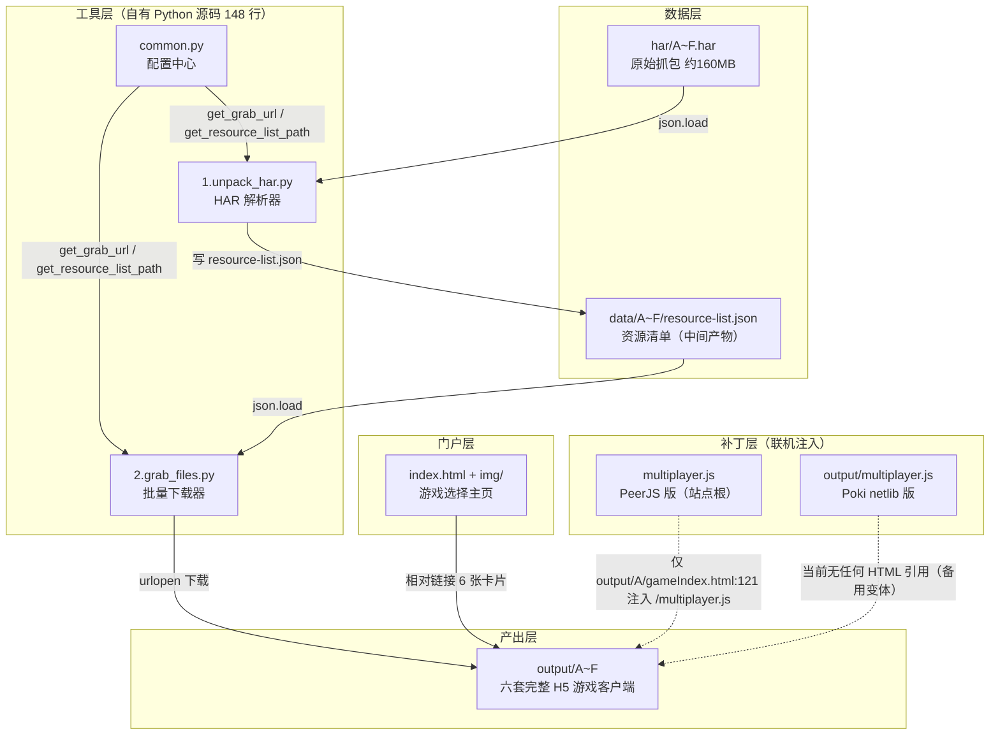
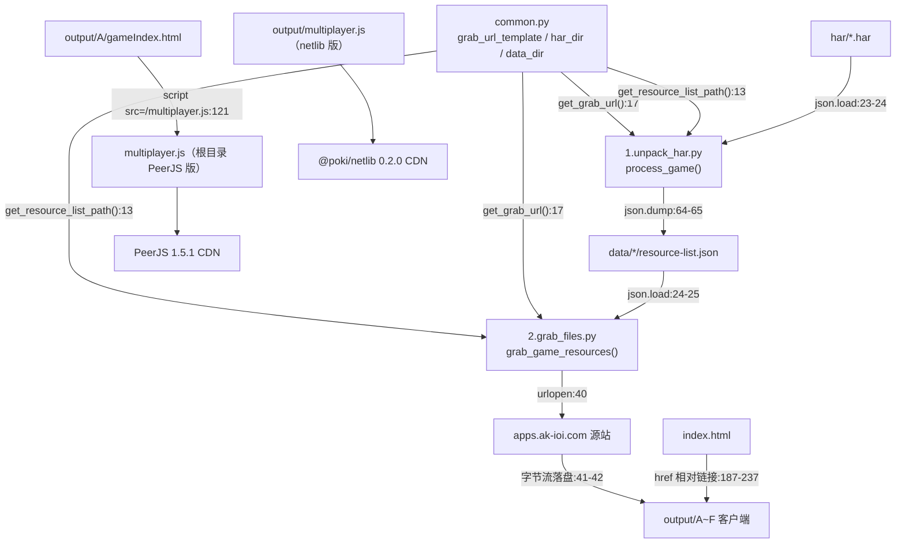

# Fireboy-and-Watergirl（森林冰火人批量抓取与在线游玩）— 项目架构报告

**分析时间**：2026-09-30 11:35
**分析范围**：`D:\Guiyuan1111\GitHub\slbhr\Fireboy-and-Watergirl`
**分析模式**：自有源码完整分析（5 个文件 100% 函数覆盖）+ output/ 游戏客户端采样分析（以 output/A 为主样本）

---

## 1. 技术栈全景

### 编程语言

| 语言 | 文件数 | 行数 | 主要用途 |
|------|--------|------|---------|
| Python | 3 | 148 | HAR 解析与资源批量下载工具链（`1.unpack_har.py:1-70`、`2.grab_files.py:1-63`、`common.py:1-17`） |
| HTML | 2 | 252 + 124 | 门户页 `index.html`（252 行）与被注入过的游戏入口 `output/A/gameIndex.html`（124 行，抓取产物） |
| JavaScript | 2 | 220 + 170 | P2P 联机补丁：根目录 `multiplayer.js`（PeerJS 版，220 行）与 `output/multiplayer.js`（Poki netlib 版，170 行） |
| JSON（数据） | 6 清单 + 数百游戏数据 | — | `data/A~F/resource-list.json` 资源清单与 output/ 内 temple.json/Tiled 关卡 |

自有源码合计约 620 行（不含 `output/multiplayer.js` 则为 620 行整：69+62+17+252+220，见 `wc -l` 实测）。

### 框架与运行时

| 技术 | 版本 | 用途 | 证据位置 |
|------|------|------|---------|
| Python 标准库 | 3.x | 全部工具依赖（json/base64/os/urllib.request），零第三方包 | `1.unpack_har.py:1-4`、`2.grab_files.py:1-6` |
| PeerJS | 1.5.1（unpkg CDN） | 根目录联机补丁的 WebRTC 信令与数据通道 | `multiplayer.js:9` |
| @poki/netlib | 0.2.0（unpkg CDN） | output/ 部署版联机补丁的 P2P 房间库 | `output/multiplayer.js:4` |
| Phaser | v2.2.9（A~E 内置打包） | 游戏引擎（A~E 代） | `output/A/js/init.eb02fbdab2aa1d24.js` 内 `VERSION = "v2.2.9"`（grep 实证） |
| @azerion/phaser | 2.6（jsDelivr CDN） | 第 6 代（F）引擎（Phaser CE 分支） | `output/F/version.js:2` |
| PIXI.js | 随 Phaser 2 内置 | 渲染层（Phaser 2 基于 Pixi） | init.js 内 grep 到 "PIXI" 标识 |
| Box2D | 随包内置 | 物理引擎（`box2d.b2World`） | init.js 偏移 1.5MB 处 `box2d.b2World.prototype.QueryShape` |
| RequireJS | bower_components 版 | 游戏客户端 AMD 加载器 | `output/A/gameIndex.html:73` |
| Tiled 地图格式 | JSON | 关卡数据 | `output/A/data/forest/levels/forest_02.json:1`（`compressionlevel/height/layers[].data`） |

### 构建与工具链

- 构建工具：**无**（Python 脚本即"构建流水线"，无打包器）
- 包管理器：**无**（Python 零依赖；游戏客户端依赖运行时 CDN）
- 代码检查 / 格式化：**无**（未发现任何 lint/formatter 配置）
- CI/CD：**无**（无 `.github/workflows`，根目录列表实证）
- 部署方式：GitHub Pages 静态托管，仓库根即站点根（`README.md:32` 的在线地址 + `README.md:61` 的"静态路径解耦"说明）

### 外部服务与基础设施

| 服务 | 集成方式 | 代码位置 |
|------|---------|---------|
| apps.ak-ioi.com（原站游戏 CDN） | urllib 直连下载 | `common.py:4` |
| unpkg.com（PeerJS / netlib CDN） | 运行时动态 `<script>` 注入 | `multiplayer.js:9`、`output/multiplayer.js:4` |
| PeerJS 免费信令服务器 | `new Peer()` 默认云服务 | `multiplayer.js:67` |
| Poki netlib 房间服务 | `netlib.host()/join()` | `output/multiplayer.js:55`、`output/multiplayer.js:84` |
| jsdelivr.net（F 代引擎库 CDN） | `version.js` 声明 lib 列表 | `output/F/version.js:2` |
| analytics.sparkslab.art（umami 统计） | 抓取产物 HTML 中残留 | `output/A/gameIndex.html:44-49` |
| Cloudflare Insights | 抓取产物 HTML 中残留 | `output/A/gameIndex.html:120` |

---

## 2. 目录结构与功能角色（分层结构）

```
Fireboy-and-Watergirl/
├── 1.unpack_har.py               # [工具层-阶段1] 解析 HAR 抓包 → 生成资源清单
├── 2.grab_files.py               # [工具层-阶段2] 按清单批量下载资源 → output/
├── common.py                     # [工具层-配置] URL 模板与路径的唯一配置中心
├── har/                          # [数据层-输入] 6 份浏览器 HAR 抓包（约 160MB）
│   ├── A.har … F.har
│   └── .dummy                    # 0 字节占位
├── data/                         # [数据层-中间产物] 每代一份资源清单
│   └── A~F/resource-list.json
├── output/                       # [产出层] 6 套完整 H5 游戏客户端（可离线运行）
│   ├── A/gameIndex.html          #   A~E 结构相同：入口 + js/init.<hash>.js + assets + data
│   ├── B/ … E/
│   ├── F/index.htm               #   F 结构不同：index.htm + fairy-tales.min.js + version.js
│   └── multiplayer.js            # [补丁层-部署变体] Poki netlib 版联机脚本（170 行）
├── index.html                    # [门户层] 游戏选择主页（6 张卡片）
├── img/                          # [门户层资源] background.jpg + icon.png
├── multiplayer.js                # [补丁层] PeerJS 版联机脚本（220 行，站点根部署）
├── README.md / LICENSE
└── .git/                         # main 单分支，12 commits，2 贡献者
```

### 分层结构图



### 目录角色标注说明

- **[工具层]** — 两个 Python 脚本 + 配置模块，构成"抓取流水线"
- **[数据层]** — HAR 原始输入与清单中间产物
- **[产出层]** — 抓取结果：可直接静态部署的完整游戏客户端（约占仓库体积 99%）
- **[门户层]** — 面向用户的入口页面
- **[补丁层]** — 对抓取产物二次修改的联机脚本（不修改原代码，靠 HTML 注入 + 事件合成）

---

## 3. 模块依赖关系

### 核心依赖图



### 模块间依赖分析

| 源模块 | 目标模块 | 依赖类型 | 关键代码 |
|--------|---------|---------|---------|
| `1.unpack_har.py` | `common.py` | 配置读取（共享模块） | `1.unpack_har.py:12-14`（调用 `get_grab_url`/`har_dir`/`get_resource_list_path`） |
| `2.grab_files.py` | `common.py` | 配置读取（共享模块） | `2.grab_files.py:13-14` |
| `2.grab_files.py` | `data/*/resource-list.json` | 数据契约（阶段 1 的输出即阶段 2 的输入） | `2.grab_files.py:24-25` |
| `index.html` | `output/A~F` | 超链接导航 | `index.html:187,197,207,217,227,237` |
| `output/A/gameIndex.html` | 根目录 `multiplayer.js` | 运行时脚本注入（站点根绝对路径） | `output/A/gameIndex.html:121` |
| 根目录 `multiplayer.js` | `output/multiplayer.js` | 无依赖关系（同用途的两代实现，已分叉） | git 实证：`6cd4b37` 创建根版本、`14f6562` 创建 output 版 |
| output 客户端内部 | `bower_components/requirejs` + `js/init.*.js` | AMD 加载链 | `output/A/gameIndex.html:73` |

**依赖要点**：

1. `common.py` 是两个脚本唯一的共享模块（17 行，其中配置常量 10 行），通过两个纯函数消除 URL/路径硬编码——这是典型的"配置中心"模式（`common.py:13-18`）。
2. 两脚本之间**没有代码级依赖**，只通过 `resource-list.json` 文件契约衔接（松耦合、可独立重跑）。
3. `index.html` 与 `multiplayer.js` **互不引用**：门户不加载联机脚本；联机脚本只被 `output/A/gameIndex.html` 以站点根绝对路径 `/multiplayer.js` 注入（`output/A/gameIndex.html:121`），因此**只有第 1 代（A）启用了联机**，B~F 的 gameIndex/index.htm 均无此行（diff 实证：`121d121`）。
4. 该绝对路径要求托管根必须等于仓库根（GitHub Pages 场景成立）；若以 `output/` 为站点根则会命中另一份 `output/multiplayer.js`（netlib 版）——两份补丁与两种托管假设并存。

---

## 4. 函数级调用链清单（自有源码 100% 覆盖）

### 4.1 common.py（17 行，2 个函数）

```text
common.py（模块级）
├── grab_url_template = "https://apps.ak-ioi.com/fireboy-and-watergirl/{}/dist/"   [common.py:4]
├── har_dir = "./har"                                                              [common.py:7]
├── data_dir = "./data"                                                            [common.py:10]
├── get_resource_list_path(game_code) -> str                                       [common.py:13-14]  2 行
│   └── （纯函数，f-string 拼接 data_dir，无调用、无副作用）
└── get_grab_url(game_code) -> str                                                 [common.py:17-18]  2 行
    └── （纯函数，grab_url_template.format(game_code)，无调用、无副作用）
```

### 4.2 1.unpack_har.py（69 行，1 个顶层函数 + 1 个内嵌闭包 + 驱动循环）

```text
1.unpack_har.py（模块级）
├── games = ['A','B','C','D','E','F']                                              [1.unpack_har.py:8]
├── process_game(game_code)                                                        [1.unpack_har.py:10-66]  57 行
│   ├── [跨模块] common.get_grab_url(game_code)                                    [→ common.py:17]
│   ├── [跨模块] common.get_resource_list_path(game_code)                          [→ common.py:13]
│   ├── 守卫1: path.exists(har_path) 不存在则 return                                [1.unpack_har.py:16-18]
│   ├── [stdlib] json.load(f)（try/except 守卫2）                                    [1.unpack_har.py:22-27]
│   ├── 初始化 resource_list={'resources':[],'levels':[]} 与 hash_list={}           [1.unpack_har.py:30-31]
│   ├── push_levels(temple_data)                     ← 闭包，捕获 resource_list     [1.unpack_har.py:33-35]  3 行
│   │   └── for item in temple_data['levels']: 追加 'data/'+filename                [1.unpack_har.py:34-35]
│   ├── for entry in har_entries:                                                   [1.unpack_har.py:37]
│   │   ├── 分支1: url.startswith(grab_url_base) → 剥前缀                            [1.unpack_har.py:40-41]
│   │   ├── 分支2: '?' in clean_url → 去查询串                                       [1.unpack_har.py:42-43]
│   │   ├── 分支3: hash_list 去重（首个出现才收录）                                    [1.unpack_har.py:45-46]
│   │   ├── 分支4: '/levels/' not in → 才进 resources（关卡走 temple.json 单独收录）  [1.unpack_har.py:47-48]
│   │   └── 分支5: '/temple.json' in url →                                           [1.unpack_har.py:50]
│   │       ├── 分支6: encoding=='base64' → base64.b64decode                         [1.unpack_har.py:54-55]
│   │       ├── [stdlib] json.loads(text)                                           [1.unpack_har.py:57]
│   │       └── push_levels(temple_json)                                            [1.unpack_har.py:58]
│   │           └── （裸 except：解析失败仅打印警告继续）                              [1.unpack_har.py:59-60]
│   ├── [stdlib] os.makedirs(dirname, exist_ok=True)                                [1.unpack_har.py:63]
│   └── [stdlib] json.dump(resource_list, indent='  ') 落盘清单                       [1.unpack_har.py:64-65]
└── for g in games: process_game(g)                                                 [1.unpack_har.py:69-70]
```

### 4.3 2.grab_files.py（62 行，1 个顶层函数 + 1 个内嵌闭包 + 驱动循环）

```text
2.grab_files.py（模块级）
├── games = ['A','B','C','D','E','F']                                              [2.grab_files.py:9]
├── grab_game_resources(game_code)                                                 [2.grab_files.py:11-57]  47 行
│   ├── [跨模块] common.get_resource_list_path(game_code)                          [→ common.py:13]
│   ├── [跨模块] common.get_grab_url(game_code)                                    [→ common.py:17]
│   ├── game_output_dir = path.join("output", game_code)                            [2.grab_files.py:16]
│   ├── 守卫1: 清单不存在则 return                                                   [2.grab_files.py:18-20]
│   ├── [stdlib] json.load(resource_list)                                          [2.grab_files.py:24-25]
│   ├── grab_file(relative_url)                       ← 闭包，捕获 url 基址与输出目录 [2.grab_files.py:27-46]  20 行
│   │   ├── url = grab_url_base + relative_url                                       [2.grab_files.py:29]
│   │   ├── save_path = path.join(game_output_dir, relative_url)                    [2.grab_files.py:30]
│   │   ├── [stdlib] os.makedirs(dirname, exist_ok=True)（逐文件建父目录）            [2.grab_files.py:32]
│   │   ├── 守卫2: path.exists(save_path) → return（断点续传：跳过已下载）             [2.grab_files.py:36-38]
│   │   ├── [网络] urlopen(url).read()                                              [2.grab_files.py:40]
│   │   ├── 落盘 open(save_path,'wb')                                               [2.grab_files.py:41-42]
│   │   └── 异常分支: HTTPError 打印状态码 / Exception 打印消息（均不中断整体）         [2.grab_files.py:43-46]
│   ├── [stdlib] os.makedirs(game_output_dir, exist_ok=True)                        [2.grab_files.py:49]
│   ├── for url in resource_list['resources']: grab_file(url)                      [2.grab_files.py:52-53]
│   └── for url in resource_list['levels']: grab_file(url)                          [2.grab_files.py:56-57]
└── for g in games: grab_game_resources(g)                                         [2.grab_files.py:60-61]
```

### 4.4 multiplayer.js（根目录，PeerJS 版，220 行，8 个函数 + 1 个模块级守卫）

```text
multiplayer.js（模块级，IIFE 自启动）
├── loadPeerJS()  [IIFE 立即执行]                                                  [multiplayer.js:7-15]  9 行
│   ├── 动态 <script> 注入 https://unpkg.com/peerjs@1.5.1/dist/peerjs.min.js        [multiplayer.js:8-9]
│   └── script.onload → initMultiplayer()                                           [multiplayer.js:10-13]
├── 全局态: peer, conn, isHost=false, roomCode, localKeys, remoteKeys              [multiplayer.js:17-20]
├── initMultiplayer()                                                              [multiplayer.js:22-60]  39 行
│   ├── URLSearchParams 检测 ?host → isHost                                        [multiplayer.js:23-24]
│   ├── 创建 #mp-ui 悬浮容器（DOM 注入副作用）                                        [multiplayer.js:27-36]
│   ├── 分支1 主机: 渲染"创建房间"按钮 → onclick=createRoom                          [multiplayer.js:38-45]
│   └── 分支2 客机: 渲染房间码输入框 → onclick → joinRoom(code)                     [multiplayer.js:46-59]
├── createRoom()                                                                   [multiplayer.js:63-99]  37 行
│   ├── 随机 Peer ID 'host-'+random6                                                [multiplayer.js:66]
│   ├── [外部] new Peer(randomId,{debug:2})（PeerJS 云信令）                          [multiplayer.js:67-70]
│   ├── peer.on('open') → 房间码=Peer ID，注册 peer.on('connection')                 [multiplayer.js:72-93]
│   │   ├── conn.on('open') → startHostSync()                                       [multiplayer.js:79-82]
│   │   ├── conn.on('data') → type==='keys' → simulateKeys(data.keys)              [multiplayer.js:83-88]
│   │   └── conn.on('close') → 状态提示                                              [multiplayer.js:89-91]
│   └── peer.on('error') → 状态提示                                                  [multiplayer.js:95-98]
├── joinRoom(code)                                                                 [multiplayer.js:102-132]  31 行
│   ├── 随机 Peer ID 'guest-'+random6 + new Peer                                    [multiplayer.js:105-106]
│   ├── peer.on('open') → conn = peer.connect(code,{reliable:true})                 [multiplayer.js:108-109]
│   │   ├── conn.on('open') → startGuestSync()                                      [multiplayer.js:110-116]
│   │   ├── conn.on('data') → simulateKeys(data.keys)                              [multiplayer.js:117-122]
│   │   └── conn.on('close')                                                        [multiplayer.js:123-125]
│   └── peer.on('error')                                                            [multiplayer.js:128-131]
├── startHostSync()                                                                [multiplayer.js:135-152]  18 行
│   ├── 白名单 ['ArrowUp','ArrowDown','ArrowLeft','ArrowRight']（火人）               [multiplayer.js:137]
│   ├── keydown/keyup 监听 → localKeys[e.key]=true/false → sendKeys()              [multiplayer.js:138-149]
│   └── 初始 sendKeys() 一次                                                        [multiplayer.js:151]
├── sendKeys()                                                                     [multiplayer.js:154-158]  5 行
│   └── 守卫: conn && conn.open → conn.send({type:'keys', keys:localKeys})           [multiplayer.js:155-157]
├── startGuestSync()                                                               [multiplayer.js:161-177]  17 行
│   ├── 白名单 ['w','W','a','A','s','S','d','D']（水女孩）                           [multiplayer.js:162]
│   └── keydown/keyup 监听 → localKeys → sendKeys()（与主机侧对称）                   [multiplayer.js:163-176]
├── simulateKeys(keysObj)                                                          [multiplayer.js:180-204]  25 行
│   ├── 全局状态 window._simulatedState（防重复触发）                                 [multiplayer.js:182-183]
│   ├── 循环1 keydown: keysObj[key] && !state[key] → new KeyboardEvent('keydown')   [multiplayer.js:188-195]
│   └── 循环2 keyup: !keysObj[key] && state[key] → new KeyboardEvent('keyup')       [multiplayer.js:197-203]
└── 模块级键盘拦截守卫 if(!isHost) → 捕获阶段 stopPropagation+preventDefault          [multiplayer.js:211-220]  10 行
    └── 时序缺陷：此判断在脚本解析期执行，isHost 尚为默认 false（initMultiplayer
        要等 PeerJS onload 后才解析 URL 参数），故捕获监听无条件安装（详见 §8）
```

### 4.5 output/multiplayer.js（netlib 部署版，170 行，7 个函数）

```text
output/multiplayer.js（模块级）
├── CDN 加载器: 注入 @poki/netlib@0.2.0，onload → init()                            [output/multiplayer.js:3-6]
├── 全局态: netlib, room, isHost=false, localKeys, remoteKeys, isSyncing=false      [output/multiplayer.js:8-13]
├── init()                                                                         [output/multiplayer.js:14]（函数体约至 :51）
│   ├── netlib = window.NetLib；URL 参数 ?host 判定角色
│   ├── 分支 客机: 房间码输入 + joinBtn → joinRoom(inviteCode)
│   └── 分支 主机: createBtn → createRoom()
├── createRoom()  [async]                                                          [output/multiplayer.js:54]（至 :80）
│   ├── room = await netlib.host({gameName:'FireboyWatergirl', maxPlayers:2})        [output/multiplayer.js:55-58]
│   ├── inviteCode = room.getInviteCode()（房间码来源改为 netlib）
│   ├── room.on('peerConnected') → startGameSync()
│   └── room.on('data') → type==='keys' → 仅更新 remoteKeys（主机侧不再模拟按键，
│       与根版本行为不对称：按键模拟只在客机侧发生）
├── joinRoom(inviteCode)  [async]                                                  [output/multiplayer.js:82]（至 :106）
│   ├── room = await netlib.join({gameName, inviteCode})
│   ├── isSyncing = true（客机启用键盘封锁）
│   ├── room.on('data') → simulateKeys(data.keys)
│   └── room.send({type:'ready'})（新增就绪握手协议）
├── startGameSync()                                                                [output/multiplayer.js:108]（至 :123）
│   └── keydown/keyup → if(isHost) → localKeys 更新 → sendKeys()
├── sendKeys()                                                                     [output/multiplayer.js:125]（至 :130）
│   └── 守卫 room 存在 → room.send({type:'keys', keys:localKeys})
├── simulateKeys(keysObj)                                                          [output/multiplayer.js:132]（至 :154）
│   ├── activeKeys/inactiveKeys 差集计算（与根版本算法不同：以 remoteKeys 为旧状态）
│   └── 派发 KeyboardEvent keydown/keyup
└── 键盘拦截守卫: 捕获阶段监听，条件由 !isHost 改为 if(isSyncing)                     [output/multiplayer.js:157-168]
    （修正了根版本的时序缺陷：只有真正进入同步态的客机才拦截）
```

### 4.6 函数签名速查表

| 函数 | 签名 | 位置 | 行数 | 一句话职责 |
|------|------|------|------|-----------|
| get_resource_list_path | `(game_code: str) -> str` | `common.py:13` | 2 | 拼出某代资源清单路径 |
| get_grab_url | `(game_code: str) -> str` | `common.py:17` | 2 | 用模板生成某代的源站 URL 基址 |
| process_game | `(game_code: str) -> None` | `1.unpack_har.py:10` | 57 | 从 HAR 提取去重资源表 + 解析 temple.json 关卡表并落盘清单 |
| push_levels | `(temple_data: dict) -> None` | `1.unpack_har.py:33` | 3 | 闭包：把 temple.json 中的关卡文件名归一为 data/ 前缀并入 levels 表 |
| grab_game_resources | `(game_code: str) -> None` | `2.grab_files.py:11` | 47 | 读清单、建输出目录、按 resources+levels 两批循环下载 |
| grab_file | `(relative_url: str) -> None` | `2.grab_files.py:27` | 20 | 闭包：下载单个相对 URL 到镜像路径（含断点续传与异常吞没） |
| loadPeerJS | `() -> void`（IIFE） | `multiplayer.js:7` | 9 | 动态注入 PeerJS CDN 脚本并挂 onload 回调 |
| initMultiplayer | `() -> void` | `multiplayer.js:22` | 39 | 解析 ?host 角色并渲染主机/客机两套 UI |
| createRoom | `() -> void` | `multiplayer.js:63` | 37 | 主机建 Peer、以 Peer ID 为房间码、接线数据回调 |
| joinRoom | `(code: string) -> void` | `multiplayer.js:102` | 31 | 客机按房间码 reliable 连接主机并接对称回调 |
| startHostSync | `() -> void` | `multiplayer.js:135` | 18 | 监听方向键维护 localKeys 并推送 |
| sendKeys | `() -> void` | `multiplayer.js:154` | 5 | 连接可用时发送 `{type:'keys', keys}` 消息 |
| startGuestSync | `() -> void` | `multiplayer.js:161` | 17 | 监听 WASD 维护 localKeys 并推送 |
| simulateKeys | `(keysObj: object) -> void` | `multiplayer.js:180` | 25 | 将远端按键状态差分合成为原生 KeyboardEvent 派发 |
| （模块级守卫） | `if (!isHost)` 拦截块 | `multiplayer.js:211` | 10 | 捕获阶段拦截键盘（存在时序缺陷，见 §8） |
| init | `() -> void` | `output/multiplayer.js:14` | ~38 | netlib 版角色判定与 UI 渲染 |
| createRoom | `async () -> void` | `output/multiplayer.js:54` | ~27 | netlib.host 建房并展示邀请码 |
| joinRoom | `async (inviteCode: string) -> void` | `output/multiplayer.js:82` | ~25 | netlib.join 入房、开键盘封锁、发 ready 握手 |
| startGameSync | `() -> void` | `output/multiplayer.js:108` | ~16 | 主机侧按键采集与推送（isHost 门控） |
| sendKeys | `() -> void` | `output/multiplayer.js:125` | ~6 | room.send 按键消息 |
| simulateKeys | `(keysObj: object) -> void` | `output/multiplayer.js:132` | ~23 | 差分合成 KeyboardEvent（以 remoteKeys 为旧态） |
| （模块级守卫） | `if (isSyncing)` 拦截块 | `output/multiplayer.js:157` | ~12 | 仅同步态客机拦截键盘（修正版） |

---

## 5. 产出层架构：output/ 游戏客户端（采样分析，主样本 output/A）

### 5.1 output/A 客户端结构

```
output/A/
├── gameIndex.html            # 入口页（124 行，抓取自源站并被本仓库注入 /multiplayer.js）
├── game.json                 # 游戏自举配置（123 字节单行 JSON）
├── bower_components/requirejs/require.js     # 唯一的 bower 依赖：AMD 加载器
├── js/init.eb02fbdab2aa1d24.js               # 2,273,196 字节 / 54,323 行 的全量打包单体
├── assets/
│   ├── atlasses/             # 图集对（TexturePacker JSON-hash + PNG）
│   │   ├── CharAssets / GroundAssets / MechAssets / MenuAssets
│   │   ├── MenuBackgrounds / PopupAssets / PreloaderAssets（.json+.png 成对）
│   │   └── Temples/          # 神庙场景图集
│   ├── audio/                # 33 个 mp3（LevelMusic、Death、Diamond、Portal* 等）
│   ├── fonts/chinese/        # 位图字体 font.fnt + font.png（中文化痕迹）
│   ├── images/               # TempleHallForest.jpg、GameNameForest.png、branding/
│   └── tilemaps/tilesets/    # Chars/Ground/LargeObjects/Objects.json（供 Tiled 编辑用）
└── data/
    ├── forest/temple.json    # 关卡图元数据（见 5.4）
    ├── forest/levels/*.json  # 47 张 Tiled 地图
    └── tutorials/levels/     # 1 张教学关（forest_01.json）
```

### 5.2 gameIndex.html 启动链

| 步骤 | 内容 | 代码位置 |
|------|------|---------|
| 1 | 遗留 IE 条件注释 + no-cache meta（抓取原样保留） | `output/A/gameIndex.html:2-12` |
| 2 | PWA manifest 声明 | `output/A/gameIndex.html:24` |
| 3 | 注释掉的 4399 平台 h5api（源站为中国门户 4399 的证据） | `output/A/gameIndex.html:41` |
| 4 | umami 统计脚本 + `window.sendAnalyticsEvent` 桩（原站残留） | `output/A/gameIndex.html:44-65` |
| 5 | `window.requireNode = window.require; window.require = undefined;`（防 Node require 与 AMD 冲突的垫片） | `output/A/gameIndex.html:67-70` |
| 6 | RequireJS 引导：`data-main="js/init.eb02fbdab2aa1d24.js"` + bower 加载器 | `output/A/gameIndex.html:73` |
| 7 | DOM 脚手架：`#root > #container / #hammer / #debug-fps` | `output/A/gameIndex.html:76-80` |
| 8 | 移动端全屏按钮 + UA 嗅探 IIFE（requestAnimationFrame 轮询全屏态） | `output/A/gameIndex.html:83-118` |
| 9 | Cloudflare beacon（原站残留） | `output/A/gameIndex.html:120` |
| 10 | **本仓库注入**：`<script src="/multiplayer.js">`（唯一非抓取原生行） | `output/A/gameIndex.html:121` |

### 5.3 js/init.*.js 混淆状态判定

- **体积/行数**：2,273,196 字节、54,323 行（`wc` 实测），单文件包含 **106 个 `define(` AMD 模块**（grep 计数）——是"多模块合并 + 美化"的单体包。
- **文件头**（`head -c 500`）：**可读**，含英文逆向注释，如 `console.log2 = console.log` 备份、`GameConfig.refreshRate.referenceFPS: 60` 及 `// Appears to affect nothing.` 等人工批注。
- **文件中段**（偏移 500KB / 1.5MB 处采样）：**压缩混淆**——`c.Gamepad.prototype`、`(a instanceof box2d.b2QueryCallback ...)` 等单双字母标识符的 minified 风格代码，但未加壳、未字符串加密。
- **文件尾**：可读的 `require.config({...})`，paths 指向 `../scripts/lib/phaser-super-storage`、`phaser-cachebuster`、`bower_components/promise-polyfill` 等原始工程路径。

**结论**：`init.*.js` 是"轻混淆"产物——uglify 式短标识符压缩 + 保留结构的 AMD 单体，头部/尾部被前人（原抓取项目或游戏 Mod 社区）补充了可读注释；不是不可读的重度混淆。

### 5.4 运行时数据组织（配置驱动）

- **game.json（自举配置）**：`{"id":"forest","type":"legacy","assets":"forest","temples":"forest","title":"..."}`（output/A/game.json:1，单行）。引擎按 `assets`/`temples` 字段定位资源与关卡目录。变体：E 代为 `"type":"multi"` 且 `assets`/`temples` 为 7 元素数组；F 代多出 `"canRevive":true`。
- **temple.json（关卡图谱）**：`{"index","id","label","color","type"}` + `levels[]`，每个关卡含 `id, x, y`（在神庙地图上的坐标）、`filename`、`time / mobileTime`（限时）、`required, initial, opened`（解锁状态）（output/A/data/forest/temple.json:1）。E 代 schema 扩展了 `elements:["forest","fire"]` 与 `unlock_key` 字段。
- **关卡文件（Tiled JSON 地图）**：`compressionlevel/height/infinite/layers[].data` 平铺 tile 数组（output/A/data/forest/levels/forest_02.json:1），可用 Tiled 编辑（README.md:84-87）。
- **图集格式**：TexturePacker JSON-hash：`frames[].{filename, frame{x,y,w,h}, rotated, trimmed, spriteSourceSize, sourceSize}`（output/A/assets/atlasses/CharAssets.json:1-12）。

### 5.5 六代目录对比

| 代 | 主题（data/ 实测） | 入口 | 主 JS（字节） | 结构差异 | 资源清单 resources/levels |
|----|-------------------|------|--------------|---------|--------------------------|
| A | forest（森林神庙） | gameIndex.html | init.eb02fbdab2aa1d24.js（2,273,196） | 基准结构；**唯一注入 multiplayer.js** | 66 / 48 |
| B | light（光明神庙） | gameIndex.html | init.9f90a1e8c8c137c8.js（2,274,991） | init 引用带 `?vvvv=14` 缓存穿透参数 | 66 / 41 |
| C | ice（寒冰圣殿） | gameIndex.html | init.c13c04134a9952ea.js（2,275,185） | 同 A | 66 / 53 |
| D | crystal（水晶殿） | gameIndex.html | init.67a8071adb0d6eda.js（2,276,958） | 同 A | 66 / 39 |
| E | elements（元素；子神庙 fire/forest/ice/water/crystal/light/wind 各含独立 temple.json+levels） | gameIndex.html | init.8186f59168991c89.js（2,332,154） | 多出 icon PNG；game.json type=multi；关卡按 7 子神庙嵌套（4+5+5+5+5+4+4=32 + 7 教学 = 39） | 100 / 39 |
| F | fairytales（童话） | **index.htm** | **fairy-tales.min.js**（2,409,829）+ version.js | 结构分叉：无 gameIndex/js 目录；version.js（tc-7）声明 4 个 CDN 引擎库（@azerion/phaser@2.6、phaser-cachebuster@2.6?—实为 2.0、phaser-spine@3.0、phaser-super-storage@2.0）；index.htm 含 `document.domain='4399.com'` 残留与双 `<html>` 标签的畸形标记 | 78 / 32 |

六代 gameIndex/index.htm 中仅 `output/A/gameIndex.html:121` 引用 multiplayer.js；F 的 index.htm 尾部无该脚本（tail 实证）。

### 5.6 客户端技术栈判断（结论与依据）

**Phaser 2 系列，非 Phaser 3、非纯 Pixi、非 Unity/Construct。**

依据：
1. `output/A/js/init.eb02fbdab2aa1d24.js` 内 grep 到 `VERSION = "v2.2.9"`（Phaser 版本串）与大量 "Phaser"/"PIXI" 标识；Phaser 2.x 正是基于 PIXI 的渲染层——两者同时出现是 Phaser 2 的特征（Phaser 3 已弃用 PIXI）。
2. 打包体内含 `c.Gamepad.prototype`（Phaser 输入系统类名）与 `phaser-super-storage`、`phaser-cachebuster`（Phaser 官方生态插件名，见文件尾 require.config）。
3. 物理层为 Box2D（`box2d.b2World.prototype.QueryShape/QueryPoint`，偏移 1.5MB 处采样），A~E 将引擎整体打进 init 单体。
4. F 代走另一路线：`output/F/version.js:2` 显式列出 `@azerion/phaser@2.6`（Azerion 维护的 Phaser CE 分支）等 4 个 jsDelivr CDN 库，且引入 **phaser-spine**（Spine 骨骼动画插件）——引擎从 CDN 加载而非内置。

---

## 6. 数据层：har/ 与 resource-list.json 格式

### 6.1 har/ 抓包存档（只统计，未读内容）

| 文件 | 大小（字节） |
|------|-------------|
| har/A.har | 19,127,387 |
| har/B.har | 23,653,858 |
| har/C.har | 28,049,294 |
| har/D.har | 32,882,228 |
| har/E.har | 27,326,051 |
| har/F.har | 29,254,764 |
| har/.dummy | 0（占位） |

合计 160,293,682 字节（约 160 MB），为仓库中最大的输入数据；由 `1.unpack_har.py:23-24` 以 `json.load` 整体读入内存解析。

### 6.2 data/*/resource-list.json 格式

由 `1.unpack_har.py:64-65` 以 `indent='  '` 写出，顶层两数组：

```json
{
  "resources": [
    "gameIndex.html",
    "bower_components/requirejs/require.js",
    "js/init.eb02fbdab2aa1d24.js",
    "manifest.json",
    "game.json",
    "assets/atlasses/PreloaderAssets.png",
    "data/forest/temple.json"
  ],
  "levels": [
    "data/tutorials/levels/forest_01.json",
    "data/forest/levels/forest_02.json"
  ]
}
```

- `resources`：**不含查询串、已去重、不含 `/levels/`** 的相对路径（`1.unpack_har.py:42-48` 的三重过滤）。
- `levels`：**只能来自 temple.json 的 `levels[].filename`** 加 `data/` 前缀（`1.unpack_har.py:33-35,50-58`）——因为 HAR 里只有玩家实际进过的关卡，temple.json 补全了"全部关卡"清单。
- 六份清单体量 4,182~5,950 字节；条目数见 §5.5 表（E 最大：100 资源，因其聚合 7 套主题资源）。

---

## 7. 架构模式识别

### 模式 1：两阶段 ETL 流水线（Extract → Manifest → Download）

- **判断依据**：阶段 1 只读 HAR 产出 `resource-list.json`（`1.unpack_har.py:64-65`），阶段 2 只消费清单产出文件树（`2.grab_files.py:24-25,52-57`）；两阶段零代码依赖，仅靠 JSON 文件契约衔接，可独立重跑。
- **表现位置**：`1.unpack_har.py`、`data/`、`2.grab_files.py`。
- **特征**：中间产物可人工审查（README.md:78 明确要求"Inspect data/resource-list.json manually"）。

### 模式 2：批处理编排 + 配置中心

- **判断依据**：两个脚本各自持有 `games = ['A'..'F']` 外循环（`1.unpack_har.py:8,69-70`、`2.grab_files.py:9,60-61`），全部 URL/路径常量收敛于 `common.py:4-10`，由两个纯函数分发（`common.py:13-18`）。
- **特征**：新增第 7 代游戏只需放一个 `G.har` 并把 'G' 加进两处 games 列表。

### 模式 3：断点续传 / 幂等重入（Resume-friendly Idempotent Download）

- **判断依据**：`grab_file` 对已存在文件直接 return（`2.grab_files.py:36-38`，注释"节省时间"），且逐文件 `os.makedirs(exist_ok=True)`（`2.grab_files.py:32`）；异常吞没不中断循环（`2.grab_files.py:43-46`）。
- **特征**：中断后重跑等价于增量同步；代价是无法感知"半截文件/源站更新"。

### 模式 4：清单驱动的站点镜像（Manifest-driven Mirroring）

- **判断依据**：`resource-list.json` 的相对路径被原样映射为 `output/<game>/<relative_url>` 目录结构（`2.grab_files.py:16,30`），产出即为可静态部署的镜像。
- **特征**：HAR 中 URL 空间 = 本地文件空间的 1:1 投影，配 `common.py:4` 的基址模板完成六代复用。

### 模式 5：猴子补丁注入 + 事件合成适配（Monkey-patch & Adapter）

- **判断依据**：不改游戏 2.2MB 单体的前提下，仅向 `output/A/gameIndex.html:121` 插一行 script 引入联机层；`simulateKeys` 把 P2P 消息 `{type:'keys'}` 差分还原为原生 `KeyboardEvent` 派发回 document（`multiplayer.js:180-204`），等于在输入子系统外挂了一个"虚拟键盘"。
- **特征**：对遗留闭源客户端做行为增强的标准手法；反向兼容风险低但依赖游戏自身监听键盘的方式。

### 模式 6：主机-客机 P2P 输入中继拓扑

- **判断依据**：主机=火人（方向键，`multiplayer.js:137`），客机=水女孩（WASD，`multiplayer.js:162`）；两侧各自把本地按键状态广播、把对端状态模拟为本机事件（`multiplayer.js:83-88,117-122`）。游戏逻辑仍只跑在双方浏览器内（事件级同步，非状态同步）。
- **变体演进**：netlib 版引入 `isSyncing` 状态门与 `{type:'ready'}` 握手（`output/multiplayer.js:88-104,157-168`）。

### 模式 7：模板方法式的"代际参数化"

- **判断依据**：A~F 六代仅以单字母 `game_code` 参数化（URL 模板 `{}`、HAR 文件名、清单路径、输出目录全部由它派生：`common.py:4,13-18`、`1.unpack_har.py:13`、`2.grab_files.py:16`），处理流程完全一致。
- **特征**：E（multi 类型）与 F（不同入口）在客户端层有分叉，但抓取层无需感知——流水线的统一性来自"URL 空间同构"这一源站事实。

---

## 8. 关键设计模式实例与实现细节评注

| 模式 | 位置 | 代码示例 / 评注 |
|------|------|----------------|
| 模板方法（字符串级） | `common.py:4,17-18` | `grab_url_template.format(game_code)`——以格式串参数化六代 |
| 路径工厂 | `common.py:13-14` | `get_resource_list_path(game_code)` 统一清单路径约定 |
| 闭包（捕获环境） | `1.unpack_har.py:33-35` | `push_levels` 捕获外层 `resource_list`；`2.grab_files.py:27-46` `grab_file` 捕获 `grab_url_base`/`game_output_dir` |
| 去重集合（哨兵表） | `1.unpack_har.py:31,45-46` | `hash_list` 保证 HAR 中重复 URL 只收录一次 |
| 观察者 | `multiplayer.js:72-93,108-126` | `peer.on('open'/'connection'/'error')`、`conn.on('open'/'data'/'close')` 全事件驱动 |
| 适配器 | `multiplayer.js:180-204` | 按键状态消息 → `KeyboardEvent` 的双向适配 |
| 状态门控守卫 | `output/multiplayer.js:157-168` | `if (isSyncing)` 才拦截键盘（正确时机） |
| **时序缺陷（负例）** | `multiplayer.js:211-220` | 根版本守卫在脚本解析期执行，此时 `isHost` 仍为 `common` 初始值 `false`（`multiplayer.js:17`；URL 参数要到 PeerJS onload 后的 `initMultiplayer()`（`multiplayer.js:23-24`）才解析），因此捕获阶段的 `stopPropagation+preventDefault` **无条件安装**，主机模式同样被拦截；实际未破坏游戏推测是 Phaser 键盘监听注册在 window（捕获序先于 document），但该行代码意图（"仅客机拦截"）与行为不符。netlib 版已改为 `isSyncing` 门控修复 |
| 行为不对称（变体分叉） | `output/multiplayer.js:68-72` vs `multiplayer.js:83-88` | netlib 版主机收到客机按键只存 `remoteKeys` 不再模拟；根版本两侧都模拟——两份补丁行为已分叉且无版本说明 |

---

## 9. 架构健康度评估

| 维度 | 评分（1-5） | 说明 |
|------|------------|------|
| 模块化程度 | 4 | 工具/数据/产出/门户/补丁五层边界清晰；脚本-清单-下载契约解耦（§2、§7 模式 1） |
| 依赖管理 | 2 | Python 零依赖（优）；但联机补丁运行时依赖 unpkg CDN、F 代引擎依赖 jsDelivr CDN，无本地回退；抓取产物残留原站统计脚本（`output/A/gameIndex.html:44-49,120`） |
| 可测试性 | 2 | 全过程序式脚本 + 网络副作用，函数可单测（均接收 game_code 参数）但仓库无任何测试、无 CI；`1.unpack_har.py:59` 裸 except 会吞掉解析错误 |
| 文档一致性 | 3 | README 流程详尽（README.md:71-87），但引用了不存在的 `tiled-atlasses/` 目录（README.md:49，根目录列表无此项）；未说明两份 multiplayer.js 的关系与"仅 A 代联机"的现状 |
| 技术债务 | 3 | 体量极小故绝对量低：games 列表在两脚本重复定义（`1.unpack_har.py:8`、`2.grab_files.py:9`）；两份联机脚本分叉（§8）；`multiplayer.js:211` 时序缺陷；F 代 index.htm 双 `<html>` 畸形（抓取原样保留） |
| 安全/合规 | 2 | 抓取第三方商业游戏资源，README 已置免责声明（README.md:8-22）；产物保留原站遥测与 4399 域名残留（`output/F/index.htm` document.domain） |

### 总体结论

这是一个"**小工具 + 大产物**"型仓库：自研代码仅约 620+170 行，却通过 148 行 Python 驱动了约 160MB HAR → 约 15MB×6 套可运行游戏客户端的完整镜像流水线。核心架构资产有三：① 以 `common.py` 为中心的代际参数化两阶段流水线；② `resource-list.json` 单一事实清单（SSOT）；③ 对闭源 Phaser 2 客户端的无侵入联机补丁（HTML 注入 + KeyboardEvent 合成）。主要脆弱点集中在补丁层的双实现分叉、CDN 运行时依赖与守卫时序缺陷。

---

## 附录：证据与命令留痕

- 函数行数：`wc -l 1.unpack_har.py 2.grab_files.py common.py index.html multiplayer.js output/multiplayer.js` → 69/62/17/252/220/170
- init 混淆判定：`wc -c/-l output/A/js/init.*.js`（2,273,196 B / 54,323 行）；`head -c 500`、`dd skip=500000/1500000`、`tail -c 300` 三点采样；`grep -c "define("` → 106；`grep "VERSION = \"v2.2.9\""`、`grep -o "Phaser\|PIXI"`、`box2d.b2World` 实证
- 主题确认：`ls output/{A..F}/data/` → forest/light/ice/crystal/elements/fairytales（E 下 7 子神庙目录）
- multiplayer 引用面：`grep -l "multiplayer.js" output/*/gameIndex.html output/F/index.htm` → 仅 `output/A/gameIndex.html`
- git：`main` 单分支；`git shortlog -s -n` → 夜影、NightShadow 11 + 1224HuangJin 1（共 12 commits）；`multiplayer.js` 由 `6cd4b37` 创建、`output/multiplayer.js` 由 `14f6562` 创建、`8568034` 修改注入路径
