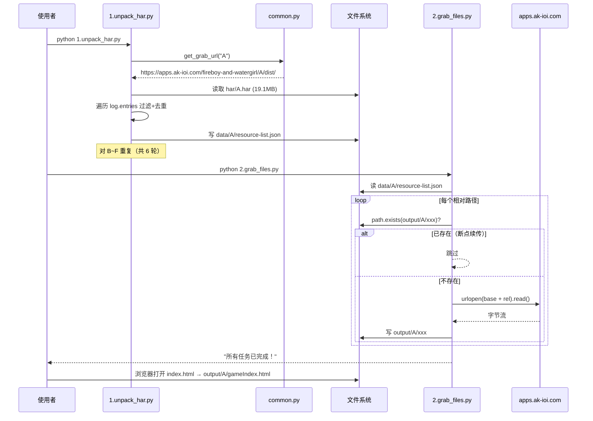
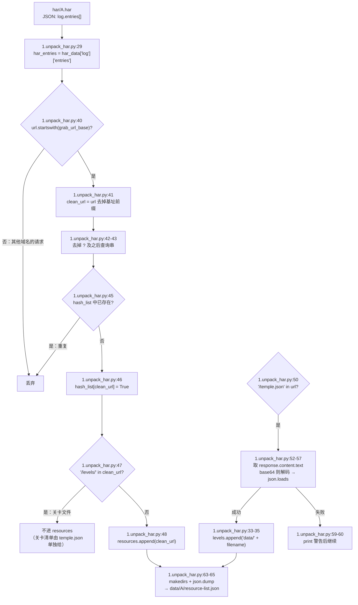
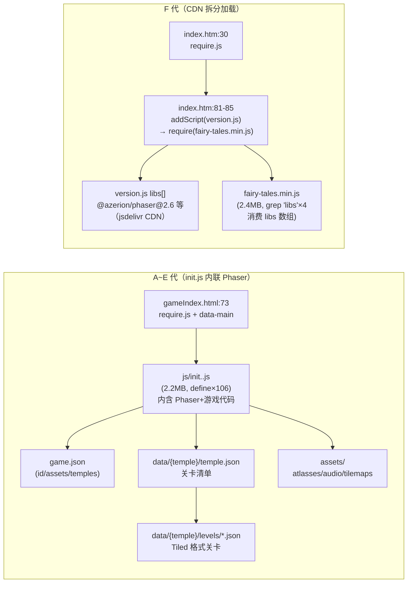
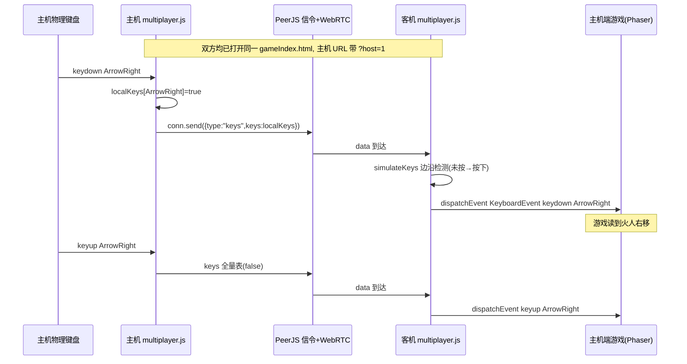
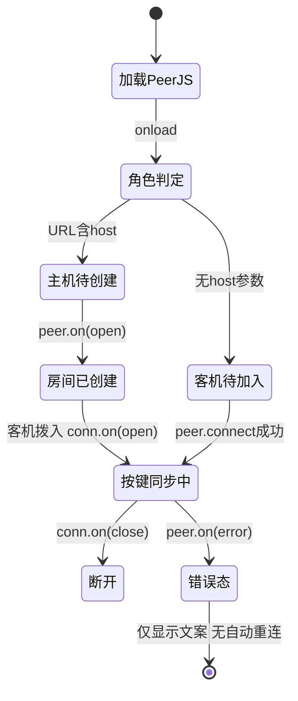

# Fireboy-and-Watergirl — 项目运行原理报告

**分析时间**：2026-09-30 11:35
**分析范围**：`D:\Guiyuan1111\GitHub\slbhr\Fireboy-and-Watergirl`
**分析模式**：完整分析（自有源码 620 行逐行精读；`har/` 目录仅统计未读内容；`output/*/js/init.*.js` 与 `fairy-tales.min.js` 为 2.2~2.4MB 混淆/压缩文件，仅做 `head -c` 采样与 `grep -c` 关键字统计，游戏内部逻辑粒度降级到模块级）

---

## 1. 启动初始化序列

本项目没有单一入口，而是**三个独立入口**：两个顺序执行的 CLI 脚本（抓取流水线）+ 一个静态门户页（游玩入口）。三者通过 `data/*/resource-list.json` 与 `output/` 目录这两个"文件系统状态"耦合。

### 入口文件

| 入口 | 路径 | 角色 | 运行方式 |
|------|------|------|---------|
| 阶段一脚本 | `1.unpack_har.py` | CLI：HAR → 资源清单 | `python 1.unpack_har.py`（无 `if __name__` 保护，顶层直接执行循环） |
| 阶段二脚本 | `2.grab_files.py` | CLI：清单 → 批量下载 | `python 2.grab_files.py`（同样顶层直接执行） |
| 门户页 | `index.html` | 静态 HTML 游戏选择页 | 浏览器打开 / GitHub Pages 托管（`README.md:32`） |
| 共享配置 | `common.py` | URL 模板与路径函数库 | 被两个脚本 `import`，自身无副作用代码 |

### 阶段一脚本初始化步骤（`1.unpack_har.py`）

| 步骤 | 操作 | 代码位置 | 说明 |
|------|------|---------|------|
| 1 | 导入 common | `1.unpack_har.py:5` | `import common  # 确保你已经创建了刚才说的那个 common.py` |
| 2 | 定义游戏代号表 | `1.unpack_har.py:8` | `games = ['A', 'B', 'C', 'D', 'E', 'F']`，硬编码 6 代 |
| 3 | 循环处理每个游戏 | `1.unpack_har.py:69-70` | `for g in games: process_game(g)` 顶层驱动 |
| 4 | 解析三个路径变量 | `1.unpack_har.py:12-14` | `grab_url_base` / `har_path` / `output_json` 全部经 `common` 计算 |
| 5 | HAR 存在性预检 | `1.unpack_har.py:16-18` | 缺失则 `print` 跳过并 `return`（不抛异常） |
| 6 | 读取并解析 HAR JSON | `1.unpack_har.py:22-24` | `json.load(f)`，`try/except` 包裹 |
| 7 | 取出 entries | `1.unpack_har.py:29` | `har_data['log']['entries']`（HAR 1.2 规范结构） |
| 8 | 初始化累加器 | `1.unpack_har.py:30-31` | `resource_list = {'resources': [], 'levels': []}` 与去重字典 `hash_list = {}` |
| 9 | 逐条过滤 entries | `1.unpack_har.py:37-60` | 详见数据流 1 |
| 10 | 建目录并写清单 | `1.unpack_har.py:63-65` | `json.dump(..., indent='  ')` |

### 阶段二脚本初始化步骤（`2.grab_files.py`）

| 步骤 | 操作 | 代码位置 | 说明 |
|------|------|---------|------|
| 1 | 导入 urllib | `2.grab_files.py:4-5` | `from urllib.request import urlopen, HTTPError`（标准库，无 requests 依赖） |
| 2 | 定义游戏代号表 | `2.grab_files.py:9` | 与阶段一相同的 6 元素列表（重复硬编码，未复用 common） |
| 3 | 计算三条路径 | `2.grab_files.py:13-16` | 清单路径、URL 基址、`game_output_dir = path.join("output", game_code)` |
| 4 | 清单存在性预检 | `2.grab_files.py:18-20` | 缺失则跳过该游戏（即阶段一未跑则阶段二静默空转） |
| 5 | 加载清单 JSON | `2.grab_files.py:24-25` | **无 try/except**，清单损坏则整个脚本崩溃 |
| 6 | 串行下载 resources | `2.grab_files.py:52-53` | `for url in resource_list['resources']: grab_file(url)` |
| 7 | 串行下载 levels | `2.grab_files.py:56-57` | 第二轮循环 |
| 8 | 循环下一个游戏 | `2.grab_files.py:60-61` | 6 游戏串行 |
| 9 | 终态打印 | `2.grab_files.py:63` | `print("\n所有任务已完成！...")` —— 无论是否有失败都会打印"完成" |

### 两阶段流水线总时序图



### 优雅关闭机制

**不存在。** 两个脚本均未注册信号处理，Ctrl+C 直接 `KeyboardInterrupt` 中断；得益于"文件存在即跳过"设计（`2.grab_files.py:36-38`），中断后重跑即自动续传。部分写入的文件（下载到一半被中断）会被误判为完整文件，这是无校验的续传盲区（见第 5 节）。

---

## 2. 核心数据流追踪

### 数据流 1：HAR → resource-list.json（阶段一）

**触发方式**：手动运行 `python 1.unpack_har.py`。

HAR 文件现状（只统计，未读内容）：

| 文件 | 大小 | 状态 |
|------|------|------|
| `har/A.har` | 19,127,387 B | 含完整网络会话记录 |
| `har/B.har` ~ `har/F.har` | 23.6MB ~ 32.8MB | 同上 |
| `har/.dummy` | 0 B | 占位文件 |

**完整路径**：



**过滤条件原文引用**（`1.unpack_har.py:40-48`）：

````python
if url.startswith(grab_url_base):
    clean_url = url[len(grab_url_base):]
    if '?' in clean_url:
        clean_url = clean_url.split('?')[0]

    if not hash_list.get(clean_url):
        hash_list[clean_url] = True
        if '/levels/' not in clean_url:
            resource_list['resources'].append(clean_url)
````

过滤规则三要素：
1. **前缀白名单**：URL 必须以 `common.py:4` 的模板展开结果 `https://apps.ak-ioi.com/fireboy-and-watergirl/{A..F}/dist/` 开头，其余域名/路径（统计脚本、信令、第三方资源）全部丢弃。
2. **查询串剥离**：`?vvvv=14` 之类的缓存参数被切掉后再判重（`1.unpack_har.py:42-43`），因此 `a.js` 与 `a.js?v=1` 视为同一资源。
3. **关卡路径排除**：URL 中含 `/levels/` 的不进 `resources`，关卡清单完全依赖 temple.json 的 `filename` 字段重构（`1.unpack_har.py:33-35` 前缀拼 `'data/'`）。这依赖一个隐含假设：**HAR 中 temple.json 的响应体必须被浏览器完整记录**（base64 编码），否则该作 levels 为空数组。

**变量级数据变换表（阶段一）**：

| 变量名 | 类型 | 值变化 | 代码位置 |
|--------|------|--------|---------|
| `games` | `list[str]` | `['A','B','C','D','E','F']` 常量 | `1.unpack_har.py:8` |
| `grab_url_base` | `str` | `None` → `"https://apps.ak-ioi.com/fireboy-and-watergirl/A/dist/"` | `1.unpack_har.py:12` ← `common.py:17-18` |
| `har_path` | `str` | → `"./har/A.har"`（`common.har_dir` 为 `"./har"`） | `1.unpack_har.py:13` ← `common.py:7` |
| `output_json` | `str` | → `"./data/A/resource-list.json"` | `1.unpack_har.py:14` ← `common.py:13-14` |
| `har_data` | `dict` | 文件字节 → HAR 顶层对象 | `1.unpack_har.py:24` |
| `har_entries` | `list[dict]` | HAR 对象 → `log.entries` 数组（每项含 request/response） | `1.unpack_har.py:29` |
| `resource_list` | `dict{resources:list, levels:list}` | `{'resources':[], 'levels':[]}` → 累积填充（A：66 + 48 项） | `1.unpack_har.py:30` |
| `hash_list` | `dict[str,bool]` | `{}` → 已见 URL 集合（去重索引，非哈希） | `1.unpack_har.py:31,45-46` |
| `url` | `str`（注解于 `1.unpack_har.py:38`） | entry.request.url 原文，含查询串 | `1.unpack_har.py:38` |
| `clean_url` | `str` | 绝对 URL → 相对路径（如 `"js/init.eb02fbdab2aa1d24.js"`） | `1.unpack_har.py:41-43` |
| `content` / `text` | `dict` / `str` | response.content → 文本（base64 时解码为 UTF-8） | `1.unpack_har.py:52-55` |
| `temple_json` | `dict` | 文本 → `{id, label, levels:[{filename,...}]}` | `1.unpack_har.py:57` |
| `item['filename']` | `str` | `"tutorials/levels/forest_01.json"` → `"data/tutorials/levels/forest_01.json"` | `1.unpack_har.py:35` |

**产出清单规模实测**（对 `data/*/resource-list.json` 统计）：

| 游戏 | resources 项数 | levels 项数 | levels[0] |
|------|---------------|-------------|-----------|
| A | 66 | 48 | `data/tutorials/levels/forest_01.json` |
| B | 66 | 41 | `data/tutorials/levels/light_01.json` |
| C | 66 | 53 | `data/tutorials/levels/light_01.json` |
| D | 66 | 39 | `data/tutorials/levels/light_01.json` |
| E | 100 | 39 | `data/tutorials/levels/tutorial_fire.json` |
| F | 78 | 32 | `data/tutorials/levels/forest_01.json` |

注：C/D 的 levels[0] 均为 `light_01.json`，与其各自游戏主题（ice/crystal）不一致——这是 HAR 抓取时会话串扰的证据（教程关资源可能来自站内通用路径），属于数据质量观察点，非脚本逻辑 bug。

### 数据流 2：resource-list.json → output/ 本地文件树（阶段二）

**触发方式**：手动运行 `python 2.grab_files.py`。

**路径映射规则**（URL → 本地路径的完整模板链）：

```
远端 URL  = common.py:4 的 grab_url_template.format(游戏代号) + 清单中的相对路径
          = https://apps.ak-ioi.com/fireboy-and-watergirl/{A..F}/dist/{relative_url}

本地路径  = path.join("output", game_code, relative_url)      ← 2.grab_files.py:30
          = output/{A..F}/{relative_url}

清单路径  = {data_dir}/{game_code}/resource-list.json          ← common.py:13-14
HAR 路径  = {har_dir}/{game_code}.har                          ← 1.unpack_har.py:13
```

即 **URL 的路径部分 1:1 镜像到本地目录结构**（`dist/` 基址本身不落盘），游戏客户端因此无需任何路径改写即可离线运行（README.md:61 所述"静态文件路径解耦"的实现本质）。

**单文件下载函数逐行解构**（`2.grab_files.py:27-46`）：

| 行号 | 代码职责 | 关键点 |
|------|---------|--------|
| `2.grab_files.py:28` | `print(f"[{game_code}] 下载: {relative_url}")` 进度日志 | 每个 URL 一行 |
| `2.grab_files.py:29` | `url = grab_url_base + relative_url` | 字符串拼接还原绝对 URL |
| `2.grab_files.py:30` | `save_path = path.join(game_output_dir, relative_url)` | URL→本地映射 |
| `2.grab_files.py:32` | `os.makedirs(path.dirname(save_path), exist_ok=True)` | **先建父目录再判存在**（注意：目录创建发生在存在性检查之前） |
| `2.grab_files.py:36-38` | `if path.exists(save_path): return` | **断点续传的全部实现**——存在即视为已下载，不校验大小/内容 |
| `2.grab_files.py:40` | `data = urlopen(url).read()` | 同步阻塞下载，无超时参数、无重试 |
| `2.grab_files.py:41-42` | `open(save_path,'wb').write(data)` | 全量内存写入（大文件会整段驻留内存） |
| `2.grab_files.py:43-44` | `except HTTPError` → `print(f"    错误 {err.code}: ...")` | 仅打印，**无重试、无失败清单** |
| `2.grab_files.py:45-46` | `except Exception` → `print(f"    发生异常: {e}")` | 兜底，同样继续循环 |

**断点续传机制结论**：没有下载状态文件、没有 manifest 校验和；唯一的"已下载标记"就是**目标文件在磁盘上的存在性**（`2.grab_files.py:36-38`）。重跑脚本时已存在文件在 `path.exists` 处短路返回，天然幂等。

**下载完整性实测**（对照清单逐项 `os.path.exists` 检查）：

| 游戏 | 清单去重后应下载 | 实际缺失 | 缺失文件 |
|------|-----------------|----------|---------|
| A | 114 | 2 | `manifest.json`, `icon-60x60.png` |
| B | 107 | 2 | `manifest.json`, `icon-60x60.png` |
| C | 119 | 2 | `manifest.json`, `icon-60x60.png` |
| D | 105 | 2 | `manifest.json`, `icon-60x60.png` |
| E | 139 | 2 | `manifest.json`, `icon-512x512.217d8c4d6508dd2e.png` |
| F | 110 | 1 | `manifest.json` |

6 个游戏**全部**缺 `manifest.json`（`gameIndex.html:30` 的 `<link rel="manifest">` 引用了它）——这是 `2.grab_files.py:43-44` "打印后继续"式静默失败的活证据：失败只留在终端滚动的日志里，终态 `2.grab_files.py:63` 仍报告"所有任务已完成"。运行时影响有限（PWA manifest 404），但暴露了"无失败汇总、无重跑校验"的容错缺陷。

### 数据流 3：门户页 → 游戏客户端启动链（运行时）

**门户页加载序列**（`index.html`，252 行纯静态，无 JS 逻辑）：

| 步骤 | 资源 | 代码位置 | 说明 |
|------|------|---------|------|
| 1 | `img/icon.png` favicon | `index.html:9` | |
| 2 | 内联 `<style>`（约 165 行 CSS） | `index.html:10-176` | 火红/水蓝双色主题，`:root` 变量 `index.html:11-15` |
| 3 | `img/background.jpg` 背景 | `index.html:36` | body 背景图 |
| 4 | 6 张游戏卡片 `<a>` | `index.html:185-245` | **games 列表是纯静态 HTML 硬编码，无 JS 数组、无动态构造** |
| 5 | footer 外链 | `index.html:247-249` | GitHub 仓库 + 原站链接 |

卡片链接指向（奇数卡火色、偶数卡水色仅为 CSS `:nth-child` 悬停差异，`index.html:104-114`）：

| 代 | 链接 href | 代码位置 |
|----|----------|---------|
| 1 森林神庙 | `output/A/gameIndex.html` | `index.html:187` |
| 2 光明神庙 | `output/B/gameIndex.html` | `index.html:197` |
| 3 寒冰圣殿 | `output/C/gameIndex.html` | `index.html:207` |
| 4 水晶殿 | `output/D/gameIndex.html` | `index.html:217` |
| 5 元素 | `output/E/gameIndex.html` | `index.html:227` |
| 6 童话 | `output/F/index.htm`（**注意扩展名不同**） | `index.html:237` |

**output/A 客户端启动链**（静态推断，`output/A/gameIndex.html` 共 123 行）：

| 步骤 | 操作 | 代码位置 | 说明 |
|------|------|---------|------|
| 1 | 声明 PWA meta | `gameIndex.html:30-33` | `<link rel="manifest" href="manifest.json">`（该文件实际缺失） |
| 2 | 加载 umami 统计 | `gameIndex.html:44-49` | `analytics.sparkslab.art/script.js`，异步 |
| 3 | 定义 `window.sendAnalyticsEvent` | `gameIndex.html:55-63` | 空实现包装，游戏可调用 |
| 4 | **Node 兼容垫片** | `gameIndex.html:67-69` | `window.requireNode = window.require; window.require = undefined;` —— 先备份 Electron/NW.js 环境的 require，再置空，防止 CommonJS require 干扰接下来的 AMD 加载器 |
| 5 | **RequireJS 引导** | `gameIndex.html:73` | `<script data-main="js/init.eb02fbdab2aa1d24.js" src="bower_components/requirejs/require.js">` |
| 6 | 挂载游戏容器 | `gameIndex.html:75-79` | `#root > #container`（渲染目标）、`#hammer`（触摸手势）、`#debug-fps` |
| 7 | 移动端全屏按钮 | `gameIndex.html:82-119` | UA 检测 + `requestAnimationFrame` 轮询 `document.fullscreenElement` 控制按钮显隐（`gameIndex.html:106-114`） |
| 8 | Cloudflare Insights | `gameIndex.html:120` | 抓取时页面自带的第三方统计（离线不可用，静默失败） |
| 9 | **多人补丁注入** | `gameIndex.html:121` | `<script src="/multiplayer.js"></script>` —— **根绝对路径**；仅 A 代注入，B~E 的 gameIndex.html 无此引用（grep 验证），F 的 index.htm 也没有 |

**init.*.js 的角色**（混淆文件，粒度降级到模块级）：

- `output/A/js/init.eb02fbdab2aa1d24.js`，2,273,196 字节。开头 ~1500 字节为**可读注释**的 `GameConfig` 全局对象（`referenceFPS: 60`、自适应 tick 调度、手动缩放配置等），之后为混淆代码。
- AMD 模块特征：`grep -c "define("` = **106** 个模块定义；`baseUrl: "js"`（grep 命中）说明 RequireJS 以 `js/` 目录解析依赖；未发现 `requirejs.config` 字面调用（=0），配置内联在 init 自身。
- 引擎特征（`grep -c` 关键字统计）：`Phaser`×432、`PIXI`×322、`Matter`×13 → **Phaser 2/CE 引擎（PIXI 渲染层 + Matter 物理可选）**。B 代 init 同法验证：`Phaser`×436、`localStorage`×13。
- F 代给出决定性版本证据：`output/F/version.js:1` 的 `libs` 数组明确声明 `@azerion/phaser@2.6`（Phaser CE 2.6）、`phaser-cachebuster@2.0`、`phaser-spine@3.0`、`phaser-super-storage@2.0`，全部从 jsdelivr CDN 拉取。

**A~E 与 F 的加载架构差异**：



**game.json / temple.json / levels 的加载关系**（以 A 为例）：

1. `game.json`（55 字节单行）：`{"id":"forest","type":"legacy","assets":"forest","temples":"forest",...}` —— 声明游戏身份与资源目录名。六代的 id 分别为 `forest` / `light` / `ice` / `crystal` / `elements`（type:"multi"，assets 为 7 元素数组）/ `fairytales`（`canRevive:true`）。
2. `data/forest/temple.json`：含 `"levels":[{"id":1,...,"filename":"tutorials/levels/forest_01.json",...,"opened":true},{"id":2,...,"initial":false},...]` —— 关卡地图数据（每关坐标 x/y、限时 `time`/`mobileTime`、类型 `type:"general"|"speed"`、解锁条件 `required`）。
3. `data/forest/levels/forest_02.json ...` 共 47 个文件 + 1 个教程关 = 48 关，与清单 levels 数完全吻合（`ls | wc -l` 实测）。README.md:84 说明关卡文件可用 Tiled 编辑器打开。

### 数据流 4：multiplayer.js P2P 按键同步（运行时补丁）

仓库存在**两份不同实现**的补丁（`diff` 确认内容不同）：

| 文件 | 行数 | 信令/P2P 库 | 注入来源 |
|------|------|------------|---------|
| `multiplayer.js`（仓库根） | 220 | PeerJS 1.5.1（unpkg CDN） | `output/A/gameIndex.html:121` 的 `/multiplayer.js`（根绝对路径） |
| `output/multiplayer.js` | 170 | `@poki/netlib@0.2.0`（unpkg CDN） | **无任何页面引用它**（grep 全 output 无命中），疑似废弃/备用版本 |

按 GitHub Pages 项目站部署（`README.md:32`，`https://1224HuangJin.github.io/Fireboy-and-Watergirl/`）推断：`gameIndex.html:121` 的根绝对 `/multiplayer.js` 会解析到 `1224HuangJin.github.io/multiplayer.js`（用户域根）而非仓库子路径 → **404，多人补丁在 Pages 部署下实际不生效**（此为静态推断结论，标记为部署缺陷候选；若以仓库根做本地静态服务器根目录则可命中根目录那份 PeerJS 版）。

**根版 multiplayer.js 函数级全覆盖**（220 行逐函数）：

| 函数/块 | 行号 | 做什么 | 监听/机制 |
|---------|------|--------|----------|
| `loadPeerJS()` IIFE | `multiplayer.js:7-15` | 动态建 `<script>` 加载 `unpkg.com/peerjs@1.5.1/dist/peerjs.min.js`，`onload` 回调调 `initMultiplayer()`，插入 `document.head` | script.onload 事件；**自执行，随页面加载即运行** |
| 模块级全局 | `multiplayer.js:17-20` | `let peer, conn, isHost=false; let roomCode=''; let localKeys={}, remoteKeys={}` | — |
| `initMultiplayer()` | `multiplayer.js:22-60` | 读 `URLSearchParams(window.location.search)` 判 `isHost = urlParams.has('host')`；创建固定右上角 `#mp-ui` 容器（内联样式 z-index:9999）；按角色渲染不同 innerHTML：主机=「创建房间」按钮绑定 `createRoom`（:45），客机=房间码输入框+「加入房间」按钮绑定 `joinRoom(code)`（:55-58，空码不动作） | onclick（DOM 属性赋值式，非 addEventListener） |
| `createRoom()` | `multiplayer.js:63-99` | 生成 `randomId = 'host-'+Math.random().toString(36).substr(2,6)`；`new Peer(randomId,{debug:2})`（用 PeerJS 默认免费信令服务器）；`peer.on('open')` 中把 Peer ID 当房间码显示；`peer.on('connection')` 接收入连接 → `conn` 保存，`conn.on('open')` 状态追加"客机已加入"并调 `startHostSync()`；`conn.on('data')` 收 `{type:'keys'}` 时 `remoteKeys = data.keys; simulateKeys(remoteKeys)`；`conn.on('close')` 显示"客机已断开"；`peer.on('error')` 显示错误消息 | peer: open/connection/error；conn: open/data/close |
| `joinRoom(code)` | `multiplayer.js:102-132` | 生成 `'guest-'+random` 的 Peer ID；`peer.on('open')` 后 `conn = peer.connect(code,{reliable:true})`；`conn.on('open')` 显示"已连接到主机"并调 `startGuestSync()`；`conn.on('data')` 同上双向处理 keys；`conn.on('close')`/`peer.on('error')` 更新状态文案 | 同上；注释（:112-114）说明分工：客机控 WASD（水女孩），主机控方向键（火人） |
| `startHostSync()` | `multiplayer.js:135-152` | 只放行 `['ArrowUp','ArrowDown','ArrowLeft','ArrowRight']` 四键；keydown/keyup 时置 `localKeys[e.key]` true/false 并立即 `sendKeys()`；末尾先发一次初始空状态 | document.addEventListener keydown/keyup（冒泡阶段） |
| `sendKeys()` | `multiplayer.js:154-158` | `if (conn && conn.open) conn.send({type:'keys', keys: localKeys})` —— 状态型（全量按键表）而非事件型（边沿触发）发送 | — |
| `startGuestSync()` | `multiplayer.js:161-177` | 与主机版对称，白名单为 `['w','W','a','A','s','S','d','D']`（大小写共 8 个字面量） | 同 addEventListener |
| `simulateKeys(keysObj)` | `multiplayer.js:180-204` | **边沿检测模拟器**：用 `window._simulatedState` 记录上次模拟状态；对每键比较目标态与当前态，false→true 派发 `new KeyboardEvent('keydown',{key,bubbles:true})` 到 `document`，true→false 派发 keyup。把对端发来的"全量按键表"还原为本地游戏可感知的按键边沿事件——**这是补丁改写游戏行为的唯一手段：游戏本身完全无感知，只是收到合成键盘事件** | document.dispatchEvent；无定时器、无 MutationObserver |
| 客机键盘拦截块 | `multiplayer.js:211-220` | 模块加载即执行：`if (!isHost)` 注册 **capture 阶段**（第三个参数 `true`）的 document keydown/keyup，对**所有**按键 `e.stopPropagation(); e.preventDefault()` —— 客机本地物理键盘被完全吞掉，防止本地点键干扰（本地物理输入无法再控制游戏，只能经网络往返） | document.addEventListener（捕获阶段，最高优先级） |

**无轮询/定时器**：根版补丁没有 setInterval/setTimeout/MutationObserver/requestAnimationFrame；同步完全由按键事件驱动（本地边沿触发发送 + 对端边沿检测还原）。

**P2P 按键同步时序图**（主机=火人方向键，客机=水人 WASD）：



**output 版（netlib）与根版关键差异**：客机加入成功后才置 `isSyncing=true`，键盘拦截仅在 `isSyncing` 时生效（`output/multiplayer.js:157-170`），且主机发送不过滤键位（任意键都发，`output/multiplayer.js:111-122`）；`simulateKeys` 用 `remoteKeys` 兼作状态表（`output/multiplayer.js:132-154`）。此版本未被任何页面引用。

---

## 3. 状态管理分析

### 应用状态

| 状态类型 | 管理方式 | 存储位置 | 关键代码 |
|---------|---------|---------|---------|
| 抓取流水线状态 | **无独立状态**，用"文件存在性"充当已下载标记 | 文件系统 `output/{G}/...` | `2.grab_files.py:36-38` |
| 资源清单 | 静态 JSON 文档 | `data/{G}/resource-list.json` | `1.unpack_har.py:64-65` |
| URL 去重状态 | 进程内字典（运行期，不持久化） | `hash_list` | `1.unpack_har.py:31,45-46` |
| 多人连接状态 | 进程内全局变量 + DOM 状态文案 | `peer`/`conn`/`roomCode`/`#status` div | `multiplayer.js:17-18,75,80,90` |
| 模拟按键状态 | `window._simulatedState`（挂到 window，跨函数共享） | 浏览器页面内存 | `multiplayer.js:182-183` |
| 游戏进度/设置 | localStorage（命名空间化） | 浏览器 localStorage | init.js grep：`setNamespace("fb-" + this.game.gameConfig.id)` + `setItem("progress", JSON.stringify(this.toJSON()...))` |

### 状态机 1：抓取流水线脚本阶段状态机（隐式，由控制流构成）

| 当前状态 | 目标状态 | 触发 | 条件 | 代码位置 |
|---------|---------|------|------|---------|
| 未启动 | 游戏 g 待检 | 脚本启动 `for g in games` | — | `2.grab_files.py:60` |
| 游戏 g 待检 | 跳过（下一游戏） | `return` | 清单文件不存在 | `2.grab_files.py:18-20` |
| 游戏 g 待检 | 下载中 | 继续执行 | 清单可读 | `2.grab_files.py:24` |
| 下载中（逐文件） | 文件跳过 | `return` | `path.exists(save_path)` 为真 | `2.grab_files.py:36-38` |
| 下载中 | 文件完成 | 写盘成功 | urlopen 无异常 | `2.grab_files.py:40-42` |
| 下载中 | 文件失败（继续下一文件） | print 后自然落入下一轮循环 | HTTPError 或任意 Exception | `2.grab_files.py:43-46` |
| 游戏内循环结束 | 下一游戏 / 终态 | 循环变量推进 | — | `2.grab_files.py:60-61` |
| 全部游戏完成 | 终态"所有任务已完成" | 无条件打印 | **即使有失败也到达** | `2.grab_files.py:63` |

### 状态机 2：multiplayer.js 连接/房间状态机（根版 PeerJS）

| 当前状态 | 目标状态 | 触发 | 条件 | 代码位置 |
|---------|---------|------|------|---------|
| 未初始化 | 角色判定完成 | PeerJS script.onload → `initMultiplayer()` | CDN 加载成功 | `multiplayer.js:10-13,23-24` |
| 角色判定完成 | 主机待创建 / 客机待加入 | URL 是否含 `host` 参数 | `urlParams.has('host')` | `multiplayer.js:24,38-59` |
| 主机待创建 | 房间已创建（等连接） | `peer.on('open')` | Peer ID 注册成功 | `multiplayer.js:72-76` |
| 房间已创建 | **连接建立** | `peer.on('connection')` + `conn.on('open')` | 客机拨入 | `multiplayer.js:77-82` |
| 连接建立 | 按键同步中 | `startHostSync()` | conn open | `multiplayer.js:81,135-152` |
| 按键同步中 | 断开 | `conn.on('close')` | 任一方关页/网络断 | `multiplayer.js:89-91` |
| 客机待加入 | 连接中 | 点击"加入房间"且输入非空 | `code` 非空 | `multiplayer.js:55-58` |
| 连接中 | 按键同步中 | `conn.on('open')` → `startGuestSync()` | 主机 accept | `multiplayer.js:110-116` |
| 任意态 | 错误态（文案显示，不自动恢复） | `peer.on('error')` | PeerJS 错误 | `multiplayer.js:95-98,128-131` |



### 状态机 3：游戏关卡状态（数据级，静态可推断）

temple.json 中每关携带解锁语义字段：`"opened":true`（首关初始开放，A 代 temple.json 第 1 关）、`"initial":true/false`、`"required":0`（解锁所需前关数）、`"type":"general"|"speed"`（普通/限时关）。结合 init.js 中 `getItem("progress")`/`setItem("progress", JSON.stringify(this.toJSON()...))` 的 grep 证据，可推断关卡解锁状态在运行时被序列化进 `fb-{gameId}:progress` 键。

| 当前状态 | 目标状态 | 触发 | 条件 | 代码位置 |
|---------|---------|------|------|---------|
| 关卡锁定 | 关卡开放 | 读取 progress | 前通过关数 ≥ `required` | `temple.json` required 字段 + init.js getItem("progress") |
| 关卡开放 | 关卡进行中 | 玩家选关 | `opened`/progress 判定 | temple.json `"opened":true` |
| 关卡进行中 | 通关（写入 progress） | 结算 | init.js `setItem("progress", JSON.stringify(this.toJSON()...))` | grep 命中 |

---

## 4. 数据持久化分析

### 数据库

**无。** 全项目（脚本 + 前端）不使用任何数据库；所有持久化均为文件系统与浏览器存储。

### 持久化清单

| 数据 | 载体 | 写入方 | 读取方 | 代码位置 |
|------|------|--------|--------|---------|
| 资源清单 | `data/{G}/resource-list.json`（`{resources:[str], levels:[str]}`，2 空格缩进） | `1.unpack_har.py:64-65` | `2.grab_files.py:24-25` | 两脚本唯一的数据交接物 |
| 游戏资源文件 | `output/{G}/...`（URL 路径 1:1 镜像） | `2.grab_files.py:41-42` | 浏览器（静态服务） | 路径规则 `2.grab_files.py:30` |
| 游戏进度 | localStorage 键 = 命名空间 `"fb-"+gameConfig.id` + 键名 | init.js（混淆） | init.js | grep：`setNamespace("fb-" + this.game.gameConfig.id)`、`getItem("progress")`、`setItem("progress", ...)` |
| 游戏设置 | 同上，键 `"settings"` | init.js | init.js | grep：`getItem("settings")`、`setItem("settings", JSON.stringify(this.settings...))` |
| 存储可用性探测 | localStorage `"testingLocalStorage"` = `"foo"` | init.js（启动自检） | init.js | grep：`setItem("testingLocalStorage","foo")` + `removeItem("testingLocalStorage")` |
| 多人按键模拟态 | `window._simulatedState`（**内存，刷新即失**） | `simulateKeys` | `simulateKeys` | `multiplayer.js:182-183` |

**localStorage API 使用频次**（`grep -o "localStorage\.(getItem|setItem|removeItem)" | uniq -c`，A 代 init.js）：`getItem`×5、`setItem`×3、`removeItem`×3，共 13 处 `localStorage` 引用；`sessionStorage` = 0，`indexedDB` = 0。**结论：游戏进度持久化方式为 localStorage（同步、同源、按 `fb-{id}` 命名空间隔离六代进度），无会话级或 IndexedDB 存储。**

### 数据迁移策略

不存在。脚本输出的清单/文件即为"迁移产物"；升级依赖重跑两脚本（幂等）。

---

## 5. 错误处理体系

### 错误类型层次

无自定义异常类。脚本层全部为裸 `try/except`，前端层为事件回调里的状态文案渲染。

### 完整错误处理链路（逐个 try/except 清单）

| # | 位置 | 包裹的操作 | 捕获类型 | 处理方式 | 重试 | 后果 |
|---|------|-----------|---------|---------|------|------|
| 1 | `1.unpack_har.py:16-18` | HAR 文件存在性（非 try，前置 if） | — | print 跳过 + return | 否 | 该游戏无清单，阶段二连锁跳过 |
| 2 | `1.unpack_har.py:22-27` | `open + json.load(har)` | `Exception`（宽捕获） | print 错误 + return | 否 | 同上 |
| 3 | `1.unpack_har.py:51-60` | temple.json 响应体提取+base64 解码+json.loads | **裸 `except:`（:59，吞一切含 KeyboardInterrupt/SystemExit）** | print 警告后继续 | 否 | **该作 levels=[]，下载不到任何关卡，且无任何后续提示**（最隐蔽的失败模式） |
| 4 | `1.unpack_har.py:63-65` | makedirs + json.dump | **无** | — | — | 清单写失败直接崩溃整个脚本 |
| 5 | `2.grab_files.py:18-20` | 清单存在性（前置 if） | — | print 跳过 + return | 否 | 该游戏不下载 |
| 6 | `2.grab_files.py:24-25` | `open + json.load(清单)` | **无** | — | — | 清单损坏 → 脚本崩溃，后续游戏不再处理 |
| 7 | `2.grab_files.py:34-46` | `urlopen(url).read()` + 写盘 | `HTTPError`（先）+ `Exception`（后） | 各 print 一行后继续循环 | **否** | 该文件缺失；失败信息仅存在于已滚动的终端输出 |
| 8 | `multiplayer.js:95-98`（主机）/ `:128-131`（客机） | Peer 创建/连接错误 | PeerJS error 事件 | `#status` innerHTML 显示消息 | 否 | 无自动重连，用户需刷新重来 |
| 9 | `output/multiplayer.js:76-78,102-104` | netlib host/join | `try/catch (e)` | `#status` 显示 e.message | 否 | 同上 |
| 10 | `gameIndex.html:55-63`（A） | 统计上报 | `if(window.umami)` 判空 | 静默不发 | — | 离线无影响（有意设计） |

### 错误传播机制

- 脚本层：**底层异常不向上传播**（一律 print 后吞掉/继续），退出码恒为 0（除非未捕获的 #4/#6 直接栈崩）；调用者无法从退出码判断成败。
- 前端层：多人连接错误仅改 UI 文案；游戏本体错误处理不可见（混淆）。

### 关键失败点与容错缺陷清单

| 编号 | 缺陷 | 证据 | 影响 |
|------|------|------|------|
| F1 | 下载失败无重试、无失败清单、终态恒报"完成" | `2.grab_files.py:43-46,63` | 实测 6 作全部缺 `manifest.json`（+图标），需人工翻终端日志才能发现 |
| F2 | 裸 `except:` 吞掉 temple.json 解析失败 | `1.unpack_har.py:59` | levels 静默为空 → 整作无关卡可下载 |
| F3 | 断点续传只看"文件存在"，无大小/完整性校验 | `2.grab_files.py:36-38` | 中断产生的半截文件被永久当作已完成 |
| F4 | `urlopen` 无 timeout 参数 | `2.grab_files.py:40` | 单文件网络挂起会无限阻塞整个串行流水线 |
| F5 | 全量 `.read()` 进内存后写盘 | `2.grab_files.py:40-42` | 大文件（图集/音频）内存峰值高 |
| F6 | 串行下载，无并发 | `2.grab_files.py:52-57` | 六作 ~700 文件逐个下载，耗时长 |
| F7 | `/multiplayer.js` 根绝对路径在 GitHub Pages 项目站下 404 | `gameIndex.html:121` + `README.md:32` 部署地址 | 多人补丁在 Pages 部署不生效（静态推断） |
| F8 | 多人补丁仅 A 代注入，B~F 无 | grep：仅 `output/A/gameIndex.html` 命中 | 其他代无联机入口 |
| F9 | 客机 capture 阶段无条件吞掉所有按键（根版） | `multiplayer.js:211-220` | 客机若在加入房间前操作，游戏完全无响应；`isHost` 判定发生在 `initMultiplayer`（:24），而拦截块在模块加载即注册——但 `isHost` 变量在 `initMultiplayer` 之前默认 `false`（:17），故客机路径成立；若 PeerJS CDN 加载失败则 UI 无从创建但拦截已生效，键盘被吞且无任何提示 |
| F10 | games 列表在两个脚本重复硬编码 | `1.unpack_har.py:8`、`2.grab_files.py:9` | 扩展新游戏需改两处（common.py 反而未承载） |
| F11 | F 代运行时依赖 jsdelivr CDN 拉 Phaser 库 | `output/F/version.js:1-2` | 离线场景 F 代无法启动（A~E 引擎内联无此问题） |
| F12 | `output/multiplayer.js`（netlib 版）无引用方，属死代码 | diff + grep 验证 | 维护混淆 |

---

## 6. 并发与异步处理

| 维度 | 实况 | 证据 |
|------|------|------|
| 脚本并发模型 | **纯同步串行**：游戏间串行（`2.grab_files.py:60-61`）→ 清单两类串行（:52-57）→ 文件逐个同步 urlopen（:40）；无线程/异步/队列 | `2.grab_files.py:40,52-61` |
| 前端补丁异步 | PeerJS 与游戏互不感知：补丁用 CDN script onload 链式初始化（`multiplayer.js:7-15`）；按键同步为事件驱动全量状态发送，无节流（每 keydown/keyup 即 send 一次，`multiplayer.js:138-149`） | `multiplayer.js:7-15,138-149` |
| 轮询/定时器 | 脚本无；补丁无 setInterval/MutationObserver；**唯一轮询**在 gameIndex.html 移动端全屏按钮（`requestAnimationFrame` 每帧查 `document.fullscreenElement`，A 代 `gameIndex.html:106-114`，F 代 index.htm 同款） | `gameIndex.html:106-114` |
| 竞态处理 | 无锁无事务；`hash_list` 去重依赖单线程遍历顺序（HAR 中同资源多次记录时取首个 URL 形态） | `1.unpack_har.py:45-46` |

---

## 7. 生命周期钩子表

| 钩子 | 类型 | 注册位置 | 作用 |
|------|------|---------|------|
| `for g in games: process_game(g)` | Python 顶层入口 | `1.unpack_har.py:69-70` | 阶段一驱动（无 `if __name__ == '__main__'` 保护，import 即执行） |
| `for g in games: grab_game_resources(g)` | Python 顶层入口 | `2.grab_files.py:60-61` | 阶段二驱动（同上无保护） |
| `(function loadPeerJS(){...})()` | JS 自执行 IIFE（模块加载即触发） | `multiplayer.js:7-15` | 动态注入 PeerJS，onload → `initMultiplayer()` |
| `script.onload` | DOM 事件 | `multiplayer.js:10-13` | PeerJS 就绪后建 UI |
| `document.getElementById('createBtn').onclick` | DOM 属性式监听 | `multiplayer.js:45` | 主机开房（每次 innerHTML 重建后重新绑定） |
| `document.getElementById('joinBtn').onclick` | DOM 属性式监听 | `multiplayer.js:55-58` | 客机入房 |
| `peer.on('open'/'connection'/'error')` | PeerJS 库事件 | `multiplayer.js:72,77,95 / :108,128` | 连接生命周期 |
| `conn.on('open'/'data'/'close')` | DataConnection 事件 | `multiplayer.js:79,83,89 / :110,117,123` | 数据/断开 |
| `document.addEventListener('keydown'/'keyup')`（主机，冒泡） | DOM 事件 | `multiplayer.js:138,144` | 采集方向键 |
| `document.addEventListener('keydown'/'keyup')`（客机，冒泡） | DOM 事件 | `multiplayer.js:163,169` | 采集 WASD |
| `document.addEventListener('keydown'/'keyup', ..., true)`（客机，**捕获**） | DOM 事件（capture） | `multiplayer.js:212-219` | 吞本地键盘，注册顺序在冒泡监听之前但 capture 优先级高于一切冒泡监听 |
| `document.dispatchEvent(KeyboardEvent)` | 合成事件 | `multiplayer.js:191-192,199-200` | 把远端按键注入游戏 |
| `requestAnimationFrame(check_func)` | 渲染帧回调（自递归轮询） | `output/A/gameIndex.html:106-114`；`output/F/index.htm`（同款 IIFE 内） | 移动端全屏按钮显隐 |
| `document.querySelector('.fullscreen-button').onclick` | DOM 属性式监听 | `gameIndex.html:103-105` | 触发 `requestFullscreen()` |
| `window.sendAnalyticsEvent` 定义 | 全局函数挂载 | `gameIndex.html:55-63` | 供游戏调用的统计桩 |
| `window.requireNode = window.require; window.require = undefined` | 加载序垫片 | `gameIndex.html:67-69`；`output/F/index.htm:26-29` | 防 CommonJS require 与 AMD 冲突 |

**加载顺序注意**（A 代页面内）：analytics（异步）→ require 垫片（同步）→ requirejs+data-main（同步，游戏主入口）→ 移动端全屏 IIFE（同步）→ Cloudflare beacon（defer）→ `/multiplayer.js`（**同步、位于 body 末尾，最后执行**，此时游戏可能已开始初始化——补丁对已存在的游戏无侵入，只叠加键盘层）。

---

## 8. 附录：引擎与规模实测数据

| 项 | 数值 | 来源 |
|----|------|------|
| A 代 init.js 中 `define(` 模块数 | 106 | grep -c |
| A 代 init.js `Phaser` 关键字 | 432 | grep -c |
| A 代 init.js `PIXI` 关键字 | 322 | grep -c |
| A 代 init.js `Matter` 物理关键字 | 13 | grep -c |
| A 代 init.js `localStorage` 引用 | 13（getItem 5 / setItem 3 / removeItem 3 + 声明 2） | grep -c / grep -o uniq -c |
| B 代 init.js `Phaser` / `localStorage` | 436 / 13 | grep -c |
| 引擎版本决定性证据 | `@azerion/phaser@2.6`（Phaser CE 2.6）+ cachebuster/spine/super-storage 插件 | `output/F/version.js:1-2` |
| 各作落盘文件数 | A112 / B105 / C117 / D103 / E137 / F109 | find -type f wc -l |
| A 代关卡文件 | `data/forest/levels/` 47 个 + 教程 1 = 48 | ls wc -l |
| output/multiplayer.js 与根版 | 内容不同（netlib vs PeerJS 两套实现） | diff -q |
| multiplayer 注入覆盖 | 仅 A 代 gameIndex.html:121；B~E、F 均 0 命中 | grep -c "multiplayer" |

**结论**：六代游戏为 Phaser 2 CE（PIXI 渲染）H5 客户端，A~E 将引擎与游戏代码混淆内联进单一 `init.<hash>.js`（RequireJS AMD 组织、`baseUrl:"js"`），F 代拆分为 jsdelivr CDN 库 + `fairy-tales.min.js`；关卡为 Tiled JSON；进度经 `fb-{gameId}` 命名空间写入 localStorage（键 `progress` / `settings`），无 sessionStorage/IndexedDB。
