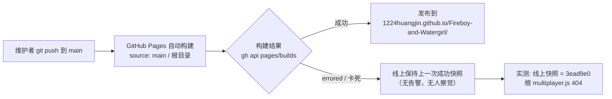
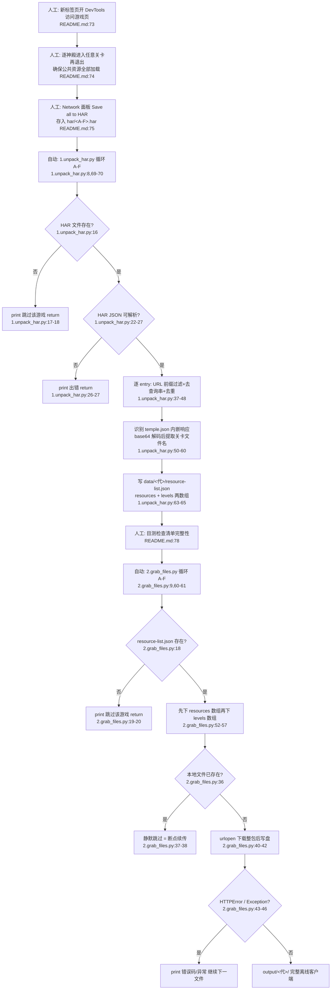
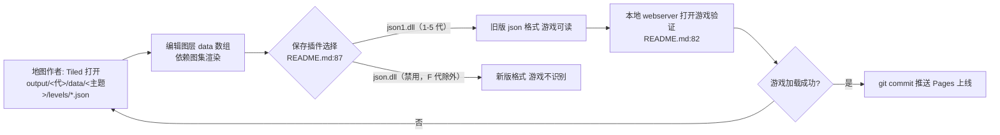
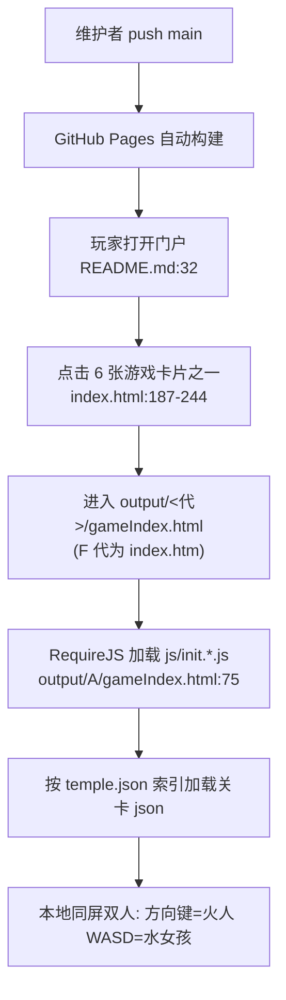
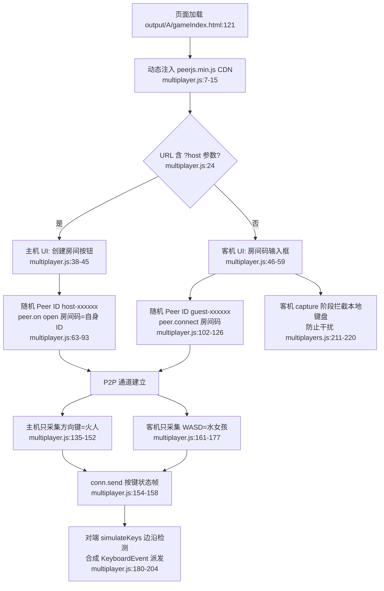

# Fireboy-and-Watergirl（森林冰火人全系列批量抓取与在线游玩）— 项目工作流分析报告

**分析时间**：2026-09-30 11:35
**分析范围**：`D:\Guiyuan1111\GitHub\slbhr\Fireboy-and-Watergirl`
**分析模式**：完整分析（3 个 Python 脚本、index.html、multiplayer.js 全文精读；har/ 仅统计未读取；关卡 json 仅头部采样；线上站点经 HTTP 实测、GitHub Pages 经 gh API 实测）

---

## 0. 执行摘要

本项目是一个**纯人工触发、零 CI、零测试的静态资源抓取与发布流水线**：人工用浏览器 DevTools 导出 6 个 HAR（约 156 MB），两个 Python 脚本将其转为资源清单并批量下载为 6 个离线 H5 游戏客户端，再经 GitHub Pages 单分支直发上线。四个核心工作流（抓取 / 关卡编辑 / 部署游玩 / 多人补丁）全部依赖人工把关，唯一的自动化质量关卡是"断点续传式跳过已存在文件"。**实测发现线上部署管线自 2026-07-05 起处于 errored/卡死状态，线上快照停留在旧提交，且多人补丁脚本在线上 404 静默失效。**

---

## 1. CI/CD 管线与交付基础设施

**状态**：未发现 CI/CD 配置。

### 1.1 管线事实

| 检查项 | 结果 | 证据 |
|--------|------|------|
| GitHub Actions workflow | 不存在（仓库无 `.github/` 目录） | 根目录 `ls` 与 `git ls-files` 均无 `.github` 条目 |
| package.json / 构建配置 | 不存在 | `git ls-files` 根层仅 14 个非 output/har 文件 |
| 测试文件 | 不存在（无 `test*`/`*_test*`/`spec*` 模式文件） | `find` / `git ls-files` 检索为空 |
| Git 分支 | 仅 `main` 单分支（本地 = origin/main = 8568034） | `git branch -a` |
| Tag | 仅 `V0`，指向 fe2dc76（第 7 个 commit） | `git tag -n1` |
| 部署方式 | GitHub Pages 从 `main` 分支根目录自动构建 | `gh api repos/1224HuangJin/Fireboy-and-Watergirl/pages` → `{"source":{"branch":"main","path":"/"},"status":"errored"}` |
| 回滚机制 | 无显式机制；隐式回滚 = git revert/push 触发 Pages 重建 | 8568034 即对 8ce1047 的一次事实性回退（见 §2.4） |

### 1.2 实际生效的"部署管线"（GitHub Pages 自动构建）

**管线实测结论（2026-09-30 取证）**：

| 事实 | 证据 |
|------|------|
| Pages 站点整体状态 `errored` | `gh api repos/1224HuangJin/Fireboy-and-Watergirl/pages` 返回 `status: errored` |
| 最新构建（8568034）自 2026-07-05T16:39:04Z 起卡在 `building`，duration=0 | `gh api repos/.../pages/builds/latest` |
| 前一提交 8ce1047 的两次构建均 `errored` | `gh api repos/.../pages/builds?per_page=3` |
| 线上快照与 3ead9e0（第 9 个 commit）文件形态完全一致：根 `multiplayer.js` → HTTP 404、`output/multiplayer.js` → HTTP 200、门户 → 200 | `curl -sI` 对 4 个线上 URL 实测 |
| 仓库把 6 个 HAR（约 156 MB）也发布到了线上（`/har/A.har` → HTTP 200） | `curl -sI https://1224huangjin.github.io/Fireboy-and-Watergirl/har/A.har` |

> 推断（基于上述证据）：线上站点最后成功构建为 3ead9e0（2026-07-05），此后两次代码提交（6cd4b37、8568034）从未上线。构建失败原因 API 未返回错误详情；仓库含 156 MB HAR + 706 个跟踪文件（打包体积 47,960 KB，`gh api repos/... --jq .size`），体量偏大是合理怀疑方向，但未经证实。

---

## 2. 核心业务流程映射（四类工作流）

### 2.1 资源抓取工作流（浏览器 → HAR → 清单 → output/）

**涉及模块**：`1.unpack_har.py`（70 行）、`2.grab_files.py`（63 行）、`common.py`（18 行）、`har/A-F.har`、`data/A-F/resource-list.json`、`output/A-F/`
**参与角色**：抓取者（人工，浏览器操作与清单目检）、两个 Python 脚本（自动）、源站 `apps.ak-ioi.com`（被下载方）

**人工步骤 vs 自动步骤边界**：

| 阶段 | 执行者 | 内容 | 证据 |
|------|--------|------|------|
| 资源发现 | 人工 | 浏览器操作触发全部资源加载（HAR 只记录实际发生过的请求） | `README.md:74` |
| 数据导出 | 人工 | DevTools 导出 HAR、按 `A-F.har` 命名放入 `har/` | `README.md:75`、`common.py:7` |
| 配置 | （已失效的人工步骤） | README 步骤 4 要求"修改 common.py 的 grab_url/har_path"，但现版 common.py 已模板化，无需手工设置 | `README.md:76` vs `common.py:4-18` |
| 清单生成 | 自动 | 6 代循环解析 HAR → `data/<代>/resource-list.json` | `1.unpack_har.py:69-70`、输出行数实测 119/112/124/110/144/115 行 |
| 质量把关 | 人工 | "Inspect data/resource-list.json manually" 是全流程唯一质量关卡 | `README.md:78` |
| 批量下载 | 自动 | 6 代 × (resources + levels) 逐文件下载 | `2.grab_files.py:52-57` |
| 结果验证 | 人工 | 浏览器经本地 webserver 打开验证 | `README.md:82` |

**产出规模**（实测）：output/ 每代文件数 A:112 / B:105 / C:117 / D:103 / E:137 / F:109，仓库共 706 个跟踪文件；HAR 输入 6 个共约 156 MB（du: 19+23+27+32+27+28 MB）。

---

### 2.2 关卡编辑工作流（Tiled + 关卡 json）

**涉及模块**：`output/<代>/data/<主题>/temple.json`（关卡索引）、`output/<代>/data/<主题>/levels/*.json`（Tiled 地图）、`output/<代>/assets/atlasses/`（图集）
**参与角色**：地图作者（人工）、Tiled 编辑器（外部工具）、游戏引擎（运行时加载与隐式校验）

**数据组织方式**（实测）：

- 每代两个主题目录：主题 + `tutorials`，映射为 A=forest、B=light、C=ice、D=crystal、E=elements、F=fairytales（`ls output/*/data`）。
- 关卡索引 `temple.json`：`{"index":0,"id":"forest","label":"forest temple","color":"#5B4610","type":"tree","levels":[{"id":1,"x":0.5,"y":0.9,"filename":"tutorials/levels/forest_01.json","time":40,"mobileTime":70,"required":0,...}]}`（`output/A/data/forest/temple.json` 头部采样）。`levels[].filename` 是游戏加载关卡 json 的依据。
- 关卡文件即 Tiled 标准导出 JSON：`forest_02.json` 头部为 `{"compressionlevel":-1,"height":29,"infinite":false,"layers":[{"data":[1,1,...]}]}`（`output/A/data/forest/levels/forest_02.json` 头部采样，全文 6,554 字节单行）。
- 抓取链路中的关卡发现：`1.unpack_har.py:33-35` 的 `push_levels` 从 temple.json 提取 `filename` 并加 `data/` 前缀写入清单 `levels` 数组；`1.unpack_har.py:47-48` 特意把 URL 含 `/levels/` 的条目排除出 `resources`，避免关卡被重复归类。
- 关卡数量（实测，含 tutorials）：A:48 / B:41 / C:53 / D:39 / E:39 / F:32。

**工作流缺口**：README 声称提供 `tiled-atlasses/` 图集目录（`README.md:49`、`README.md:86`），**但该目录在仓库中不存在**（`git ls-files | grep -i tiled` 为空；实际图集位于 `output/<代>/assets/atlasses/`）。关卡 json 也没有任何 schema 校验脚本，编辑错误的唯一发现途径是游戏加载失败。

---

### 2.3 部署与游玩工作流（GitHub Pages 门户）

**涉及模块**：`index.html`（252 行门户）、`output/A-F/`、GitHub Pages
**参与角色**：维护者（push）、GitHub Pages（自动构建）、玩家（浏览器）

**门户索引方式**（相对路径链接，实测行号）：

| 代 | 链接 href | 位置 |
|----|-----------|------|
| 1（森林神庙） | `output/A/gameIndex.html` | `index.html:187` |
| 2（光明神庙） | `output/B/gameIndex.html` | `index.html:197` |
| 3（寒冰圣殿） | `output/C/gameIndex.html` | `index.html:207` |
| 4（水晶殿） | `output/D/gameIndex.html` | `index.html:217` |
| 5（元素） | `output/E/gameIndex.html` | `index.html:227` |
| 6（童话） | `output/F/index.htm`（唯一例外，非 gameIndex.html） | `index.html:237` |

- 相对路径使门户对 GitHub Pages 子路径部署（`/Fireboy-and-Watergirl/`）与本地 serve 均天然兼容——这正是 README 所述"静态路径解耦"改造（`README.md:61`）。
- 在线地址声明于 `README.md:32`：`https://1224HuangJin.github.io/Fireboy-and-Watergirl/`（实测门户返回 200）。
- 页脚含两个外链：GitHub 仓库与原版游戏站 `apps.ak-ioi.com`（`index.html:248`）。

**本地游玩必须本地 webserver 的原因**：游戏入口页通过 RequireJS 异步加载模块——``（`output/A/gameIndex.html:121`）；B-F 各代入口均未引用（全仓 grep 仅此一处）。`/` 开头的绝对路径以"域名根"解析——在"仓库根即 webserver 根"的本地 serve 场景可用，但在 GitHub Pages 项目站（内容挂在 `/Fireboy-and-Watergirl/` 子路径下）会解析到 `https://1224huangjin.github.io/multiplayer.js`（实测 404）。

**git 演进（5 个相关 commit，2026-07-05 当天完成全部试错）**：

| # | Commit | 信息 | 变更 | 效果 |
|---|--------|------|------|------|
| 1 | 14f6562 | `AI 叫我这样可以添加多人的（）` | 新增 `output/multiplayer.js`（170 行，CDN 加载 `@poki/netlib@0.2.0`，`output/multiplayer.js:4`） | 引入方案 A |
| 2 | 3ead9e0 | `AI 叫我这样可以添加多人的（）` | `output/A/gameIndex.html` +1 行 `<script src="/multiplayer.js">` | 注入引用（线上现存快照即此状态） |
| 3 | 8ce1047 | `AI 叫我这样可以添加多人的（）` | src 改为全 URL `https://1224huangjin.github.io/Fireboy-and-Watergirl/output/multiplayer.js` | 修正 Pages 路径（该 URL 实测 200）|
| 4 | 6cd4b37 | `Create multiplayer.js` | 新增根 `multiplayer.js`（220 行，改用 PeerJS 1.5.1，`multiplayer.js:9`） | 引入方案 B，方案 A 变为孤儿文件 |
| 5 | 8568034 | `Update multiplayer.js script source path` | src 从全 URL 回退为 `/multiplayer.js` | 事实性 revert——放弃了第 3 步的修复 |

**运行时流程（根 multiplayer.js，PeerJS 方案）**：

**线上失效证据链**：线上 `output/A/gameIndex.html` 确含 `<script src="/multiplayer.js">`（curl 抓取第 121 行）；该 src 解析目标 `https://1224huangjin.github.io/multiplayer.js` 实测 404；`<script>` 404 属静默失败（无控制台 UI 提示），玩家不可感知。叠加 §1.2 的构建 errored，**多人功能在线上从未生效，且最后一次提交（8568034）主动回退了唯一的正确路径修复**。

---

## 3. 开发与交付工作流（git 历史叙事）

**分支策略**：单 `main` 分支直达生产（GitHub Pages source = main / root），无 PR、无 review、无环境保护（`git branch -a` 仅 main）。

**12 个 commit 的三阶段演进**（`git log --stat` 实测）：

| 阶段 | 时间 | Commits | 内容 |
|------|------|---------|------|
| 一、成品批量上传 | 2026-05-15 | a135677（1224HuangJin，唯一一次提交）：3 个 py + LICENSE + README + 6 份清单 + **701 个文件 / +1,021,229 行**（整个 output/ 全系列成品）；adb015e（夜影）：README 中英双语 + index.html 门户 252 行 + img 两图 | 一次性把"工具 + 抓取成果"整体入库 |
| 二、文档与链接修缮 | 2026-05-15~16 | 45c367d 免责声明；3a33194 README 细化；e2536b8 修 README 链接大小写；0e587ea 修 `.html`→`.htm`；fe2dc76 修 Game 6 链接（**V0 tag 打于此**） | 全是文档级小修，其中 3 个 commit 用于修正链接——门户链接靠人肉点验 |
| 三、多人补丁试错 | 2026-07-05 | 5 个 commit（§2.4 表） | 同一天内 A/B 两套技术方案（@poki/netlib → PeerJS）+ 一次路径修复 + 一次回退 |

**贡献者**：夜影、NightShadow 11 次；1224HuangJin 1 次（`git shortlog -sn`）。
**AI 参与开发的直接自述**：README 声明 ".py 文件的优化版皆由 AI 升级"（`README.md:17-19`）；`index.html:1` 首行注释 "ALL CODE ON THIS FILE IS BY AI"；commit 信息 "AI 叫我这样可以添加多人的（）"。
**工程规范现状**：无 CI（§1.1）、无测试、无 linter、无版本号文件（仅一个孤例 tag V0）、commit 信息中英混杂且口语化。

---

## 4. 决策树提取（3 个 py 文件全部条件分支）

### 4.1 `1.unpack_har.py`（9 条分支）

| # | 判断条件（原文） | 分支路径 | 代码位置 |
|---|------------------|----------|----------|
| B1 | `if not path.exists(har_path):` | 真 → `print("跳过 ...")` + `return`（跳过该游戏）；假 → 继续解析 | `1.unpack_har.py:16-18` |
| B2 | `except Exception as e:`（HAR 打开/`json.load`） | 触发 → `print("读取 ... 出错")` + `return` | `1.unpack_har.py:25-27` |
| B3 | `if url.startswith(grab_url_base):` | 真 → 进入 URL 清洗；假 → 该 entry 完全忽略 | `1.unpack_har.py:40` |
| B4 | `if '?' in clean_url:` | 真 → `clean_url.split('?')[0]` 去缓存查询串 | `1.unpack_har.py:42-43` |
| B5 | `if not hash_list.get(clean_url):` | 真 → `hash_list[clean_url]=True` 并收集；假 → 丢弃重复条目 | `1.unpack_har.py:45-46` |
| B6 | `if '/levels/' not in clean_url:` | 真 → 追加进 `resources`；假 → 不进（关卡只经 temple.json 途径收集） | `1.unpack_har.py:47-48` |
| B7 | `if '/temple.json' in url:` | 真 → 解析内嵌 temple 响应提取关卡；假 → 跳过 | `1.unpack_har.py:50` |
| B8 | `if content.get('encoding') == 'base64':` | 真 → `base64.b64decode(...).decode('utf-8')` | `1.unpack_har.py:54-55` |
| B9 | `except:`（裸 except 包住 temple 解析） | 触发 → `print("警告: 解析 ... 失败")` 继续循环 | `1.unpack_har.py:59-60` |

### 4.2 `2.grab_files.py`（4 条分支）

| # | 判断条件（原文） | 分支路径 | 代码位置 |
|---|------------------|----------|----------|
| B10 | `if not path.exists(resource_list_path):` | 真 → `print("跳过 ...")` + `return`；假 → 加载清单 | `2.grab_files.py:18-20` |
| B11 | `if path.exists(save_path):` | 真 → `return`（跳过已存在文件 = 断点续传）；假 → 执行下载 | `2.grab_files.py:36-38` |
| B12 | `except HTTPError as err:` | 触发 → `print(f"    错误 {err.code}: ...")`，继续下一文件（无重试） | `2.grab_files.py:43-44` |
| B13 | `except Exception as e:` | 触发 → `print(f"    发生异常: {e}")`，继续下一文件（无重试） | `2.grab_files.py:45-46` |

### 4.3 `common.py`

无任何条件分支，纯常量 + 2 个格式化函数（`common.py:13-14`、`common.py:17-18`）。

**Python 侧决策分支合计：13 条。**

### 4.4 `multiplayer.js` 主要分支（补充，8 条）

| # | 判断条件 | 分支路径 | 代码位置 |
|---|----------|----------|----------|
| M1 | `urlParams.has('host')` | 主机 UI / 客机 UI 二选一 | `multiplayer.js:24,38,46` |
| M2 | 点击加入时 `if (code)` | 空房间码不动作 | `multiplayer.js:55-58` |
| M3 | `peer.on('open')` / `peer.on('error')` | 成功建 Peer / UI 显示失败信息（无重试） | `multiplayer.js:72,95-98,108,128-131` |
| M4 | `conn.on('data')` 中 `data.type === 'keys'` | 仅处理按键帧 | `multiplayer.js:83-88,117-122` |
| M5 | `allowedKeys.includes(e.key)`（keydown/keyup 两处） | 只采集白名单键 | `multiplayer.js:139,145,163,169` |
| M6 | `if (conn && conn.open)` | 通道未开则静默丢弃发送 | `multiplayer.js:155-157` |
| M7 | `keysObj[key] && !state[key]` / `!keysObj[key] && state[key]` | 按键状态边沿检测，合成 keydown/keyup 去重 | `multiplayer.js:189-203` |
| M8 | `if (!isHost)` | 客机在 capture 阶段 `stopPropagation+preventDefault` 拦截本地键盘 | `multiplayer.js:211-220` |

---

## 5. 业务规则量化：硬编码常量清单

| # | 常量名/含义 | 值 | 位置 |
|---|-------------|-----|------|
| C1 | 游戏代号循环列表 `games` | `['A','B','C','D','E','F']` | `1.unpack_har.py:8`、`2.grab_files.py:9`（两处重复定义） |
| C2 | 源站 URL 模板 `grab_url_template` | `https://apps.ak-ioi.com/fireboy-and-watergirl/{}/dist/`（`{}`←A-F） | `common.py:4` |
| C3 | HAR 目录 `har_dir` | `./har` | `common.py:7` |
| C4 | 数据目录 `data_dir` | `./data` | `common.py:10` |
| C5 | 清单路径模板 | `{data_dir}/{game_code}/resource-list.json` | `common.py:13-14` |
| C6 | 抓取 URL 拼接 | `grab_url_template.format(game_code)` | `common.py:17-18` |
| C7 | 下载输出目录 | `output/{game_code}`（字面量 `"output"` 硬编码于 join） | `2.grab_files.py:16` |
| C8 | 关卡路径前缀 | `'data/' + item['filename']` | `1.unpack_har.py:35` |
| C9 | 关卡排除判断串 | `'/levels/'` | `1.unpack_har.py:47` |
| C10 | 关卡索引识别串 | `'/temple.json'` | `1.unpack_har.py:50` |
| C11 | HAR 内容编码标识 | `'base64'` | `1.unpack_har.py:54` |
| C12 | 清单 JSON 缩进 | 2 空格（`indent='  '`） | `1.unpack_har.py:65` |
| C13 | PeerJS CDN | `https://unpkg.com/peerjs@1.5.1/dist/peerjs.min.js` | `multiplayer.js:9` |
| C14 | 旧方案 netlib CDN | `https://unpkg.com/@poki/netlib@0.2.0/dist/netlib.umd.js` | `output/multiplayer.js:4` |
| C15 | PeerJS 调试级别 | `debug: 2` | `multiplayer.js:68,106` |
| C16 | Peer 随机 ID 规则 | `'host-'/'guest-' + Math.random().toString(36).substr(2,6)` | `multiplayer.js:66,105` |
| C17 | 主机键白名单 | `ArrowUp/ArrowDown/ArrowLeft/ArrowRight` | `multiplayer.js:137` |
| C18 | 客机键白名单 | `w/W/a/A/s/S/d/D` | `multiplayer.js:162` |
| C19 | 主机判定参数 | URL 查询参数 `?host` | `multiplayer.js:24` |
| C20 | 多人脚本引用路径 | `/multiplayer.js`（域名根绝对路径） | `output/A/gameIndex.html:121` |
| C21 | 在线游玩地址 | `https://1224HuangJin.github.io/Fireboy-and-Watergirl/` | `README.md:32` |
| C22 | 门户六卡链接 | `output/A-E/gameIndex.html`、`output/F/index.htm` | `index.html:187,197,207,217,227,237` |
| C23 | 多人 UI 挂载定位 | `fixed; top:20px; right:20px; z-index:9999` | `multiplayer.js:29-35` |

---

## 6. 异常恢复路径表

| 流程步骤 | 可能失败点 | 处理方式 | 有无恢复策略 | 代码位置 / 判定 |
|----------|-----------|----------|--------------|-----------------|
| 人工导出 HAR | 资源导航不全 → HAR 缺条目 | 无程序检测；仅靠人工"目测清单"兜底 | 部分（人工兜底，无校验） | `README.md:74,78` |
| 1.unpack_har 输入 | HAR 文件缺失 | print 跳过该游戏，继续其余代 | 有（跳过式恢复） | `1.unpack_har.py:16-18` |
| 1.unpack_har 输入 | HAR JSON 损坏/编码异常 | print 出错并 return | 有（跳过式恢复） | `1.unpack_har.py:25-27` |
| 1.unpack_har 解析 | temple.json 内嵌内容解析失败 | print 警告，继续后续 entry | 部分——**裸 `except:` 吞掉具体异常原因，且该 temple 的全部关卡静默从清单消失** | `1.unpack_har.py:59-60` |
| 1.unpack_har 输出 | data 目录不存在 | `os.makedirs(..., exist_ok=True)` 预建 | 有 | `1.unpack_har.py:63` |
| 2.grab_files 输入 | resource-list.json 缺失 | print 跳过该游戏 | 有（跳过式恢复） | `2.grab_files.py:18-20` |
| 2.grab_files 下载 | 目标文件已存在（重复运行） | 静默跳过，实现断点续传 | 有（幂等重跑） | `2.grab_files.py:36-38` |
| 2.grab_files 下载 | 目标父目录缺失 | `os.makedirs(..., exist_ok=True)` | 有 | `2.grab_files.py:32` |
| 2.grab_files 下载 | HTTP 404/403 等错误 | print 错误码，继续下一文件 | **无重试** | `2.grab_files.py:43-44` |
| 2.grab_files 下载 | 网络中断/超时/URLError | print 异常，继续下一文件 | **无重试、`urlopen` 未设 timeout，可无限阻塞** | `2.grab_files.py:40,45-46` |
| 2.grab_files 写盘 | 进程中途被杀 → 截断文件残留 | 下次重跑被 exists-skip 永久跳过 | **缺乏容错：坏文件无检测（无大小/hash 校验）无修复** | `2.grab_files.py:36-42` |
| 部署 | Pages 构建 errored | 无任何通知/监控；线上停留旧快照 | **缺乏容错：实测自 2026-07-05 卡死至今** | `gh api .../pages` status=errored |
| 线上运行 | `/multiplayer.js` 404（路径语义+构建失败双重原因） | `<script>` 静默失败，玩家无感知 | **缺乏容错** | `output/A/gameIndex.html:121` + curl 实测 404 |
| 多人连接 | PeerJS 创建/加入失败 | UI 显示错误文本 | 无自动重试 | `multiplayer.js:95-98,128-131` |
| 多人连接 | 对端断开（conn close） | UI 提示"已断开" | **无自动重连** | `multiplayer.js:89-91,123-125` |
| 关卡编辑 | 编辑出坏的关卡 json | 无校验工具，仅能靠游戏加载失败人肉发现 | **缺乏容错** | `README.md:84-88`（仅提示 json1.dll 插件规则） |
| 版本回退 | 需要撤销线上错误 | 无发布物存档/环境；唯一手段是再 commit | 隐式（8568034 即一次人肉 revert，但方向存疑） | `git log` §2.4 |

---

## 7. 工作流健康度评估

| 维度 | 评分（1-5） | 说明 |
|------|------------|------|
| 自动化程度 | 2 | 抓取/下载两环自动，但发现资源、验收清单、部署验证全靠人工（`README.md:74,78`） |
| 可重复性 | 3 | 断点续传幂等（`2.grab_files.py:36-38`），但 13 条分支中 6 条是"跳过"，失败件不补账 |
| 容错与恢复 | 1 | 截断文件永久残留、无 timeout、无重试、Pages errored 三个月无人知（§6） |
| 文档一致性 | 2 | README 与现实至少 4 处脱节：`tiled-atlasses/` 不存在（`README.md:49,86`）、步骤 4 配置说明过时（`README.md:76` vs `common.py`）、"每代含 gameIndex.html"与 F 代 `index.htm` 不符（`README.md:43` vs `index.html:237`）、清单路径少写代目（`README.md:78`） |
| 交付可靠性 | 1 | 单分支直发 + 无 CI + 无监控；线上多人功能静默失效即为实例 |
| AI 可替代性潜力 | 4 | 全部逻辑为确定性 URL 变换 + 文件搬运，输入输出边界清晰（详见 04 报告） |

---

## 附录：证据取样说明

- Python 脚本（`1.unpack_har.py` 70 行 / `2.grab_files.py` 63 行 / `common.py` 18 行）、`index.html`（252 行）、`multiplayer.js`（220 行）、`output/multiplayer.js`（前 30 行比对）全文/采样精读。
- `har/` 仅 `du` 统计体积、`git ls-files` 确认跟踪，未读取内容。
- 关卡 json 仅头部 600 字节采样（`output/A/data/forest/levels/forest_02.json`）；temple.json 头部 300 字节采样。
- 线上证据：4+ 个 URL 的 `curl -sI` 状态码实测 + 部署页面 HTML 抓取（2026-09-30）。
- GitHub API：`gh api repos/1224HuangJin/Fireboy-and-Watergirl/pages`、`/pages/builds`（2026-09-30）。
