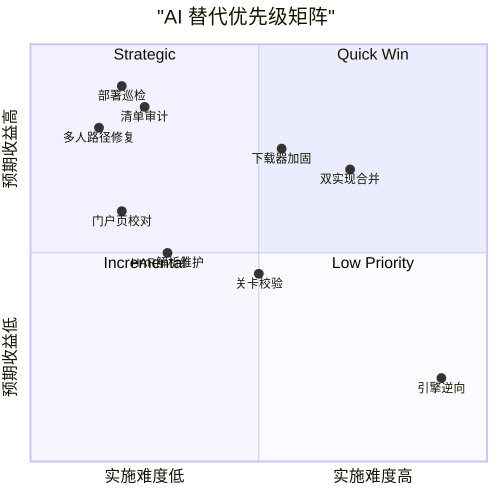

# Fireboy-and-Watergirl — AI 工作流替代方案报告

**分析时间**：2026-09-30_113536
**分析范围**：`D:\Guiyuan1111\GitHub\slbhr\Fireboy-and-Watergirl`
**自有源码规模**：5 个文件，约 620 行（3 个 Python 共 148 行 + `index.html` 252 行 + `multiplayer.js` 220 行），另有一份 170 行的孤儿补丁 `output/multiplayer.js`

---

## 1. 评估方法论

### 评分维度

| 维度 | 说明 | 低分（1-2） | 高分（4-5） |
|------|------|------------|------------|
| 确定性 | 输出是否可预测 | 高度创造性 | 完全确定性 |
| 输入结构化 | 输入是否边界清晰 | 模糊开放 | 严格结构化 |
| 安全风险 | 出错影响 | 灾难性 | 无影响 |
| 领域复杂度 | 所需专业程度 | 需要专家 | 通用知识 |
| 上下文需求 | 处理所需信息量 | 需整个代码库 | 局部即可 |
| 重复性 | 任务发生频率 | 一次性 | 高频重复 |

### 分级标准

| 等级 | 总分 | 策略 |
|------|------|------|
| 🤖 完全 AI 化 | 24-30 | AI 直接执行，无需人工介入 |
| 🧑‍💻 AI 辅助 | 15-23 | AI 生成初稿，人工审核后落地 |
| 👤 人工主导 | 6-14 | AI 仅提供参考，核心判断由人完成 |

**本项目特殊性**：README.md:17-19 自述 `.py` 文件的优化版"皆由 AI 升级"，git 历史中多人补丁的三次提交信息均为"AI 叫我这样可以添加多人的（）"（git log `14f6562`/`3ead9e0`/`8ce1047`）——本仓库的既有开发模式已经是"AI 生成 + 人工直接采纳"，AI 辅助改造存在实证基础，但也暴露了缺乏审核环节的问题（详见各模块卡片）。

---

## 2. 模块级评估

### 模块 1：配置中心 `common.py`

**路径**：`common.py`
**规模**：1 个文件，17 行，2 个函数

**6 维评分**：

| 确定性 | 输入结构化 | 安全风险 | 领域复杂度 | 上下文需求 | 重复性 | 总分 |
|--------|-----------|---------|-----------|-----------|-------|------|
| 5 | 5 | 4 | 5 | 5 | 4 | **28/30** |

**结论**：🤖 **完全 AI 化**

**当前人工做法**：手动维护 URL 模板 `https://apps.ak-ioi.com/fireboy-and-watergirl/{}/dist/`（`common.py:4`）与目录常量 `./har`（`common.py:7`）、`./data`（`common.py:10`）。

**AI 替代方式**：源站域名或目录结构变化时，AI 直接读取两个脚本的引用点并同步修改配置，保持单一事实源。

**预期收益**：配置漂移风险归零（当前 `games = ['A'..'F']` 在 `1.unpack_har.py:8` 与 `2.grab_files.py:9` 双处重复，正是缺少集中管理的症状）。

**风险与限制**：几乎无；仅源站 URL 变更需要人工确认一次。

**优先级**：⭐ 低（改动频率低），作为其他 Skill 的附属能力。

---

### 模块 2：HAR 解析器 `1.unpack_har.py`

**路径**：`1.unpack_har.py`
**规模**：1 个文件，69 行，主函数 `process_game(gc)` 57 行（`:10`）+ 闭包 `push_levels`（`:33`）

**6 维评分**：

| 确定性 | 输入结构化 | 安全风险 | 领域复杂度 | 上下文需求 | 重复性 | 总分 |
|--------|-----------|---------|-----------|-----------|-------|------|
| 4 | 5 | 3 | 4 | 5 | 3 | **24/30** |

**结论**：🤖 **完全 AI 化**

**当前人工做法**：HAR 格式或源站结构变化时人工调整过滤逻辑（前缀匹配 `:40`、hash 去重 `:42-46`、`/levels/` 分流 `:47-48`、temple.json base64 解码重建关卡清单 `:53-58`）。

**AI 替代方式**：给定新 HAR 样本，AI 解析结构差异、定位需修改的过滤条件并生成补丁；`process_game` 仅 6 个 if + 2 个 try/except，函数级圈复杂度低，AI 完全可驾驭。

**预期收益**：适配新版本游戏（如未来第 7 代）时，解析器改造从小时级降到分钟级。

**风险与限制**：`1.unpack_har.py:59` 存在裸 `except:` 静默吞掉 temple.json 解析失败（关卡清单会静默为空）——AI 修改时必须同步修复此缺陷，否则错误会被掩盖。

**优先级**：⭐⭐ 中。**对应 Blueprint**：无独立 Blueprint（并入 [blueprints/01-resource-list-auditor.md](blueprints/01-resource-list-auditor.md) 的验证闭环）。

---

### 模块 3：清单人工目检工作流（AI 自动审计替代）

**路径**：工作流步骤位于 README.md:78"Inspect data/resource-list.json manually"，产物为 `data/{A..F}/resource-list.json`（resources + levels 两个字符串数组，A 作为 66+48 项）

**6 维评分**：

| 确定性 | 输入结构化 | 安全风险 | 领域复杂度 | 上下文需求 | 重复性 | 总分 |
|--------|-----------|---------|-----------|-----------|-------|------|
| 5 | 5 | 4 | 4 | 4 | 4 | **26/30** |

**结论**：🤖 **完全 AI 化**

**当前人工做法**：跑完阶段一后打开 6 份清单"人工目测"——这是整条抓取流水线**唯一的质量关卡**，而它检查的是上千条 URL 字符串，人工实际只能扫一眼。

**AI 替代方式**：AI 交叉比对 HAR 条目数 ↔ 清单项数 ↔ `output/` 实际落盘文件数，并按 temple.json 声明的关卡数核对 levels 数组，输出差异报告。实测证据：当前 6 代全部缺失 manifest.json 与图标文件（详见 [02-operation-principles.md](02-operation-principles.md) 第 5 节缺陷①），说明人工目检从未真正发现资源缺口。

**预期收益**：资源完整性缺口从"上线后玩家发现"提前到"提交前机器发现"；本报告发现的"6 代全缺 manifest"类问题将不再发生。

**风险与限制**：HAR 本身未覆盖的资源（人工导航遗漏）AI 无法凭空发现，需配合浏览器侧导航清单。

**优先级**：⭐⭐⭐ **高 — Quick Win**。**对应 Blueprint**：[blueprints/01-resource-list-auditor.md](blueprints/01-resource-list-auditor.md)

---

### 模块 4：批量下载器 `2.grab_files.py`

**路径**：`2.grab_files.py`
**规模**：1 个文件，62 行，主函数 `grab_game_resources(gc)` 47 行（`:11`）+ 闭包 `grab_file(ru)` 20 行（`:27`）

**6 维评分**：

| 确定性 | 输入结构化 | 安全风险 | 领域复杂度 | 上下文需求 | 重复性 | 总分 |
|--------|-----------|---------|-----------|-----------|-------|------|
| 4 | 4 | 3 | 4 | 4 | 3 | **22/30** |

**结论**：🧑‍💻 **AI 辅助**

**当前人工做法**：无重试、无超时、无校验和的串行下载（`urlopen` 无 timeout，`:40`；失败仅 print 后继续，`:43-46`；断点续传 = `if path.exists(save_path): return`，`:36-38`；终态恒报"完成"，`:63`）。

**AI 替代方式**：AI 生成加固版下载器（超时 + 重试 + 失败清单 + 完整性校验 + 可选并发），人工审核网络行为参数后落地。网络代码的边界行为（弱网、半截文件）必须人工验证，故定为 AI 辅助。

**预期收益**：消除 12 项容错缺陷中最关键的 5 项（详见 [02-operation-principles.md](02-operation-principles.md)）；重跑成本从"全量重下"降为"只补失败项"。

**风险与限制**：并发过高可能触发源站限流；需人工确认重试策略不会对源站造成压力（本仓库声明非营利用途，应保守）。

**优先级**：⭐⭐⭐ **高 — Strategic**。**对应 Blueprint**：[blueprints/02-downloader-hardening.md](blueprints/02-downloader-hardening.md)

---

### 模块 5：门户页 `index.html`

**路径**：`index.html`
**规模**：1 个文件，252 行（游戏卡片列表 `:187-237`）

**6 维评分**：

| 确定性 | 输入结构化 | 安全风险 | 领域复杂度 | 上下文需求 | 重复性 | 总分 |
|--------|-----------|---------|-----------|-----------|-------|------|
| 4 | 4 | 4 | 4 | 5 | 3 | **24/30** |

**结论**：🤖 **完全 AI 化**

**当前人工做法**：手工维护 6 张游戏卡片；git 历史显示曾连续 3 个 commit 修链接（`0e587ea` 扩展名 `.html`→`.htm`、`e2536b8` 大小写、`fe2dc76` 指向）——纯机械劳动。

**AI 替代方式**：AI 扫描 `output/{A..F}/` 实际入口文件（A-E 为 `gameIndex.html`，F 为 `index.htm`，结构本就分叉）自动生成/校对卡片链接与标题。

**预期收益**：链接类 bug（历史上 3 连修）根除；新增第 7 代时门户页零手工。

**风险与限制**：视觉设计仍需人工把关（当前页面的美术风格是人工成果）。

**优先级**：⭐⭐ **中 — Quick Win**。**对应 Blueprint**：[blueprints/03-portal-page-generator.md](blueprints/03-portal-page-generator.md)

---

### 模块 6：部署与链接巡检（GitHub Pages）

**路径**：部署目标 README.md:32（`https://1224HuangJin.github.io/Fireboy-and-Watergirl/`）；涉及 `output/A/gameIndex.html:121`（`/multiplayer.js` 根绝对路径注入）与 README.md:49（引用不存在的 `tiled-atlasses/` 目录）

**6 维评分**：

| 确定性 | 输入结构化 | 安全风险 | 领域复杂度 | 上下文需求 | 重复性 | 总分 |
|--------|-----------|---------|-----------|-----------|-------|------|
| 5 | 4 | 4 | 5 | 5 | 4 | **27/30** |

**结论**：🤖 **完全 AI 化**（巡检与报告部分；修复提交需人工批准后执行）

**当前人工做法**：无任何巡检。实测：GitHub Pages 构建自 2026-07-05 起 errored 卡死，线上快照停留在 `3ead9e0`，最后两个 commit（含多人补丁修复）从未上线而无人察觉；`/multiplayer.js` 在项目站子路径下 404，多人功能静默失效。

**AI 替代方式**：AI 定期巡检——Pages 构建状态（gh api）、线上链接 404 扫描（curl 抽样）、README 引用路径存在性核对、线上版本与 HEAD 差异比对，输出巡检报告。

**预期收益**：本次分析发现的"部署三月失联"类事故将在数小时内暴露而非三个月。

**风险与限制**：巡检只读无风险；自动修复需谨慎（上次自动"修复"`8ce1047` 全 URL 又被 `8568034` 回退，说明修复策略需要人工定夺）。

**优先级**：⭐⭐⭐ **高 — Quick Win**。**对应 Blueprint**：[blueprints/04-deployment-guardian.md](blueprints/04-deployment-guardian.md)

---

### 模块 7：多人补丁 `multiplayer.js`（双实现）

**路径**：根目录 `multiplayer.js`（220 行，PeerJS 1.5.1）；`output/multiplayer.js`（约 170 行，@poki/netlib，无任何页面引用——死代码）
**规模**：2 个文件，约 390 行，合计 14 个函数（函数级清单见 [01-architecture.md](01-architecture.md) 函数清单表）

**6 维评分**：

| 确定性 | 输入结构化 | 安全风险 | 领域复杂度 | 上下文需求 | 重复性 | 总分 |
|--------|-----------|---------|-----------|-----------|-------|------|
| 3 | 3 | 2 | 3 | 3 | 3 | **17/30** |

**结论**：🧑‍💻 **AI 辅助**（高优先级：线上功能当前完全失效）

**当前人工做法**：git 历史显示典型"AI 生成 → 直接采纳 → 出问题 → 再让 AI 改"循环：根版守卫块在解析期无条件安装键盘拦截（`multiplayer.js:211`，isHost 时序缺陷）；netlib 版已修复为 isSyncing 门控（`output/multiplayer.js:157`）但成为孤儿文件；两版行为已分叉。

**AI 替代方式**：AI 负责路径修复（一行）、双实现差异分析、合并方案生成与时序缺陷修复；**人工必须**在真实双人环境验证按键同步体验（合成 KeyboardEvent 是否被 Phaser 输入系统正确消费，无法静态保证）。

**预期收益**：线上多人功能从"静默 404"恢复可用；消除双实现漂移。

**风险与限制**：这是全仓库安全风险最高的模块——补丁直接改写游戏输入流；错误的最坏情况是游戏不可玩。P2P 断线无重连（`multiplayer.js:89-91`）属于架构级问题，建议人工决策是否引入重连。

**优先级**：⭐⭐⭐ **高 — Quick Win（修路径）+ Strategic（合并重构）**。**对应 Blueprint**：[blueprints/05-multiplayer-stabilizer.md](blueprints/05-multiplayer-stabilizer.md)

---

### 模块 8：文档维护 `README.md`

**路径**：`README.md`（中英双语，88 行 + 原版 README 继承）

**6 维评分**：

| 确定性 | 输入结构化 | 安全风险 | 领域复杂度 | 上下文需求 | 重复性 | 总分 |
|--------|-----------|---------|-----------|-----------|-------|------|
| 4 | 3 | 5 | 4 | 5 | 4 | **25/30** |

**结论**：🤖 **完全 AI 化**

**当前人工做法**：手工双语维护。已发现失真：README.md:49 引用的 `tiled-atlasses/` 目录不存在（实际图集在 `output/<代>/assets/atlasses/`）。

**AI 替代方式**：AI 依据仓库实际状态核对文档声明（目录引用、链接、操作步骤），生成修订稿。此能力并入部署巡检 Blueprint（模块 6），不单独立 Blueprint。

**优先级**：⭐⭐ 中 — 随 BP04 一并处理。

---

### 模块 9：游戏引擎与关卡运行时 `output/*/js/init.*.js`

**路径**：`output/{A..E}/js/init.<hash>.js`（单体 2.27~2.33 MB，54,323 行，uglify 压缩 + 零星人工逆向注释）；`output/F/index.htm + version.js`（运行时从 jsDelivr CDN 拉 `@azerion/phaser@2.6`）

**6 维评分**：

| 确定性 | 输入结构化 | 安全风险 | 领域复杂度 | 上下文需求 | 重复性 | 总分 |
|--------|-----------|---------|-----------|-----------|-------|------|
| 2 | 2 | 3 | 2 | 2 | 2 | **13/30** |

**结论**：👤 **人工主导**

**当前人工做法**：不作修改，仅作离线镜像消费。

**AI 角色**：仅在明确任务下做局部侦察（如 grep localStorage 键名 `"fb-"+gameConfig.id`、`progress`/`settings`），不进行生成式修改。逆向 5 万行压缩 Phaser 2 引擎属于研究级工作，超出常规 AI 工作流性价比。

**风险与限制**：版权与合规边界（README 免责声明声明仅供学习研究）——修改并再分发游戏本体的风险应由人判断。

**优先级**：📋 暂时搁置。

---

### 模块 10：关卡数据编辑（Tiled 工作流）

**路径**：`output/<代>/data/<主题>/levels/*.json`（Tiled JSON，A 作 48 个 ~ C 作 53 个）+ `temple.json` 加载索引

**6 维评分**：

| 确定性 | 输入结构化 | 安全风险 | 领域复杂度 | 上下文需求 | 重复性 | 总分 |
|--------|-----------|---------|-----------|-----------|-------|------|
| 3 | 4 | 4 | 3 | 3 | 2 | **19/30** |

**结论**：🧑‍💻 **AI 辅助**

**当前人工做法**：Tiled 编辑器手工改图；无任何 schema 校验，坏文件只能在游戏加载时暴露（且引擎报错对最终用户不友好）。

**AI 替代方式**：AI 生成关卡 JSON schema 校验器 + 修改前后 diff 校验（tileset 引用、图层完整性、temple.json 索引一致性）。关卡创意设计本身人工主导。

**优先级**：🥉 逐步推进（Incremental）。不生成独立 Blueprint。

---

## 3. ROI 优先级矩阵

| 模块 | 评分 | 等级 | 实施难度 | 预期收益 | 优先级 | 阶段 |
|------|------|------|---------|---------|--------|------|
| 部署与链接巡检（模块 6） | 27/30 | 完全 AI 化 | 低 | 高（事故已发生） | 🥇 高 | Phase 1 |
| 清单自动审计（模块 3） | 26/30 | 完全 AI 化 | 低 | 高（缺口已存在） | 🥇 高 | Phase 1 |
| 门户页生成校对（模块 5） | 24/30 | 完全 AI 化 | 低 | 中 | 🥇 高 | Phase 1 |
| 多人补丁路径修复（模块 7） | 17/30 | AI 辅助 | 低 | 高（线上失效） | 🥇 高 | Phase 1 |
| 批量下载器加固（模块 4） | 22/30 | AI 辅助 | 中 | 高 | 🥈 中 | Phase 2 |
| 多人补丁双实现合并（模块 7） | 17/30 | AI 辅助 | 高 | 高 | 🥈 中 | Phase 2 |
| HAR 解析器维护（模块 2） | 24/30 | 完全 AI 化 | 低 | 中（低频） | 🥈 中 | Phase 2 |
| 关卡 schema 校验（模块 10） | 19/30 | AI 辅助 | 中 | 中 | 🥉 低 | Phase 3 |
| 游戏引擎逆向（模块 9） | 13/30 | 人工主导 | 高 | 低 | 📋 观察 | — |

---

## 4. AI 改造路线图

### Phase 1 — Quick Win（建议本月实施）

| 事项 | 措施 | 预期效果 | 依据 |
|------|------|---------|------|
| 多人补丁路径修复 | `output/A/gameIndex.html:121` 的 `/multiplayer.js` 改为相对路径 `multiplayer.js`（文件需移入或复制到 `output/A/`） | 线上多人功能恢复 | 巡检实测 404 |
| Pages 构建排障 | 排查 2026-07-05 起 errored 的构建，恢复自动部署 | 线上版本追上 HEAD（差 2 commit） | 部署巡检发现 |
| 清单自动审计 | 部署 BP01，补齐 6 代缺失的 manifest.json/图标 | 资源缺口归零 | 审计发现 |
| 门户页链接校对 | 部署 BP03，6 卡片与实际入口对账 | 链接类 bug 根除 | git 历史 3 连修 |

### Phase 2 — Strategic（建议本季度实施）

| 事项 | 措施 | 预期效果 |
|------|------|---------|
| 下载器加固 | 部署 BP02（超时/重试/失败清单/完整性校验） | 12 项容错缺陷中最关键 5 项消除 |
| 多人补丁合并 | 部署 BP05，二选一（建议 netlib 版）+ 真机双人验证 | 消除双实现漂移与时序缺陷 |
| 巡检常态化 | BP04 定期化（每次 push 后触发） | 部署事故数小时内暴露 |

### Phase 3 — Transformative（本年度规划）

| 事项 | 措施 | 预期效果 |
|------|------|---------|
| 关卡工具链 | Tiled JSON schema 校验 + AI 辅助关卡 review | 自定义关卡生态可行 |
| 全链路自动化 | HAR 投递 → 审计 → 下载 → 门户更新 → 巡检 一条龙 | 新代游戏接入成本降至小时级 |

---

## 5. 实施前提与建议

### 前提条件

- [ ] 确认继续接受"AI 生成代码"模式——本仓库 README.md:17-19 已声明此模式，但需补上**人工审核环节**（多人补丁的三次"AI 叫我这样可以"commit 正是缺审核的教训）
- [ ] 源站 `apps.ak-ioi.com` 抓取行为遵守非营利声明（README.md:8-14），AI 巡检/下载均需保守设置频率
- [ ] GitHub CLI 已安装（BP04 依赖 `gh api` 查询 Pages 构建状态）

### 开始建议

1. **从 BP04 部署巡检试水**：纯只读、零风险，且能立即量化当前损失（线上停留版本、404 清单）。
2. **建立 AI context 文档**：将本报告系列与 [01-architecture.md](01-architecture.md) 的函数清单作为 AI 助手的常备上下文，避免每次重新理解 5 个源码文件。
3. **修复类操作保持"AI 提议 → 人工批准 → 再执行"**：多人补丁的历史（`8ce1047` 修复被 `8568034` 回退）证明自动直推有风险。
4. **持续评估**：每完成一个 Phase 回顾 ROI 矩阵，模块 9（引擎）保持搁置。

---

## 附录：评分明细

| 模块 | 确定性 | 输入结构化 | 安全风险 | 领域复杂度 | 上下文需求 | 重复性 | 总分 | 等级 |
|------|--------|-----------|---------|-----------|-----------|-------|------|------|
| 配置中心 common.py | 5 | 5 | 4 | 5 | 5 | 4 | 28 | 🤖 完全 AI 化 |
| HAR 解析器 | 4 | 5 | 3 | 4 | 5 | 3 | 24 | 🤖 完全 AI 化 |
| 清单人工目检→AI 审计 | 5 | 5 | 4 | 4 | 4 | 4 | 26 | 🤖 完全 AI 化 |
| 批量下载器 | 4 | 4 | 3 | 4 | 4 | 3 | 22 | 🧑‍💻 AI 辅助 |
| 门户页 | 4 | 4 | 4 | 4 | 5 | 3 | 24 | 🤖 完全 AI 化 |
| 部署与链接巡检 | 5 | 4 | 4 | 5 | 5 | 4 | 27 | 🤖 完全 AI 化 |
| 多人补丁 | 3 | 3 | 2 | 3 | 3 | 3 | 17 | 🧑‍💻 AI 辅助 |
| 文档维护 | 4 | 3 | 5 | 4 | 5 | 4 | 25 | 🤖 完全 AI 化 |
| 游戏引擎运行时 | 2 | 2 | 3 | 2 | 2 | 2 | 13 | 👤 人工主导 |
| 关卡数据编辑 | 3 | 4 | 4 | 3 | 3 | 2 | 19 | 🧑‍💻 AI 辅助 |
