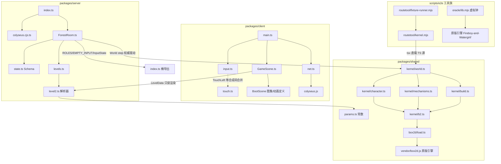

# gy-fw（森林冰火人联机版）架构分析报告

> 分析时间：2026-10-18_102654 ｜ 分析根：`/home/gy/桌面/dev/slbhr/gyのFW` ｜ 模式：完整分析（65 源码文件全量 + 代表性深读）

## 1. 项目快照

| 项 | 值 |
|----|----|
| 项目名 | `gy-fw` v0.3.31（package.json:2-4），自名"森林冰火人联机版：服务端权威 + Phaser 3 + Colyseus" |
| 技术栈 | TypeScript 5.8 / npm workspaces monorepo / Phaser 3.90 / Colyseus 0.16 + @colyseus/schema / vendored Box2DFlash 2.1a / Express 4 / Vite 6 / Vitest 3 / Playwright 1.63 / tsx |
| 代码规模 | 65 个源码文件（packages 31 + scripts 34），约 26,084 行（`find packages scripts -name '*.{ts,mjs}'` 实测） |
| 语言分布 | TypeScript 31 文件（约 13,000 行）、JavaScript(mjs) 34 文件（约 13,000 行） |
| 构建工具 | Vite（客户端构建）、tsc --noEmit（类型门禁）、tsx（服务端/工具直跑 TS 源） |
| CI/CD | 无 `.github/workflows`——门禁全部为本地可复现脚本（见 03-workflow.md §3，这是项目的刻意设计） |
| 分支策略 | 单主干 `main`（remote: github.com/Guiyuan1111/slbhr） |
| 贡献者 | 3 人：Guiyuan1111（596 commits，绝对主体）、夜影、NightShadow（11）、1224HuangJin（1） |
| 排除范围 | `Fireboy-and-Watergirl/`（269MB 原版 oracle 只读第三方）、`TEMP/`、`dist/`、`node_modules/`、`codebase-analyzer/`、`note/`（档卷，作背景参考不作代码分析对象） |

**项目定位**：对商业 Flash 游戏《森林冰火人》（Fireboy & Watergirl: Forest Temple）的**联机复刻**，核心工程纪律是"**逐字节保真**"——物理内核从原版 init.js 按字节偏移逐行转写（每条常数注释带证据锚点），并以**原版引擎本体作为仲裁 oracle**（虚拟钟确定性回放）验证行为位级/容差级一致，然后叠加 Colyseus 服务端权威联机层。

## 2. 仓库布局与目录功能角色

```text
gyのFW/                          ← ANALYSIS_ROOT（monorepo 根）
├── package.json                 ← npm workspaces: packages/*
├── tsconfig.json / vite.config.ts / vitest.config.ts
├── start.sh / start-lan.sh      ← 一键起服脚本（本地/局域网）
├── packages/
│   ├── shared/                  ←【确定性内核 + 共享协议】（零 DOM/node 依赖面窄）
│   │   ├── src/
│   │   │   ├── kernel/          ← 物理内核（服务端唯一入口）
│   │   │   │   ├── world.ts     ← World 门面：step 链/接触分发/胜负判定（449 行）
│   │   │   │   ├── character.ts ← 角色类：复合碰撞体/手感/动画态（325 行）
│   │   │   │   ├── mechanisms.ts← 机关全谱 9 类 + 组同步管理（782 行）
│   │   │   │   ├── build.ts     ← 关卡→物理世界构建（311 行）
│   │   │   │   └── b2.ts        ← 引擎访问层：FILTER/px2m/fixture 工厂（100 行）
│   │   │   ├── level2.ts        ← Tiled JSON 全机制解析器（628 行）
│   │   │   ├── params.ts        ← 原版常数字典（174 行，全部带 @字节偏移证据）
│   │   │   ├── types.ts / index.ts
│   │   │   └── __tests__/       ← kernel2(18)/level2(15)/48 关行为冒烟(1)
│   │   ├── box2d/load.ts        ← vendored 引擎加载器（85 行）
│   │   └── vendor/box2d.js      ← 原版 Closure bundle 字节级提取（scripts/vendor-box2d.mjs 产物）
│   ├── server/                  ←【Colyseus 权威服务端】
│   │   └── src/
│   │       ├── index.ts         ← express 静态托管 + WS 同端口 + 关卡 API（189 行）
│   │       ├── colyseus.cjs.ts  ← CJS 统一加载口（ESM/CJS 双实例陷阱防御，20 行）
│   │       ├── levels.ts        ← 关卡加载（LEVEL_DIRS 权威序，78 行）
│   │       └── rooms/
│   │           ├── ForestRoom.ts← 房间主逻辑：tick 链/输入排水/生命周期（543 行）
│   │           └── state.ts     ← Colyseus Schema 状态树（246 行）
│   └── client/                  ←【Phaser 3 表现层】（零玩法判定，纯快照消费）
│       └── src/
│           ├── main.ts          ← DOM 菜单→连接→拉关→Phaser 启动（441 行）
│           ├── net.ts           ← colyseus.js 封装/重连/消息差分（194 行）
│           ├── input.ts         ← 键盘分键 + 15Hz 重发 + seq（126 行）
│           ├── touch.ts         ← 触屏虚拟键 DOM 覆盖层（79 行）
│           ├── scenes/
│           │   ├── GameScene.ts ← 核心渲染场景（1706 行，全仓最大文件）
│           │   ├── BootScene.ts ← 图集/音频/动画定义
│           │   ├── MenuScene/TempleScene ← 开始界面/48 关选关树
│           │   ├── overlays.ts  ← Pause/End/GameOver 三弹窗
│           │   └── menus.ts     ← 设置/制作名单/全通关彩带
│           ├── progress.ts / settings.ts / audio.ts
│           └── vendor/seedrandom.ts ← 原版装饰 RNG 同源复刻
├── scripts/
│   ├── e2e/                     ←【四层验证工具族】（项目特色，见 §6）
│   │   ├── lib.mjs              ← 公共库：起服/入场/started 闸/sync 探针
│   │   ├── regression.mjs       ← L3 双浏览器真实联机回归
│   │   ├── route.mjs / route-all.mjs / mc.mjs / journey.mjs / touch.mjs
│   │   ├── oracle/              ← 原版引擎虚拟钟机族（lib/vtrun/vtdiff/windphase/goldcollect/animprobe）
│   │   ├── routetool/           ← 路线产线（kernel/botcore/autosearch/optimize/validate/scan/dtsweep/fixture-runner…）
│   │   └── fixtures/            ← 金轨迹回归 fixture（forest_01/04/12/26 × main/oracle-gold）
│   ├── baseline/                ← 原版基线取证（capture/diff-kernel/render-level/serve-original）
│   ├── sync-assets.mjs / vendor-box2d.mjs
│   └── dev/
├── data/                        ← 官方关卡 JSON（forest/levels 47 关 + tutorials/levels forest_01 + temple.json）
├── assets/                      ← 官方素材（图集/音频，禁止分发）
├── note/                        ← 档卷体系（research/evidence/release/handoff——背景参考）
└── benchmark/                   ← perf 基线（另槽并行工作，本报告不展开）
```

分层角色判定：

| 目录 | 角色 | 证据 |
|------|------|------|
| `packages/shared/src/kernel` | 领域核心层（业务=物理仿真本身） | world.ts:2-11 自述"服务端唯一入口" |
| `packages/server` | 外部接口层 + 应用编排层 | index.ts:164-169 WS+HTTP 同端口；ForestRoom 承载全部联机规则 |
| `packages/client` | 表现层（纯渲染 + 输入上报） | GameScene.ts:11-12"服务器是唯一权威，本场景不做任何玩法判定" |
| `packages/shared/src/level2.ts+params.ts` | 数据访问层（关卡 JSON→域模型） | level2.ts:4"全机制数据驱动" |
| `scripts/e2e`+`scripts/baseline` | 质量基础设施层 | 见 §6 与 03-workflow.md |

## 3. 技术栈与依赖全景

运行时依赖仅 4 项（package.json:19-24）：

| 依赖 | 版本 | 用途 | 使用位置 |
|------|------|------|---------|
| colyseus | 0.16.0 | 服务端房间框架 | server（经 colyseus.cjs.ts CJS 口） |
| colyseus.js | ^0.16.0 | 客户端 SDK | client/net.ts:14 |
| express | ^4.21.2 | 静态托管 + 关卡 API | server/index.ts:23 |
| phaser | ^3.90.0 | 渲染引擎 | client 全场景 |

关键点：**物理引擎不在依赖表里**。Box2D 以 `packages/shared/vendor/box2d.js` 形式从原版游戏 bundle 按字节提取（scripts/vendor-box2d.mjs），由 `box2d/load.ts:38-85` 用 `new Function` 在主上下文求值加载——注释明确记载该选择的原因：node:vm 沙箱的全局代理慢 ~7 倍（bonus_2 单步 28.8ms→4.5ms），且 vm 本就不是安全边界，被求值对象是仓内字节级受控文件。

## 4. 模块依赖图



依赖方向纪律（逆向也成立——无环）：

1. **shared 不依赖 client/server**：kernel 只 import level2/types/b2 与 vendor 引擎（world.ts:13-19），可被任一侧与工具链直接复用。
2. **client 对 shared 只读**：GameScene import `LevelData` 类型与 `windBodyPos` 纯函数（GameScene.ts:20-21）；玩法状态 100% 来自服务器快照。
3. **server 对 shared 是"驱动者"**：ForestRoom import `World` 与协议常量（ForestRoom.ts:18-19），是内核唯一的运行时调用方。
4. **工具链与生产同源**：kernel.mjs:24-25 经 `pathToFileURL + tsx` **直接 import TS 源**的 world.ts/level2.ts——不存在"测试实现"与"生产实现"分叉（fixture-runner.mjs:31 头注"与真实服务端同一份实现"）。

## 5. 架构模式判定

| 模式 | 判定 | 证据 |
|------|------|------|
| **权威-镜像（client-server authority，快照+增量）** | 核心架构 | 服务端每 tick 全量写 Schema、框架自动出增量 patch（ForestRoom.ts:409-536 `syncState` + state.ts:1-13 头注）；客户端 zero 玩法判定 |
| **共享内核确定性仿真（lockstep 变体的"单侧仿真+快照流"）** | 特色架构 | 同一份 World 被 server（ForestRoom）与工具链（kernel.mjs）实例化；输入为唯一外部变量，`step(1/60, inputs)` 纯函数化 |
| **Monorepo 分层（port-and-adapter 的轻量形态）** | 组织架构 | shared=领域层，server=适配器（网络），client=适配器（渲染），e2e=验证端口 |
| **事件驱动（帧内事件总线）** | 局部模式 | `WorldEvent[]` 由 step 返回（world.ts:23-29），ForestRoom.handleEvents 转译为广播（ForestRoom.ts:381-407）；机制层另有 `MechEvent`（mechanisms.ts:21-23） |
| **观察者（组信号 OR 分发）** | 局部模式 | MechManager.deviceChanged：信号源 state 取 OR 赋给非信号设备（mechanisms.ts:66-79）——原版 deviceChanged 语义 |
| **工厂函数（非类工厂）** | 惯用法 | buildLevelWorld/buildMechanisms/buildBox/buildBall/buildHanging/buildPulley/buildRoman/buildWindow（build.ts:174, mechanisms.ts:742）；fixture 构造族 makeFixtureDef/polygonFixture/boxFixture/circleFixture（b2.ts:67-100） |
| **单例（引擎命名空间缓存）** | 惯用法 | b2.ts:16-21 `cached` 模块级单例；load.ts:36 同款 |
| **策略（dt 调度可插拔）** | 测试基建 | fixture-runner.mjs:59-72 `makeDtFn`：fixed-60 / ms-quantized-rec 两策略；world.ts:62-70 `windClockS` 可注入时基策略 |
| **延迟销毁（deferred removal）** | 物理层惯用法 | world.ts:280-285 flushPendingRemove——Box2D 禁止接触回调内 DestroyBody，原版 _toRemove 同款 |

**不适用 MVC/微服务/Clean 全家桶**：本项目域逻辑就是仿真本身，分层沿"确定性边界"而非"职责类型"切——凡是不确定的（网络抖动、渲染时机、墙钟）都被推到 server 房间层与 client 表现层；kernel 内连 `Math.random` 都不存在（装饰随机在客户端用 seedrandom 复刻，GameScene.ts:803）。

## 6. 验证工具族架构（项目特色，独立成节）

四层金字塔，全部本地可复现、退码即门禁：

| 层 | 工具 | 对象 | 判定口径 |
|----|------|------|---------|
| L1 单元 | `vitest run`（38 用例） | kernel2/level2/box2d/48 关冒烟 | 断言=原版行为（kernel2.test.ts:5） |
| L2 内核 headless | `routetool/kernel.mjs` | World 直接回放路线 JSON | WIN/死亡帧；与生产同源 |
| L2+ 金轨迹 | `routetool/fixture-runner.mjs` | fixtures/<level>/<case>/ 三件套（route/meta/expected） | tolerance=0 位级 或 >0 数值叶 atol + oracle 扩展旗标（alignShift/outcomeWindowF/compareEvents…） |
| L3 真服 e2e | `regression.mjs`/`route.mjs`/`route-all.mjs`/`mc.mjs`/`journey.mjs`/`touch.mjs`/`oracle/animprobe.mjs` | Playwright 双浏览器真实菜单联机 | 权威 state 断言 + 零页面错误；route 门禁 repeat≥3 ALL PASS；MC 抖动通过率 ≥98% 才准上真服（mc.mjs:8-10） |
| Oracle 仲裁 | `oracle/lib.mjs` 虚拟钟 + `vtrun/vtdiff/windphase/goldcollect` | **原版引擎本体**（Fireboy-and-Watergirl/output/A 经 python http.server 只读伺服，lib.mjs:108-135） | ×N BITEXACT 逐位一致；金 fixture 采集（goldcollect）；风相位/动画态专项对拍 |

Oracle 虚拟钟原理（oracle/lib.mjs:32-102 `VT_INIT`）：CDP 虚拟时间管不住 rAF，故改用 init-script 劫持 `requestAnimationFrame + Date.now + setTimeout/setInterval`，由 Node 控制器逐帧放行（`__vt.step(n)`），并钳制 Phaser Time.elapsed 负值（跳变帧恰 1000/60）。这是把"不可复现的墙钟驱动商业游戏"变成"确定性 60Hz 归真仪器"的关键工程——所有"我方 vs 原版"仲裁判定（如 10 号档 Δθ≤1.9e-4°、12 号档动画态同构）都建立在它之上。

## 7. 核心函数级调用链

### 7.1 服务端 tick 链（ForestRoom.tick → World.step → Box2D）

```
ForestRoom.tick(dtMs)                                  → ForestRoom.ts:314
├── phase!=="started" → acc 清零 + 1Hz ping 心跳       → :315-325
├── userPaused → 同上（物理冻结，输入照常入队）          → :326-337
├── acc += min(dtMs,100)                                → :338
└── while acc≥STEP_MS && steps<6:                       → :340
    ├── deadline = startedWall + k·STEP_MS + 4          → :347
    ├── inputQueue 排水：t≤deadline 的消息写入 currentInputs → :348-354
    ├── handleEvents(world.step(1/60, currentInputs))   → :355 ─┐
    ├── FW_DUMP=1 → snapshotPlayer 落盘 TEMP/server-dump → :356-373
    ├── acc-=STEP_MS; steps++; stepIndex++              → :374-376
└── steps>0 → syncState()                               → :378

World.step(dt, inputs)                                  → world.ts:238
├── phase!=="playing" → 返回空事件                       → :240
├── for wind: wind.applyForce(windClockS(), dt)          → :247  【风施力在角色前】
├── chars.fireboy.update(B, dt, inputs.fireboy, noop)    → :248
├── chars.watergirl.update(...)                          → :249
├── for platform: p.update() 【转臂限位硬钳】             → :255
├── mechEvents=[]
│   ├── for lever: l.checkState(mechEvents)              → :258
│   └── for pusher: p.checkState(mechEvents)             → :259
├── for ev: events.push({type:"mech"}); manager.deviceChanged() → :260-263
├── updateDoors(dt, events) 【25fps 扫帧】                → :264
├── stepEvents=events; built.world.Step(dt, 8, 3)        → :267-268 【接触回调在此期间同步触发】
│   └── classifyContactPair → classifyContact ×2（双向视角）→ :135-139
│       ├── ud==="feet" → 液体致死 char.kill()/feetContacts 增删 → :301-323
│       ├── ud.type==="door" → door.isOpen=begin         → :327-333
│       ├── ud.type==="wind" → wind.setActive(role,begin)→ :336-342
│       └── ud.type==="diamond" → 拾取计数+pendingRemove  → :345-359
├── stepEvents=null; simTimeS+=dt
├── flushPendingRemove() 【步后销毁已拾钻石体】           → :281-285
└── checkEnd(events) 【isDead→gameover；双门 isUp→won】   → :273-276,403-426
```

帧序注释（world.ts:251-254）记载这是 2026-10-09 运行时探针实测的原版帧序：doors → wg → fb → 设备(逆注册序) → Step，机关检查在 Step 前（读上一步关节角，状态变化当帧进求解）。

### 7.2 角色手感链（Character.update）

```
Character.update(B, dt, cursors, onJumpSound)           → character.ts:155
├── dying? → 速度清零 + smokeT 累计 → 45/30s 后 isDead   → :156-164
├── 脚底法线：feetContacts 排序取最上者（Dot(down) 升序）  → :173-183
├── 力爬升 e = 130·dt/currentRunForce（慢速过半程给满）    → :185-188
├── left/right 分支：
│   ├── 有法线 n：currentRunForce 爬升 + i = n×(−F) + sqrt(p) 门控
│   │   └── p>0.6 且 0≤iy<20 → iy+=20 【贴地吸附】        → :191-213
│   └── 无 n（空中）：i = ±floatForce(30)                 → :201,212
├── else（松键）：currentRunForce=0.475·s; i=(7·−vx,0) 刹车 → :214-218
├── 跳跃：prohibitJump 边沿 + (n.y>0.2 || feetContacts≥2)  → :221-243
│   ├── ApplyLinearImpulse(0,1) + SetLinearVelocity 归一钳 jumpVelocity(15.5)
│   └── 对脚下 reactable 施 −1 冲量 【滑轮板联动】         → :233-240
├── 施力：跳跃帧 iy=0；|vx|<maxSpeed(8.5) 才 ApplyForce   → :245-254
├── 硬钳 absoluteMaxSpeed(40) 无条件                      → :256-260
└── updateAnim(cursors, n) → idle/jumping/rising/falling + headTilt → :262,266-324
```

### 7.3 客户端渲染消费链（GameScene.update）

```
GameScene.update(time, delta)                           → GameScene.ts:1198
├── st = net.room.state（快照唯一来源）
├── 时钟文本差分（lastClock 防无谓重绘）                   → :1204-1205
├── phase 差分 → onPhaseChanged（ready 复位/started 解冻相机/won 楼梯演出）→ :1207-1213
├── drainSfx()（net.sfxQueue 逐帧取空）                   → :1215
├── updatePlayers(st, delta)                             → :1217
│   ├── snapPending → 瞬移直贴（ready 重开防跨图平滑）     → :1356-1358
│   ├── dead-reckoning：ex=tx+vx·lead/1000 → 指数收敛 k=1−exp(−rate·dt)
│   │   self: lead=17ms rate=40；other: lead=25ms rate=20 → :1360-1374
│   ├── dying 即藏身（12 号档对拍修复）                    → :1379-1384
│   ├── 动画态机切换 + 腿部层序（rising 时 legs 提顶）      → :1408-1442
│   └── 门帧差分驱动 setFrame + 门音起停                   → :1455-1464
├── updateDiamonds(st)（collected 双向差分 + 拾取音）      → :1218
├── updateMechs(st, nowMs, delta)                        → :1219
│   └── 每类机关经 mechTarget(key,x,y,a,now,delta) 平滑：
│       有限差分估速（角度最短弧）→ 目标=快照+v·25ms → 指数收敛 rate=30/s → :1501-1531
│       覆盖 lever/pusher/platform/props/wind/hanging/pulley/roman → :1534-1667
├── updatePlatformSound（位移自检触发电机声）              → :1220
├── updateTutorial（双角色进矩形 400ms 淡入/淡出）         → :1224-1229
├── 相机：!camFrozen → updateCamTarget + animateCam（弹簧 a=1/15 阻尼 0.5）→ :1232-1235
└── updateNavies（极坐标正弦漂移）→ snapPending=false     → :1237-1238
```

### 7.4 关卡加载链（三端同源解析器）

```
Tiled JSON ──parseLevel(id, json, getTileset)──→ LevelData
  ├── 服务端：levels.ts:55-78 loadLevel（LEVEL_DIRS 序，tilesetCache）
  ├── 客户端：main.ts:67-96 fetchLevel（先预取全部图块集再同步 parse）
  └── 工具链：routetool/kernel.mjs:28-59（makeProvider + locateLevel）
```

`parseLevel` 产出 `LevelData`（level2.ts:62-200 类型族）：groundType 网格、liquidRuns 行段、diamonds/doors/spawn、levers/pushers/platforms/boxes/balls/hangings/pulleys/romans/winds/windows 全机关定义 + tutorials。firstgid 归属规则、tileproperties 默认值合并等原版语义在 level2.ts:12-23 逐条注明。

## 8. 关键设计决策与不变式（架构级）

1. **坐标双取负约定**：物理 = (−screenX/32, −screenY/32)（b2.ts:46-53）。所有机关角度符号口径分两族——hangings/pulleys/romans/lever 发 +体角，platforms/props 发 −体角（world.ts:190-191 注释"双取负历史口径，客户端有配对取负，勿混用"）。这是逆向 PointProxy 的烙印，贯穿三个包。
2. **确定性三时基**：仿真时基 simTimeS（默认，位级可复现）/ 生产风时基墙钟（原版逐跑随机相位）/ FW_WIND_PHASE 固定相位（e2e 口径，world.ts:62-70 + ForestRoom.ts:200-207）。
3. **fixture 创建顺序即物理**：角色四 fixture 顺序 portal→躯干圆→脚圆→梯形（character.ts:85-87 注释：box2d 按序遍历接触，落地冲量分配依赖该顺序——2026-10-06 二轮校准实证）。
4. **Schema 字段必须 constructor 赋值**：class fields 会绕过 prototype setter 拦截导致编码崩溃（state.ts:6-10）。
5. **Colyseus CJS 统一加载口**：ESM/CJS 双实例会导致 Symbol.metadata 崩溃与 seat reservation expired（colyseus.cjs.ts:1-11）。
6. **输入全量快照语义**：input 消息缺省键按 false 处理，服务器不 diff、按意图跨度排水（ForestRoom.ts:92-108）——与 seq 仅用于排查的设计配套。

## 9. 架构风险与观察

| 观察 | 证据 | 影响 |
|------|------|------|
| GameScene.ts 1706 行单文件承载渲染/平滑/相机/音频/HUD/演出 | wc -l 实测 | 修改面集中但内聚度高（全是快照消费）；有 groundCache/lastClock 等性能自审计痕迹 |
| mechSnapshot 每帧全量重算 + syncState 全量写（60Hz） | world.ts:165-208, ForestRoom.ts:410-536 | 框架出增量补丁兜底；11 号档已实测带宽 1.95-2.86KB/s（2 人局），可接受 |
| 无 CI：门禁全靠本地脚本自觉执行 | ls .github 为空 | 与"位级可复现"哲学一致，但依赖单人纪律；04 报告给出 AI 补位方案 |
| vendor/box2d.js 是黑盒大文件 | load.ts 求值加载 | 已被 det 哈希链 + 83 项单测围栏（load.ts:21-22 注释） |
| ForestRoom 输入队列上限 128 截断 | ForestRoom.ts:107 | 防爆队列；截老保新符合"全量快照"语义 |

## 10. 小结

本仓库是"**确定性内核 + 权威快照服务 + 纯表现客户端 + oracle 仲裁工具链**"四位一体的复刻工程。架构上最不寻常之处在于：把"与原版位级一致"当作可执行的质量属性（fixture 位级门禁、虚拟钟 BITEXACT、det 48 关哈希链），并为此专门建设了一套把原版商业游戏当测试仪器的脚本族。分层依据不是通用分层教条，而是**确定性边界**：kernel 内一切可复现，kernel 外一切可平滑。

相关报告：[运行原理](02-operation-principles.md) ｜ [工作流分析](03-workflow.md) ｜ [AI 替代方案](04-ai-substitution.md) ｜ [Blueprint 索引](blueprints/index.md)
