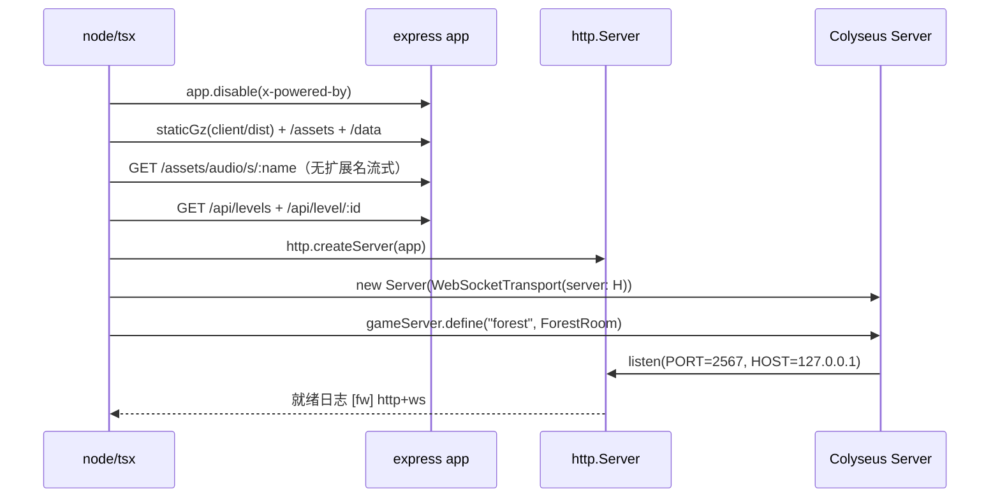
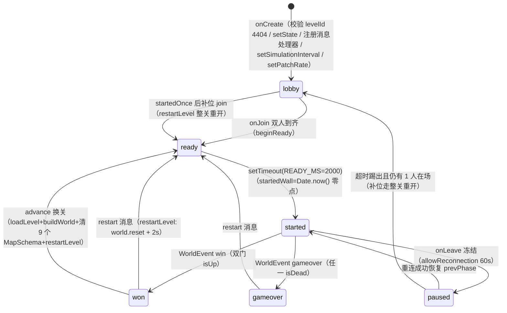
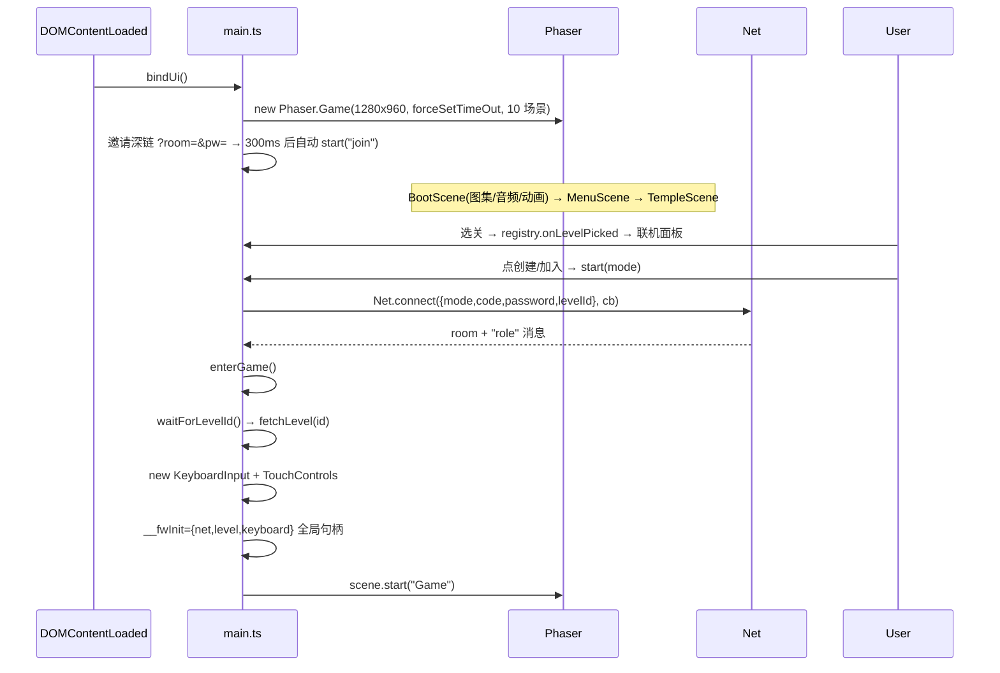
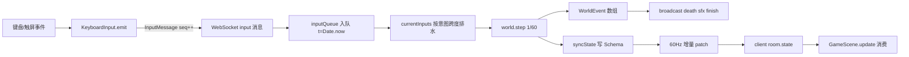

# gy-fw 运行原理报告

> 分析时间：2026-10-18_102654 ｜ 分析根：`/home/gy/桌面/dev/slbhr/gyのFW`
> 本报告覆盖：启动序列、核心数据流（变量级）、状态机、生命周期钩子、错误处理链路。

## 1. 启动流程

### 1.1 服务端启动序列（packages/server/src/index.ts）



初始化要点（含行号）：

1. **HOST 缺省 127.0.0.1**（index.ts:21）——公网访问走隧道，安全默认。
2. **staticGz 压缩协商**（index.ts:50-120）：文本扩展名 + 1KB-8MB 才压；br 优先（quality 5）否则 gzip（level 6）；产物按 `路径+mtime+编码` 内存缓存（compCache）；分级缓存策略——Vite 哈希产物 immutable 1 年（HASHED_EXT, :35）、html no-cache、其余 public 1 天（cachePolicy, :37-41）；html 不压缩直走 fallback（:77-82）。
3. **音频无扩展名路由**（index.ts:130-143）：`/assets/audio/s/<name>` 校验 `^[A-Za-z0-9_.-]+$` 后补 .mp3，以 octet-stream 返回——防御 IDM 等下载工具按扩展名劫持。
4. **WS 与 HTTP 同端口**：Colyseus 0.16 `gameServer.listen` 驱动内部 httpServer 监听，matchmake 路由 + express + ws 共存（index.ts:171-173 注释）。

### 1.2 房间生命周期（ForestRoom，一局一房）



- `onCreate`（ForestRoom.ts:76-193）：读密码/levelId → loadLevel → `worldEpochMs=Date.now()`（风时基页面级零点）→ buildWorld（注入 windClockS）→ setState(RoomState) → 注册 6 类消息（input/restart/advance/pause/resume + FW_DEBUG 钩子）→ `setSimulationInterval(tick)` → `setPatchRate(PATCH_MS)`。
- `onAuth`（:210-215）：创建与加入共用，密码不符抛 `ServerError(4403)`。
- `onJoin`（:217-240）：先到先得 fireboy（ROLES.find 未占用者），满员 4409；`client.send("role", role)` 私发角色。
- `onLeave`（:242-270）：一律 `phase="paused"` + `allowReconnection(60s)`；重连成功恢复原 phase 并补发 pause-changed；超时释放角色/清输入/解玩家暂停，剩 1 人则回 lobby。
- `restartLevel`（:296-311）与 `advance`（:121-139）：两者都以 ready→2s→started 收尾；advance 额外清空 9 个 MapSchema（"syncState 只增不删，残留=幽灵机关"，:128-137）。

### 1.3 客户端启动序列（main.ts）



关键启动决策：

- **画布固定 1280×960 + FIT**（main.ts:384-391）：与原版设计尺寸逐像素同几何；`forceSetTimeOut:true` 使后台标签页不冻结（rAF 被浏览器暂停的问题）。
- **关卡数据统一走 `/api/level/:id`**（main.ts:67-96）：服务端 LEVEL_DIRS 为唯一权威；图块集必须**先异步预取全部再同步 parse**（传 Promise 会让 tileTypeOf 全失败，:79-81 注释）。
- **场景数据经全局句柄 `__fwInit` 传递**（main.ts:183）而非 scene.data——场景 init 从 globalThis 取（GameScene.ts:230-234），重启场景时数据仍可复用。
- 深链两种：`?level=`（选关直通）与 `?room=&pw=`（邀请直入，main.ts:426-430）。

## 2. 核心数据流

### 2.1 输入流（端到端，变量级）



数据变换详情表（输入路径）：

| 步骤 | 变量 | 类型 | 值/状态变化 | 代码位置 |
|------|------|------|------------|---------|
| 1 | `pressed` | `Set<string>` | 如 `{ArrowRight}` → InputState | input.ts:117-121 |
| 2 | 消息载荷 | `InputMessage` | `{up:false,left:false,right:true,seq:42}` | input.ts:124 |
| 3 | 队列项 | `{t,role,data}` | `t=Date.now()` 到达墙钟（非客户端时戳——服务器时钟权威） | ForestRoom.ts:98-106 |
| 4 | 排水判定 | `deadline` | `startedWall + stepIndex·(1000/60) + 4`ms | ForestRoom.ts:347 |
| 5 | `currentInputs` | `Record<Role,InputState>` | 全量覆盖该角色三元组 | ForestRoom.ts:353 |
| 6 | 内核入参 | `inputs` | 同上引用传入 step | ForestRoom.ts:355 |

意图跨度排水的设计动机（ForestRoom.ts:95-97 注释）：直接写 currentInputs 会被"晚到的唤醒"提前一个步消费（Wakeup 与 16.7ms 边界有 ±5-15ms 抖动）；队列消费与唤醒时机解耦后，路由回放（route.mjs OFFSET=-10ms 瞄准窗口中心）成为可能。复杂度：入队 O(1)，排水均摊 O(1)（队头条件 shift），队列上限 128 截老保新（:107）。

### 2.2 快照流（World → Schema → 客户端渲染，变量级）

| 步骤 | 变量 | 类型 | 值/状态变化 | 代码位置 |
|------|------|------|------------|---------|
| 1 | `sim` | `PlayerSnapshot` | `{x:96.0, y:864.0, vx:120.5, anim:"jumping", facing:-1, headTilt:0.12, doorFrame:17.3, ...}`（屏幕 px，m2px 换算） | world.ts:211-233 |
| 2 | 量化写 Schema | `ps.x` | `Math.round(sim.x*10)/10` → 96（0.1px 量化；headTilt 千分位） | ForestRoom.ts:419-425 |
| 3 | 框架 diff | patch | Colyseus 增量二进制，60Hz（PATCH_MS=1000/60，:33；FW_PATCH_MS 可回退 20Hz） | ForestRoom.ts:192 |
| 4 | 客户端读 | `ps.x/vx` | `Number(ps.x)‖0` + PAD=32 | GameScene.ts:1354-1355 |
| 5 | dead-reckoning | `ex,ey` | `tx + vx·lead/1000`（self lead=17ms / other 25ms） | GameScene.ts:1367-1369 |
| 6 | 收敛 | `view.cx` | `cx += (ex-cx)·k`，`k=1-exp(-rate·delta/1000)`（self rate=40 / other 20） | GameScene.ts:1370-1373 |
| 7 | 机关平滑 | `mechTarget` 返回 | 有限差分估速 v=(Δ快照/Δt) → 目标=快照+v·25ms → 指数收敛 rate=30/s；角度最短弧 `((da+π)%2π+2π)%2π−π` | GameScene.ts:1511-1530 |

量化副作用说明：0.1px/0.001rad 快照量化 → 有限差分速度噪声 ≤2px/s、0.02rad/s（GameScene.ts:1495-1496 注释），对真实速度可忽略——这是平滑层参数成立的边界条件。

lead/rate 参数的实证来源（GameScene.ts:1360-1366 注释，11 号档）：60Hz patch 下快照零陈旧，self lead 50ms 会前冲震荡（A/B 网格扫描 rms 5.85→0.16px）；20Hz 回退口径则需 lead 50 抵消半个快照周期——参数与 patch 率耦合，改 PATCH_MS 必须重扫。

### 2.3 拾取钻石事件流（接触回调全链）

| 步骤 | 变量 | 类型 | 值/状态变化 | 代码位置 |
|------|------|------|------------|---------|
| 1 | contact | b2Contact | 角色躯干 fixture × 钻石 sensor，Step 求解期间触发 | world.ts:268 |
| 2 | `ud.type` | userData | `"diamond"` 且对侧是角色 body | world.ts:345-348 |
| 3 | 资格判定 | `eligible` | `diamond.char==="silver"/"fbwg"‖char.char===diamond.char`（红钻只给火人） | world.ts:352 |
| 4 | 计数 | `char.diamonds` | `+=1`（或 silverDiamond） | world.ts:355-356 |
| 5 | 延迟销毁 | `pendingRemove` | push(diamond.body)——步后 flushPendingRemove 统一 DestroyBody | world.ts:357,281-285 |
| 6 | 事件 | `WorldEvent` | `{type:"diamond", role, kind:"red"}` 随 step 返回 | world.ts:358 |
| 7 | 广播 | sfx 消息 | `{kind:"diamond", role}`——客户端本地差分已覆盖音效，消息为备用 | ForestRoom.ts:401-402；GameScene.ts:1335 注释 |
| 8 | 客户端差分 | `img.visible` | collected=true 且可见 → 隐藏 + sfx_diamond；重开复位 | GameScene.ts:1475-1486 |

### 2.4 风力数据流（三时基特色路径）

```
Wind.applyForce(nowS, dtS)                              → mechanisms.ts:663
├── state!==1 → return（组信号关闭）
├── dir = (0,1) 旋转 body.GetAngle()（机身角 = π(rotation+90)/180）
├── for 活跃角色（activeRoles 由接触回调进出维护）:
│   ├── dist = |cp − bp|
│   ├── f = (1.2 + 0.2·sin(nowS)) · 100 · (1 − dist/length)   【无钳制，柱顶外为负=吸回】
│   ├── body.ApplyForce(dir·f)
│   ├── v ×= 0.975^(dt·60)   【dt 加权阻尼——oracle L59569 直证，07 号档裁定】
│   └── |v|>15 → 归一到 15  【限速】
```

`nowS` 三口径（world.ts:62-70）：缺省 `simTimeS`（det/金轨迹位级）；生产 `(Date.now()-worldEpochMs)/1000`（原版页面级随机相位语义，跨重开/换关延续，ForestRoom.ts:73-74,200-207）；`FW_WIND_PHASE=X` → `simTimeS+X`（e2e 固定相位，X=0 与缺省位级相同）。

## 3. 状态机提取

### 3.1 房间 phase（ForestRoom，字符串枚举）

| 当前 | 目标 | 触发 | 条件 | 代码位置 |
|------|------|------|------|---------|
| lobby | ready | onJoin | roles.size===2 且 !startedOnce | ForestRoom.ts:232-234 |
| ready | started | setTimeout | READY_MS=2000（原版 1600+400ms） | ForestRoom.ts:282-292 |
| started | won | handleEvents | WorldEvent win（双门 isUp） | ForestRoom.ts:383-392 |
| started | gameover | handleEvents | WorldEvent gameover（任一 isDead） | ForestRoom.ts:395-397 |
| started | paused | onLeave | 任何一方断线 | ForestRoom.ts:247-250 |
| paused | (原 phase) | allowReconnection 成功 | 等待期内回来 | ForestRoom.ts:251-255 |
| paused | lobby | 重连超时 | roles 仍 >0（剩 1 人） | ForestRoom.ts:262-266 |
| won/gameover | ready | "restart" 消息 | phase 必须为 won/gameover | ForestRoom.ts:110-115 |
| won | ready | "advance" 消息 | 新 levelId 合法且 ≠当前 | ForestRoom.ts:121-139 |

玩家暂停（userPaused）是独立布尔、不占 phase 词汇（ForestRoom.ts:146-159）：started 才受理；暂停期 tick 早退但 inputQueue 照常入队——"按住不放=恢复瞬间生效"（原版键掩码语义，:143-145 注释）。

### 3.2 World phase（kernel）

`playing → won | gameover`（world.ts:21,83）。checkEnd 判定序（:403-426）：先 isDead（任一角色）→ gameover；后双门 isUp → won + `timeMs = timerMs + 1600`（通关计时含楼梯演出，原版 45097 口径）。

### 3.3 角色死亡链（四态）

| 当前 | 目标 | 触发 | 条件 | 代码位置 |
|------|------|------|------|---------|
| 存活 | dying | kill() | feet 感应遇 liquid_death 且 liquidTouched（7 全杀 / wg 遇 6 / fb 遇 5） | world.ts:307-312; character.ts:142-152 |
| dying | dead | kill() 同时置 | 原版 _doKill 立即 dead（速度每帧清零） | character.ts:146-152 |
| dying | isDead | smokeT ≥ 45/30s | 死亡烟雾 1.5s 播完 | character.ts:159-163 |
| isDead | (触发 gameover) | checkEnd | 世界层判定 | world.ts:405-409 |

客户端表现：dying 即藏身（12 号档 A/B 104/195→195/195 覆盖，GameScene.ts:1379-1384）——原版"触液即化烟、本体消失"。

### 3.4 门状态（每角色一扇）

```
closed(frac=0) --isOpen=true--> opening --25·min(0.04,dt)/帧--> frac=21 → isUp(信号一次)
opening --isOpen=false--> closing（frac 反向递减，signaled 复位）
```

关键修复证据（world.ts:382-384 注释）：推进必须用 frac 本身——`round(frac)<21` 会在 20.83 帧提前停摆，isUp 永差一步，"0.3.26 及之前真实游玩永不通关的根因"。

### 3.5 拉杆/推杆（信号源二态）

- Lever：`state=0 && 关节角×onis<0 → state=1，马达 −4·onis`；反向对称（mechanisms.ts:141-153）。
- Pusher：`t>0.2 → state=1`；`t≤0.2 → state=0`（mechanisms.ts:210-219）。
- 组同步：信号源 state OR → 赋非信号设备（平台/风/窗）→ signalApply → 平台 SetMotorSpeed ±2（mechanisms.ts:66-79,333-338）。

### 3.6 角色动画态（AnimState）

`idle | jumping | rising | falling`（character.ts:33）+ facing ±1 + headTilt 弧度。判定优先级（updateAnim, :266-324）：有地面法线 n → 移动键决定 jumping（+坡面倾角钳 ±0.25π/±0.1π）；无 n → |vx|>4 jumping / vy>3 rising / vy<−3 falling / 按住键 jumping（用旧 headTilt）/ 其余 idle。客户端腿部规则（GameScene.ts:1438-1441）：`jumping → legs_run（无条件，含顶墙跑），否则 legs_idle`。

## 4. 生命周期钩子注册序

| 钩子 | 序 | 处理逻辑 | 代码位置 |
|------|----|---------|---------|
| Colyseus onCreate | 1st | 密码/关卡初始化 + 6 消息处理器注册 | ForestRoom.ts:76 |
| onMessage("input") | 2nd | 全量快照语义入队（截 128） | ForestRoom.ts:92 |
| onMessage("restart"/"advance"/"pause"/"resume") | 3rd | 相位把守的状态迁移 | ForestRoom.ts:110-159 |
| setSimulationInterval(tick) | 4th | 16.7ms 缺省唤醒（Windows 定时器分辨率注释 :186-188） | ForestRoom.ts:189 |
| setPatchRate(1000/60) | 5th | 出站增量广播频率 | ForestRoom.ts:192 |
| onAuth → onJoin | 连接期 | 4403/4409 把关 + 角色分配 | ForestRoom.ts:210-240 |
| onLeave(allowReconnection) | 断线期 | 60s 冻结窗口 | ForestRoom.ts:242 |
| onDispose | 终结 | clearTimeout | ForestRoom.ts:272 |
| Phaser Scene: init → preload → create → update(每帧) | 客户端 | init 取 __fwInit；preload 懒装载音频 | GameScene.ts:223-1239 |
| Net onStateChange 差分 | 每快照 | phase/levelId 迁移检测 | net.ts:119-132 |

## 5. 错误处理链路

| 层 | 机制 | 行为 | 代码位置 |
|----|------|------|---------|
| 服务端鉴权 | ServerError(4403) | 房间密码错误拒绝入房 | ForestRoom.ts:212 |
| 服务端选关 | ServerError(4404) | 关卡不存在 | ForestRoom.ts:80 |
| 服务端满员 | ServerError(4409) | roles 已满 | ForestRoom.ts:221 |
| 服务端换关守卫 | 静默忽略 | advance 仅 won 受理；双端各点一次第二发天然被 phase 把守 | ForestRoom.ts:121-124 |
| 断线重连 | allowReconnection + reconnectionToken | 客户端 net.ts:134-151 重连后**必须重绑全部监听**（新 Room 实例）；失败回菜单提示刷新 | ForestRoom.ts:242-270; net.ts:134 |
| 客户端关卡拉取 | try/catch + 文案 | res.ok 检查 + error json 回显；失败退菜单释放房间 | main.ts:68-76,361-366 |
| Colyseus room not found | 专属文案 | 提示"两台设备连的不是同一服务进程"排查清单 | main.ts:368-371 |
| 音频缺失 | 静默跳过 | `cache.audio.exists` 防"音频缺失炸掉更新循环"；音效键未装载直接 return | GameScene.ts:315-316 |
| 表达式容错 | loadLevel 目录遍历 | ENOENT 试下一目录，全 miss 抛错 | levels.ts:55-78 |
| 静态服务 | 三重回退 | stat 失败/超尺寸/压缩异常 → express.static fallback | index.ts:50-118 |
| 运行时页面错误 | window.__errs 收集 | e2e 断言"全程为空"（regression.mjs:84） | lib.mjs 注释 |
| Schema 崩溃预防 | constructor 赋值纪律 | class fields 绕过 setter → Symbol.metadata 崩溃（症状级文档） | state.ts:6-10 |
| 输入丢包 | 15Hz 强制重发 | RESEND_MS=66ms 定时 emit(force)，单次消息丢失自愈 | input.ts:61-62,114-125 |
| 卡键防御 | blur 清空 + 暂停先发全松 | 窗口失焦清 pressed；setPaused(true) 前先发"全松"快照防角色持续怼墙 | input.ts:54-60,80-88 |
| tick 螺旋上限 | min(dtMs,100)+steps<6 | 卡顿后丢弃多余时间（防死亡螺旋） | ForestRoom.ts:338-340 |
| 大厅假活防御 | 1Hz ping 心跳 | 非 started 相位每秒 broadcast("ping")，死 TCP 1-2s 内触发 ws close | ForestRoom.ts:316-324 |

重试策略盘点：无指数退避/熔断器（游戏实时语义下不合理）；唯一"重试"是客户端重连令牌一次性重试 + 15Hz 输入重发，均固定间隔。

## 6. 持久化分析

| 数据 | 存储 | 键/结构 | 代码位置 |
|------|------|--------|---------|
| 神庙进度 | localStorage | `fw-temple-progress-v1` → `{filename: {stars, time}}`，解锁=initial 或相邻已通关（tree 传播） | progress.ts |
| 用户设置 | localStorage | `fw-settings-v1` → `{music, fx}` | settings.ts |
| 房间状态 | 内存（Colyseus Schema） | 无磁盘持久化——房间即进程，重启即消亡（e2e 文案"期间没有重启过服务器"呼应） | state.ts |
| 关卡数据 | 文件系统只读 | data/{forest,tutorials}/levels/*.json + temple.json | levels.ts |
| 诊断 dump | TEMP/server-dump-*.jsonl | FW_DUMP=1 时 30 帧批量 appendFileSync（防逐帧 IO 污染输入到达时刻，ForestRoom.ts:51-53） | ForestRoom.ts:56-63 |

## 7. 性能相关设计（运行时内建）

1. **地面合成缓存**：buildGround 结果 canvas 按 levelId 单槽缓存（GameScene.ts:339-349），重开重进免付 ≈20.8MB 像素缓冲重算。
2. **HUD 文本差分**：clockText 仅在字符串变化时 setText（:150-151,1204-1205）。
3. **音频懒装载**：18 键 2.8MB 从 Boot 挪到 GameScene.preload（:223-228），菜单冷启动减负。
4. **主上下文求值 vendor 引擎**：比 vm 沙箱快 ~7 倍（load.ts:13-19）。
5. **tick 补帧上限 6 步**：兼顾追帧与防螺旋（ForestRoom.ts:340）。

相关报告：[项目架构](01-architecture.md) ｜ [工作流分析](03-workflow.md) ｜ [AI 替代方案](04-ai-substitution.md)
