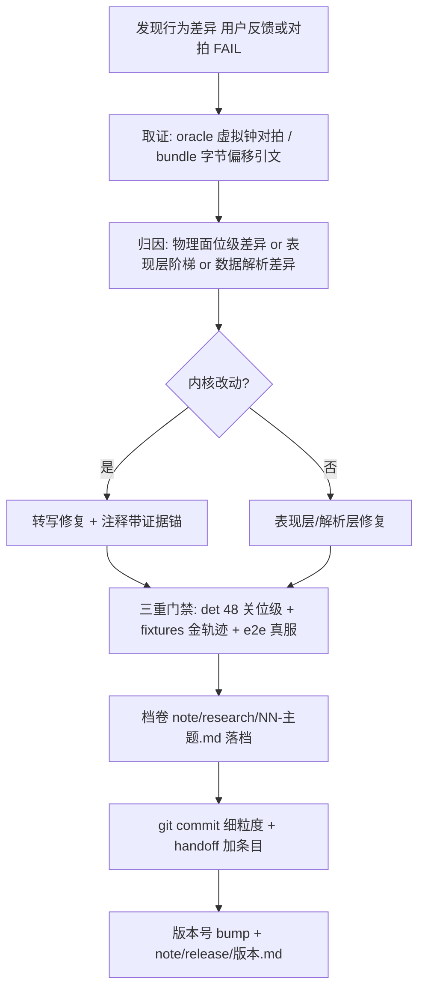
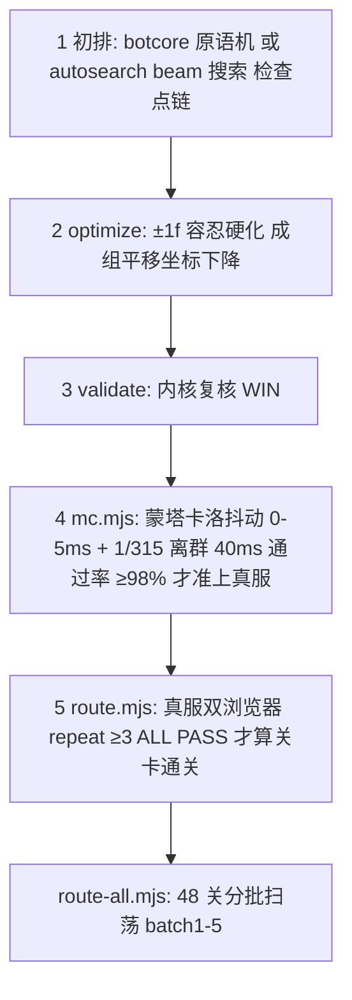

# gy-fw 工作流分析报告

> 分析时间：2026-10-18_102654 ｜ 分析根：`/home/gy/桌面/dev/slbhr/gyのFW`
> 本报告覆盖：开发与交付工作流、测试策略全景、核心业务流程（决策树级）、验证产线（路线产线/oracle 仲裁）、异常恢复路径。

## 1. 开发与交付工作流

### 1.1 CI/CD 现状

**未发现 CI/CD 配置**（无 `.github/workflows`、无 gitlab-ci/Jenkinsfile）。这不是缺失而是当前形态的刻意选择：门禁全部为**本地可复现脚本**（位级确定性使"本机绿=处处绿"在本项目近似成立——同一 dt 序列下浮点逐位一致是内核的设计属性）。版本发布走 git tag + 本地构建产物。工作流报告在此仅描述事实；CI 缺位的补偿方案见 [AI 替代方案](04-ai-substitution.md)。

npm scripts 全集（package.json:10-18）：

| 脚本 | 作用 |
|------|------|
| `dev:client` | sync-assets → vite（开发客户端，直连 :2567） |
| `dev:server` | tsx watch 热重载服务端 |
| `build` | sync-assets → vite build |
| `start` | tsx 直跑服务端（生产同型） |
| `typecheck` | tsc --noEmit（类型门禁） |
| `test` | vitest run（38 用例） |

### 1.2 开发循环（从 git log 与档卷体系还原的实际流程）



该流程的证据密度在 commit message 中可见一斑（git log 2026-10 实样）：每个 commit 引用档卷编号、量化指标（"rms 0.308°→0.232°"、"48/48 位级一致"）与归因结论（"物理面经虚拟钟 oracle 对拍位级同源 Δθ≤1.9e-4°，处置=客户端平滑已修"）。

### 1.3 档卷体系（note/，工程的记忆结构）

| 目录 | 内容 | 工作流角色 |
|------|------|-----------|
| note/research/ | 主题档（2026-10-fidelity / behavior-parity / autoplay / perf-hotspot 等） | 每次排查一个主题一档，含引文行号、A/B 数据、裁定结论 |
| note/evidence/ | 原版源码区段切片（init-js-regions/、各关取证） | 字节级证据，转写的唯一依据（character.ts:2 引 char-region.js） |
| note/release/ | `<版本号>.md` 逐版本改动 | 发布记录 |
| note/handoff.md | 跨槽位交接账本 | 多子 agent 并行工作的协调点（git log 多处"handoff 加条目"） |
| note/report/perf/ | 性能报告 | perf 基线归档 |

档卷纪律的实际效力：mechanisms.ts 每个机关类的注释都指向证据文件与偏移（如 Hanging @1646198、Wind L59569），**转写纪律="任何与源码不一致的优化都是保真 bug"**（character.ts:12）。

## 2. 测试策略全景

### 2.1 测试矩阵

| 类型 | 位置 | 框架 | 数量/对象 | 断言口径 |
|------|------|------|----------|---------|
| 单元 | packages/shared/src/__tests__/kernel2.test.ts | vitest | 18 例 | 原版行为（文件头:5 明示"非旧 AABB 内核行为"） |
| 单元 | packages/shared/src/__tests__/level2.test.ts | vitest | 15 例 | 解析器全机制 |
| 单元 | packages/shared/__tests__/box2d.test.ts | vitest | 4 例 | 引擎可用性 + 半隐式欧拉基线（Δ=15.885m 解析式） |
| 行为冒烟 | packages/shared/src/__tests__/48-level-behavior.test.ts | vitest | 1 大例 × 48 关 | 出生站稳 ≤2s + 浸泡 10s 无 NaN/不出界/不 gameover（收集制 STRICT=false） |
| 金轨迹回归 | scripts/e2e/fixtures/ | fixture-runner（node 直跑） | 6 case：forest_01/{main,oracle-gold}、forest_04/main、forest_12/main、forest_26/{main,oracle-gold} | tolerance=0 位级（v1 自基线）或 >0 atol + oracle 旗标 |
| 真服 e2e | scripts/e2e/*.mjs | Playwright | 7 工具（见 §4） | 权威 state + 零页面错误 + repeat 一致性 |
| 确定性门禁 | benchmark/perf-determinism（另槽工作） | node | 48 关 × 双输入 × float64 位哈希链 | 优化前后逐位一致（load.ts:21-22 引证） |
| oracle 仲裁 | scripts/e2e/oracle/ | Playwright + 虚拟钟 | vtrun ×N BITEXACT / windphase / animprobe | 原版引擎逐位/容差 |

### 2.2 fixture 协议（金轨迹回归，fixture-runner.mjs:5-36）

```text
scripts/e2e/fixtures/<level>/<case>/
├── route.json     输入事件流（与路线产线同构）
├── meta.json      { source: v1|oracle, dtSchedule, tolerance, sampleEvery,
│                    compareEvents, comparePhase, compareVelocities,
│                    outcomeWindowF, alignShift, notes }
├── expected.json  金输出（--update 重录；source=oracle 禁 --update 防覆盖）
└── dtschedule.json（dtSchedule=ms-quantized-rec 时：实录整数 ms 序列）
```

关键语义：oracle 采样器在物理 Step 前采样 → `oracle sample[k] ≡ kernel frame[k−1]`，故 alignShift=1（netopt 11 号档裁定）；行为性时长偏移（forest_01 同 dt 下 win 2367 vs 2463 帧）由 outcomeWindowF 承认，status 恒精确比对。

### 2.3 覆盖面评估

- **强覆盖**：内核物理（位级）、数据解析（全 48 关）、联机生命周期（journey 5 场景）、输入链路（rolesplit/touch/mc 抖动）、动画态（animprobe）、风相位（windphase）。
- **薄覆盖**：客户端渲染像素级仅靠 oracle 实拍抽样（无系统性视觉回归）；server/index.ts 的压缩协商路由无单测（有性能报告佐证）；断线重连仅 journey.rejoin 一场景。
- 测试不修改被测系统纪律：FW_DUMP 落盘批量化"诊断工具不得干扰被测系统"（ForestRoom.ts:51-53）。

## 3. 核心业务流程映射

本项目"业务"= 游戏对局。五大核心流程：

| # | 流程 | 一句话 | 主要模块 |
|---|------|--------|---------|
| 1 | 对局生命周期 | 建房→邀请→双人→ready 2s→started→won/gameover→重开/换关 | ForestRoom.ts; main.ts; net.ts |
| 2 | 移动与死亡 | 按键→意图跨度排水→力驱动物理→触液即死→gameover 静置 | input.ts; ForestRoom.ts; character.ts |
| 3 | 机关联动 | 踩板/扳杆→组信号 OR→平台马达/风启停 | mechanisms.ts |
| 4 | 通关结算 | 双门 21 帧→win 事件→楼梯演出 1600ms→EndMenu 星级→进度存档 | world.ts; GameScene.ts; main.ts |
| 5 | 暂停与断线 | P 键全场冻结 / 断线 60s 冻结补位 | ForestRoom.ts; overlays.ts |

### 3.1 决策树：通关结算流程（星级计算，main.ts:277-309）

```text
phase 差分 = "won"
├── keyboard.setPaused(true)
├── 结算数据 = net.lastFinish（finish 消息，ForestRoom.handleEvents 广播）
│   {fbDiamonds, wgDiamonds, silver, timeMs}
├── diaTotal = 本关非银钻总数；diaGot = fb+wg；timeSec = round(timeMs/1000)
├── limit/type = temple.json 当前关条目（取不到 → general/0）
├── type==="puzzle"?
│   ├── 是 → passed = silver>0；stars = passed?3:0（不收银钻=未通过）
│   └── 否 → diaFull = diaTotal>0 && diaGot>=diaTotal
│             timeOk = limit>0 && timeSec<=limit
│             stars = 1 + diaFull + timeOk；passed = true
├── passed && 有条目 → saveBest(filename, stars, timeSec)（localStorage 只留最佳）
└── scene.start("EndMenu", {…}) → 「继续」→ __fwNextLevel()
    ├── temple 序有后继 && 仍在房 → net.advance(下一关 id)（活房间换关，席位保留）
    └── 否则 → leaveToMenu()（回选关树）
```

业务规则量化（原版 ProgressModel 口径）：星级 = 1（通关）+1（全普通钻）+1（限时内）；puzzle 关例外只看银钻。`timeMs` 含 +1600ms 楼梯演出（world.ts:412-413 注释，原版 45097 口径）。

### 3.2 决策树：tick 输入排水（ForestRoom.tick:314-379）

```text
tick(dtMs)
├── phase !== "started"
│   ├── acc=0；pingAcc 累计 ≥1000ms → broadcast("ping") → return
├── userPaused === true
│   └── 同上（acc=0，inputQueue 不动）→ return
├── acc += min(dtMs, 100)
└── loop: acc ≥ STEP_MS(16.667) && steps < 6
    ├── deadline = startedWall + stepIndex·STEP_MS + 4
    ├── while inputQueue[0].t ≤ deadline
    │   └── currentInputs[role] = shift().data   【早到 ≤10ms 归本步，晚于上个 deadline+4.7ms 才归下步】
    ├── handleEvents(world.step(1/60, currentInputs))
    │   ├── "win" → phase=won + broadcast("finish")
    │   ├── "death" → broadcast("death")
    │   ├── "gameover" → phase=gameover（静置等 Retry）
    │   ├── "mech"/"diamond"/"door-open" → broadcast("sfx")
    └── acc −= STEP_MS; steps++; stepIndex++
└── steps>0 → syncState()
```

条件复杂度评估：排水条件是单变量墙钟比较（简单）；+4ms 余量与 −10ms 注入偏移构成 14.7ms 接受窗（route.mjs OFFSET=-10 配对设计）。

### 3.3 决策树：死亡处理（跨三层）

```text
feet 感应 BeginContact（Step 求解期间）
├── 对侧是 liquid_death sensor?
│   ├── liquidTouched?（7 全杀 / wg遇6 / fb遇5）
│   │   ├── 是且 !dying → char.kill() → events.push(death)
│   │   └── char.isOnLiquid = true（水声判定用）
│   └── EndContact → isOnLiquid = false
├── 客户端（快照差分）
│   ├── ps.dying 变 true → 烟雾动画 + sfx_death + bgm 切 bgm_over + 本体隐藏
│   └── toast "XX化烟了！点「再试一次」重开"
├── 服务端 1.5s 后 → WorldEvent gameover → phase=gameover
│   └── 客户端 onPhase → GameOverMenu 弹出（F2：原版无自动重开）
└── 任一端 R 键/点 Retry → "restart" 消息 → phase 把关（gameover）→ restartLevel
```

### 3.4 异常恢复路径汇总

| 流程步骤 | 可能失败点 | 处理方式 | 恢复策略 | 代码位置 |
|---------|-----------|---------|---------|---------|
| 关卡拉取 | /api/level 404/500 | try/catch + error 文案 | 退回菜单、释放房间 | main.ts:68-76,361-366 |
| WS 断线 | 网络闪断 | reconnectionToken 重连 | 新 Room 实例重绑监听；服务端 60s 冻结窗口兜底 | net.ts:134-151; ForestRoom.ts:242 |
| 长连接假死 | 对端进程消失 | 1Hz ping 心跳 | 1-2s 内 ws close → 双端显示断线 | ForestRoom.ts:316-324 |
| 输入单包丢失 | UDP 级丢（TCP 下罕见但消息可能乱序晚到） | 15Hz 强制重发 | 下一次重发自愈；seq 供排查 | input.ts:61 |
| 服务端卡顿 | tick 欠载 | acc 累计补帧 | 最多 6 步追帧，超出丢弃 | ForestRoom.ts:338-340 |
| 房间死锁 | phase 卡 paused 无人补位 | 重连超时回 lobby | 补位 join 触发 restartLevel 整关重开 | ForestRoom.ts:262-267 |
| 场景晚于消息启动 | 重连直进 won 房 | lastFinish 缓存 + prevPhase 初始化补演出 | playStairsSequence 幂等（stairsPlayed 门） | GameScene.ts:303-307,1306 |
| 换关快照残留 | advance 后旧关条目 | 主动 clear 9 个 MapSchema | 一次到位（无自愈需求） | ForestRoom.ts:128-137 |
| B 页输入系统性晚 | CDP 派发偏移 | route.mjs --offset-b 逐毫秒补偿 | e2e 专用（非运行时） | route.mjs:44-48 |

缺乏容错标记：服务端 `onDispose` 仅清 timer，未 flush dumpBuf（FW_DUMP 尾部 <30 帧可能丢——诊断数据，影响轻微）。

## 4. 验证产线（路线产线与 oracle 仲裁——项目特色工作流）

### 4.1 路线产线（routetool，五步流水）



- **autosearch**（autosearch.mjs:1-30）：人给检查点链（entry/waypoints/target 断言组），机器逐段 beam 搜索双角色原语程序；评分 = 路标解锁×1000 + 目标 5000 − shaping − 死亡 1e6（§4.1）；段间 seam 校验失败换种子/回滚。
- **mc.mjs 门禁逻辑**（mc.mjs:5-10）：MC 通过率 ≈ 真服单轮通过率（forest_06_1 实测校准）；连锁 tap 相位链会被单离群雪崩（旧路线 78%），自愈结构（长按进墙、定点跳）98%+。
- **输入时间线格式**（全线同构）：`{level, tickHz:60, totalFrames, fb:[{f,dir,type}], wg:[…]}`；同帧先 up 后 down（kernel.mjs:62-76 expandFlat）。

### 4.2 oracle 仲裁工作流（行为保真的裁决回路）

```mermaid
flowchart LR
    O1["原版 bundle 静态解读 字节偏移引文"] --> O2["转写进 kernel 注释带证据"]
    O2 --> O3["vtrun 虚拟钟 ×N BITEXACT 自证"]
    O3 --> O4["goldcollect 采集金 fixture 实录 dt 序列"]
    O4 --> O5["fixture-runner 对拍 tolerance+旗标"]
    O5 --> O6|位级一致| PASS["结论: 保真"]
    O5 --> O7|容差内偏差| JUDGE["归因裁定: 行为差主导? dt 差? 表现层?"]
    O7 --> O8["专项探针 windphase/animprobe/dtsweep"]
    O8 --> O2
```

已落档的仲裁案例（git log 可溯）：风阻尼语义（07 号档：oracle=dt 加权，bundle L59569 字节直证）、门扫帧提前停摆（0.3.26 永不通关根因）、旋转体系表现层归因（10 号档：物理面 Δθ≤1.9e-4° → 判定用户反馈为 20Hz patch 阶梯 → 客户端 mechTarget 平滑修复）、dying 即藏身（12 号档 A/B 104/195→195/195）、风相位恒定偏移 16.333ms 可锚定（09 号档）。

**仲裁纪律**（本项目方法论核心，评估 AI 替代时的关键上下文）：
1. 禁止猜测——分歧必须落到字节偏移引文或 A/B 数据；
2. oracle 是唯一真值源，金 fixture 不可被内核回放覆盖（fixture-runner 禁 --update on source=oracle）；
3. 表现层与物理面分账归因，修复不得污染 det 基线（"纯表现层，零物理/det 影响"是 commit 常见结论）。

## 5. 多槽位并行工作流（子 agent 协作）

项目当前实际以"槽位（slot）"方式并行开发（本次分析任务即运行于 codebase-analyzer 槽）：bench/hotspot/docsync 等槽各管一摊（benchmark/、note/report/perf/、note/handoff.md 有各自属主），通过 note/handoff.md 交接账本 + git 细粒度 commit 协调。产出纪律：零源代码修改红线、产出仅在专属目录、git commit 仅含本槽产出（禁 add -A）。这一工作流形态是 04 报告 AI 替代评估的现实基线——部分"AI 替代"已在此仓发生（槽位本身即 AI 工作单元）。

## 6. 工作流级风险

| 风险 | 证据 | 说明 |
|------|------|------|
| 门禁依赖人工自觉 | 无 CI；route-all/mc/fixtures 均手动触发 | 忘跑 ≠ 不绿；04 报告建议以 pre-push 钩子或本地 watcher 补位 |
| oracle 路径硬编码 | oracle/lib.mjs:20 `ORACLE_ROOT=/home/gy/桌面/dev/slbhr/...` | 换机器需改源码 |
| 单人 97% 贡献 + 深隐性知识 | git 短贡献 | 档卷体系是主要缓解（知识在 note/ 不在脑子里） |
| fixture 数量少（4 关 6 case） | §2.1 | 48 关全铺有预案（06 号档"48 关铺开预案"）但未执行 |

相关报告：[项目架构](01-architecture.md) ｜ [运行原理](02-operation-principles.md) ｜ [AI 替代方案](04-ai-substitution.md)
